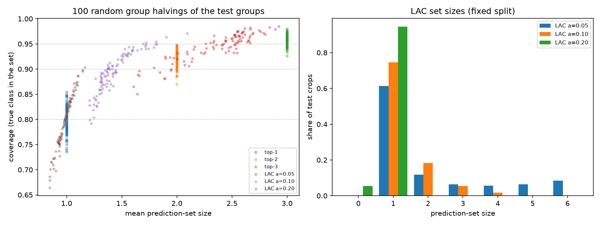

# Architecture 0: plain LAC split conformal prediction on enhanced_res

Baseline for every later calibration method. The model's probabilities as they are (no temperature scaling), one threshold for all classes, no unknown checks.

## Data

d1_grouped's test groups are halved by source group into `cal` and `test` (seed 0, balanced by each group's main class); train and val are unchanged, so enhanced_res is not retrained. Manifest: `calibration/cal_split.csv`.

| split | crops | source groups |
|---|---:|---:|
| train | 20,179 | 496 |
| val | 4,203 | 178 |
| cal | 1,838 | 88 |
| test | 2,417 | 87 |

enhanced_res accuracy on all original test crops (from the cached probabilities): 0.8045.

## Fixed split: coverage and set size on the new test half

Coverage = share of crops whose true class is in the set. 95% intervals resample whole source groups.

| method | coverage (95% CI) | mean set size (95% CI) | single class | empty set |
|---|---|---|---:|---:|
| top-1 | 79.1% (70.3%-85.6%) | 1.00 (1.00-1.00) | 100.0% | 0.0% |
| top-2 | 93.0% (88.3%-96.1%) | 2.00 (2.00-2.00) | 0.0% | 0.0% |
| top-3 | 96.5% (93.6%-98.4%) | 3.00 (3.00-3.00) | 0.0% | 0.0% |
| LAC a=0.05 | 92.8% (87.4%-96.6%) | 2.10 (1.85-2.45) | 61.3% | 0.0% |
| LAC a=0.10 | 88.5% (81.4%-93.7%) | 1.34 (1.26-1.47) | 74.5% | 0.0% |
| LAC a=0.20 | 77.2% (68.0%-83.9%) | 0.95 (0.92-0.96) | 94.5% | 5.5% |

LAC thresholds (probability cut-off = 1 - q): alpha 0.05: q = 0.9869 (keep classes with p >= 0.0131), alpha 0.10: q = 0.9560 (keep classes with p >= 0.0440), alpha 0.20: q = 0.4387 (keep classes with p >= 0.5613)

## Per-class coverage (fixed split)

| class | top-1 | top-2 | top-3 | LAC a=0.05 | LAC a=0.10 | LAC a=0.20 | test crops |
|---|---:|---:|---:|---:|---:|---:|---:|
| corrosion | 61.5% | 84.4% | 94.6% | 87.5% | 75.9% | 61.1% | 257 |
| crack | 75.8% | 90.7% | 94.0% | 89.3% | 84.3% | 71.7% | 636 |
| dent | 88.2% | 97.3% | 98.5% | 96.8% | 94.9% | 87.2% | 1129 |
| missing-head | 93.2% | 97.7% | 98.5% | 98.5% | 97.0% | 92.4% | 132 |
| paint-peel-off | 64.8% | 85.9% | 95.8% | 85.9% | 80.3% | 62.7% | 142 |
| scratch | 50.4% | 85.1% | 94.2% | 87.6% | 79.3% | 47.1% | 121 |

Plain LAC only targets coverage over all classes together; rare classes can fall below 1 - alpha. Per-class (Mondrian) CP in architecture A addresses that.

## Set-size distribution (LAC, fixed split, crops)

| set size | LAC a=0.05 | LAC a=0.10 | LAC a=0.20 |
|---|---:|---:|---:|
| 0 | 0 | 0 | 132 |
| 1 | 1,481 | 1,801 | 2,285 |
| 2 | 285 | 443 | 0 |
| 3 | 156 | 132 | 0 |
| 4 | 134 | 40 | 0 |
| 5 | 155 | 1 | 0 |
| 6 | 206 | 0 | 0 |

## Stability: 100 random group halvings

| method | coverage mean (min-max) | mean set size | single class |
|---|---|---:|---:|
| top-1 | 80.1% (73.5%-85.4%) | 1.00 | 100.0% |
| top-2 | 92.1% (87.0%-94.7%) | 2.00 | 0.0% |
| top-3 | 95.9% (92.6%-97.9%) | 3.00 | 0.0% |
| LAC a=0.05 | 94.5% (85.0%-98.5%) | 2.37 | 53.7% |
| LAC a=0.10 | 89.4% (79.2%-97.1%) | 1.44 | 72.6% |
| LAC a=0.20 | 79.5% (66.4%-90.3%) | 0.98 | 94.1% |

## Secondary check: calibrate on val, evaluate on all test crops

val was already used to choose the kNN weight and MLP epochs, so this is slightly optimistic.

| method | coverage | mean set size | single class |
|---|---:|---:|---:|
| top-1 | 80.4% | 1.00 | 100.0% |
| top-2 | 92.4% | 2.00 | 0.0% |
| top-3 | 96.1% | 3.00 | 0.0% |
| LAC a=0.05 | 94.6% | 2.34 | 55.5% |
| LAC a=0.10 | 91.0% | 1.50 | 69.9% |
| LAC a=0.20 | 82.7% | 1.06 | 94.4% |

MAPIE cross-check of the LAC sets: alpha 0.05: 100.00% identical sets; alpha 0.10: 100.00% identical sets; alpha 0.20: 100.00% identical sets.

