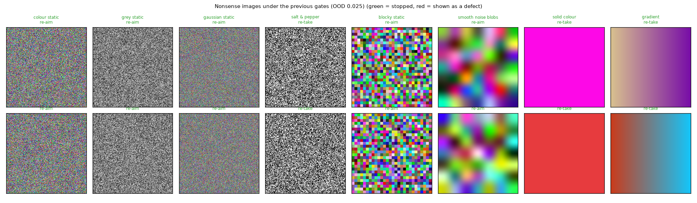

# Random static and other nonsense images vs architecture A's gates

40 images of each kind (224 px, seeded). Every option is recalibrated on the clean cal half. False reject = normal test-half crops stopped; false accept = nonsense that passes both gates and is shown as a defect or an ambiguous set.

## False rejects on normal crops (the cost)

| option | per crop | per family |
|---|---:|---:|
| previous (quality 0.10, OOD 0.025) | 15.8% | 11.3% |
| OOD 0.05 | 16.5% | 12.0% |
| OOD 0.10 (default since 2026-10-27) | 20.0% | 17.8% |
| sharpness both sides | 18.7% | 12.8% |
| sharpness both sides + OOD 0.05 | 19.4% | 13.4% |

## False accepts (passes both gates)

| set | previous (quality 0.10, OOD 0.025) | OOD 0.05 | OOD 0.10 (default since 2026-10-27) | sharpness both sides | sharpness both sides + OOD 0.05 |
|---|---:|---:|---:|---:|---:|
| off-target | 40.5% | 31.0% | 17.5% | 36.5% | 28.0% |
| noise s2 | 20.4% | 12.1% | 6.1% | 0.0% | 0.0% |
| jpeg s2 | 12.7% | 9.2% | 6.7% | 11.9% | 8.9% |
| colour static | 0.0% | 0.0% | 0.0% | 0.0% | 0.0% |
| grey static | 0.0% | 0.0% | 0.0% | 0.0% | 0.0% |
| gaussian static | 0.0% | 0.0% | 0.0% | 0.0% | 0.0% |
| salt & pepper | 0.0% | 0.0% | 0.0% | 0.0% | 0.0% |
| blocky static | 0.0% | 0.0% | 0.0% | 0.0% | 0.0% |
| smooth noise blobs | 0.0% | 0.0% | 0.0% | 0.0% | 0.0% |
| solid colour | 0.0% | 0.0% | 0.0% | 0.0% | 0.0% |
| gradient | 0.0% | 0.0% | 0.0% | 0.0% | 0.0% |

