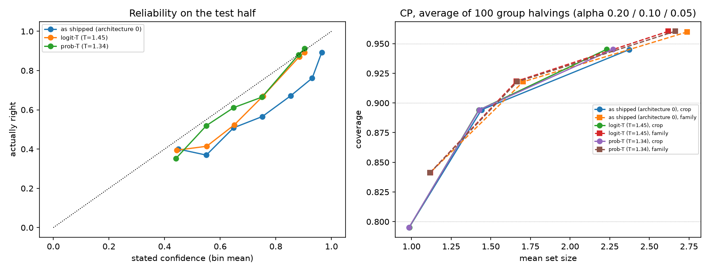

# Architecture A, step 1: temperature scaling + family-weighted CP

Compared against architecture 0 (model as shipped, crop-weighted LAC). T fitted on val by NLL; CP thresholds on the cal half; everything below measured on the test half (2,417 crops, 87 families). No retraining.

Re-blending the cached heads' logits and kNN vote reproduces architecture 0's probabilities (max difference 1.2e-07).

Fitted temperatures: logit-T = **1.449**, prob-T = **1.342** (T > 1 softens).

## Calibration of the stated confidence (test half)

| version | accuracy | mean stated confidence | ECE | NLL |
|---|---:|---:|---:|---:|
| as shipped (architecture 0) | 79.1% | 89.4% | 0.105 | 0.743 |
| logit-T (T=1.45) | 79.0% | 82.4% | 0.035 | 0.701 |
| prob-T (T=1.34) | 79.1% | 80.8% | 0.035 | 0.691 |

Reliability (stated vs actually right, per confidence bin):

| bin | as shipped (architecture 0): crops / stated / right | logit-T (T=1.45): crops / stated / right | prob-T (T=1.34): crops / stated / right |
|---|---|---|---|
| 0.00-0.50 | 65 / 45.0% / 40.0% | 104 / 44.3% / 39.4% | 159 / 44.1% / 35.2% |
| 0.50-0.60 | 111 / 55.0% / 36.9% | 140 / 55.1% / 41.4% | 152 / 55.0% / 52.0% |
| 0.60-0.70 | 118 / 64.8% / 50.8% | 126 / 65.1% / 52.4% | 144 / 64.8% / 61.1% |
| 0.70-0.80 | 129 / 75.2% / 56.6% | 200 / 75.4% / 67.0% | 185 / 75.0% / 66.5% |
| 0.80-0.90 | 180 / 85.4% / 67.2% | 1707 / 88.4% / 87.1% | 1709 / 88.1% / 88.0% |
| 0.90-0.95 | 218 / 93.1% / 76.1% | 140 / 90.3% / 89.3% | 68 / 90.3% / 91.2% |
| 0.95-1.00 | 1596 / 96.5% / 89.3% | 0 / - / - | 0 / - / - |

## CP on the fixed split

Coverage per crop (as architecture 0) and per family (each test family's coverage, averaged).

| version | calibration | alpha | coverage (crop) | coverage (family) | mean set size | single class | all 6 | empty |
|---|---|---:|---:|---:|---:|---:|---:|---:|
| as shipped (architecture 0) | crop | 0.05 | 92.8% | 93.5% | 2.10 | 61.3% | 8.5% | 0.0% |
| as shipped (architecture 0) | crop | 0.10 | 88.5% | 87.1% | 1.34 | 74.5% | 0.0% | 0.0% |
| as shipped (architecture 0) | crop | 0.20 | 77.2% | 73.1% | 0.95 | 94.5% | 0.0% | 5.5% |
| as shipped (architecture 0) | family | 0.05 | 95.7% | 96.3% | 2.71 | 47.0% | 23.0% | 0.0% |
| as shipped (architecture 0) | family | 0.10 | 91.5% | 91.8% | 1.71 | 66.3% | 1.5% | 0.0% |
| as shipped (architecture 0) | family | 0.20 | 85.1% | 83.6% | 1.17 | 84.1% | 0.0% | 0.0% |
| logit-T (T=1.45) | crop | 0.05 | 92.9% | 93.2% | 1.93 | 59.5% | 1.9% | 0.0% |
| logit-T (T=1.45) | crop | 0.10 | 88.7% | 87.1% | 1.35 | 73.7% | 0.0% | 0.0% |
| logit-T (T=1.45) | crop | 0.20 | 76.9% | 73.0% | 0.94 | 94.2% | 0.0% | 5.8% |
| logit-T (T=1.45) | family | 0.05 | 95.6% | 96.2% | 2.56 | 45.9% | 14.7% | 0.0% |
| logit-T (T=1.45) | family | 0.10 | 91.6% | 91.7% | 1.65 | 64.9% | 0.4% | 0.0% |
| logit-T (T=1.45) | family | 0.20 | 84.9% | 83.6% | 1.17 | 84.7% | 0.0% | 0.0% |
| prob-T (T=1.34) | crop | 0.05 | 92.7% | 93.1% | 1.97 | 59.7% | 2.9% | 0.0% |
| prob-T (T=1.34) | crop | 0.10 | 88.7% | 87.2% | 1.35 | 73.5% | 0.0% | 0.0% |
| prob-T (T=1.34) | crop | 0.20 | 77.2% | 73.2% | 0.95 | 94.8% | 0.0% | 5.2% |
| prob-T (T=1.34) | family | 0.05 | 95.7% | 96.3% | 2.62 | 45.8% | 17.5% | 0.0% |
| prob-T (T=1.34) | family | 0.10 | 91.5% | 91.7% | 1.65 | 65.2% | 0.4% | 0.0% |
| prob-T (T=1.34) | family | 0.20 | 85.1% | 83.6% | 1.17 | 84.1% | 0.0% | 0.0% |

## Stability: 100 random group halvings

| version | calibration | alpha | coverage mean (min-max) | family coverage | mean set size | single class |
|---|---|---:|---|---:|---:|---:|
| as shipped (architecture 0) | crop | 0.05 | 94.5% (85.0%-98.5%) | 94.2% | 2.37 | 53.7% |
| as shipped (architecture 0) | crop | 0.10 | 89.4% (79.2%-97.1%) | 87.7% | 1.44 | 72.6% |
| as shipped (architecture 0) | crop | 0.20 | 79.5% (66.4%-90.3%) | 74.2% | 0.98 | 94.1% |
| as shipped (architecture 0) | family | 0.05 | 96.0% (88.1%-98.8%) | 95.7% | 2.74 | 44.4% |
| as shipped (architecture 0) | family | 0.10 | 91.8% (83.4%-96.9%) | 90.6% | 1.70 | 66.0% |
| as shipped (architecture 0) | family | 0.20 | 84.1% (75.7%-92.0%) | 80.1% | 1.12 | 88.9% |
| logit-T (T=1.45) | crop | 0.05 | 94.5% (85.1%-98.5%) | 94.2% | 2.23 | 51.9% |
| logit-T (T=1.45) | crop | 0.10 | 89.4% (79.2%-97.0%) | 87.6% | 1.42 | 71.7% |
| logit-T (T=1.45) | crop | 0.20 | 79.5% (66.6%-90.0%) | 74.1% | 0.99 | 94.2% |
| logit-T (T=1.45) | family | 0.05 | 96.0% (88.9%-98.7%) | 95.8% | 2.62 | 42.1% |
| logit-T (T=1.45) | family | 0.10 | 91.8% (83.6%-97.2%) | 90.6% | 1.66 | 64.2% |
| logit-T (T=1.45) | family | 0.20 | 84.1% (76.2%-92.3%) | 80.2% | 1.12 | 88.9% |
| prob-T (T=1.34) | crop | 0.05 | 94.5% (84.9%-98.5%) | 94.2% | 2.27 | 52.4% |
| prob-T (T=1.34) | crop | 0.10 | 89.4% (79.3%-97.0%) | 87.7% | 1.43 | 71.7% |
| prob-T (T=1.34) | crop | 0.20 | 79.5% (66.4%-90.3%) | 74.2% | 0.98 | 93.8% |
| prob-T (T=1.34) | family | 0.05 | 96.0% (88.8%-98.7%) | 95.8% | 2.66 | 42.7% |
| prob-T (T=1.34) | family | 0.10 | 91.8% (83.4%-97.0%) | 90.6% | 1.67 | 64.5% |
| prob-T (T=1.34) | family | 0.20 | 84.1% (75.7%-92.3%) | 80.1% | 1.12 | 88.8% |

## Per-class coverage at alpha 0.10 (fixed split)

| class | as shipped | crop | a=0.10 | as shipped | family | a=0.10 | logit-T | crop | a=0.10 | logit-T | family | a=0.10 | prob-T | crop | a=0.10 | prob-T | family | a=0.10 |
|---|---:|---:|---:|---:|---:|---:|
| corrosion | 75.9% | 84.4% | 75.9% | 85.2% | 76.3% | 84.4% |
| crack | 84.3% | 87.6% | 84.4% | 87.3% | 84.4% | 87.3% |
| dent | 94.9% | 96.2% | 95.0% | 96.3% | 95.0% | 96.3% |
| missing-head | 97.0% | 97.0% | 97.0% | 97.0% | 97.0% | 97.0% |
| paint-peel-off | 80.3% | 84.5% | 80.3% | 84.5% | 80.3% | 84.5% |
| scratch | 79.3% | 85.1% | 79.3% | 86.0% | 79.3% | 86.0% |

