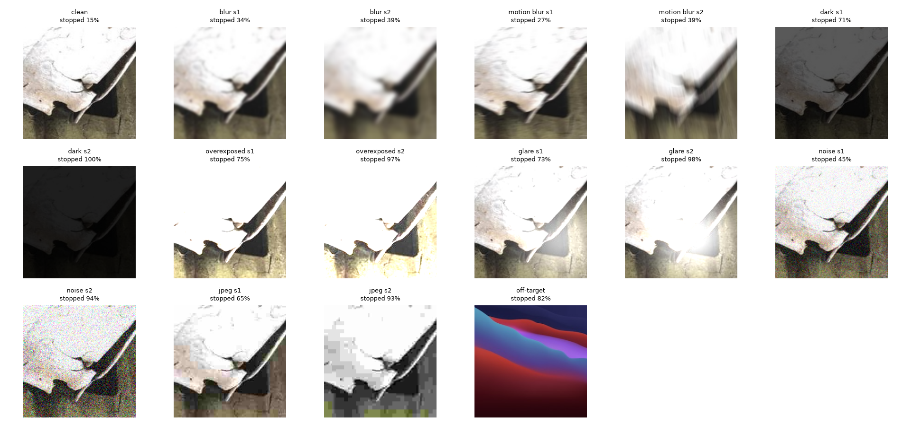

# Architecture A, step 2: quality gate + unfamiliar-input gate

> **Earlier study, kept for the record.** Architecture A's final gate is different: kNN distance + AoN (Bonferroni), α 0.08, sharpness on both sides, in parallel with the quality gate (`calibration.json`; [README](../../../README.md)).

Gates calibrated on the clean cal-half crops (family-weighted conformal p-values), alpha_quality = 0.1, alpha_OOD = 0.1. Evaluated on 553 test-half crops (up to 8 per family, 87 families), 14 synthetic corruptions of those same crops, and 400 off-target patches. CP after the gates: prob-T + family-weighted LAC, alpha 0.10. No retraining.

## What happens to each set

| set | re-take (quality) | re-aim (OOD) | stopped | passed | top quality reason | accuracy | CP coverage, all | CP coverage, passed | set size, passed |
|---|---:|---:|---:|---:|---|---:|---:|---:|---:|
| clean | 8.1% | 7.2% | 15.4% | 84.6% | sharpness | 75.2% | 89.7% | 90.4% | 1.67 |
| blur s1 | 19.2% | 14.5% | 33.6% | 66.4% | sharpness | 68.9% | 87.9% | 88.6% | 1.67 |
| blur s2 | 23.1% | 15.4% | 38.5% | 61.5% | sharpness | 63.7% | 81.6% | 79.1% | 1.69 |
| motion blur s1 | 10.8% | 15.9% | 26.8% | 73.2% | sharpness | 69.1% | 86.8% | 86.9% | 1.69 |
| motion blur s2 | 14.8% | 23.7% | 38.5% | 61.5% | sharpness | 62.0% | 81.9% | 78.2% | 1.62 |
| dark s1 | 61.8% | 8.9% | 70.7% | 29.3% | brightness | 70.0% | 89.0% | 88.9% | 1.57 |
| dark s2 | 100.0% | 0.0% | 100.0% | 0.0% | brightness | 46.1% | 80.3% | - | - |
| overexposed s1 | 73.6% | 1.6% | 75.2% | 24.8% | clipped_hi | 66.9% | 88.8% | 93.4% | 1.70 |
| overexposed s2 | 96.6% | 0.2% | 96.7% | 3.3% | clipped_hi | 55.0% | 77.8% | 88.9% | 1.89 |
| glare s1 | 66.5% | 6.9% | 73.4% | 26.6% | clipped_hi | 57.3% | 73.8% | 75.5% | 1.50 |
| glare s2 | 97.1% | 0.9% | 98.0% | 2.0% | clipped_hi | 50.1% | 68.0% | 81.8% | 1.36 |
| noise s1 | 4.5% | 40.5% | 45.0% | 55.0% | brightness | 60.2% | 79.4% | 81.9% | 1.65 |
| noise s2 | 2.2% | 91.7% | 93.9% | 6.1% | clipped_hi | 45.6% | 74.3% | 97.1% | 1.29 |
| jpeg s1 | 5.8% | 59.5% | 65.3% | 34.7% | clipped_hi | 58.8% | 86.4% | 91.7% | 1.57 |
| jpeg s2 | 9.8% | 83.5% | 93.3% | 6.7% | clipped_lo | 39.1% | 76.5% | 100.0% | 1.86 |
| off-target | 32.0% | 50.5% | 82.5% | 17.5% | clipped_lo | - | - | - | 1.70 |

## OOD score comparison: share flagged at the same p-value cut-off

| set | kNN distance | energy | 1 - top probability |
|---|---:|---:|---:|
| clean | 8.1% | 10.3% | 11.4% |
| blur s1 | 16.5% | 10.8% | 13.2% |
| blur s2 | 21.7% | 14.3% | 16.1% |
| motion blur s1 | 17.0% | 10.3% | 13.0% |
| motion blur s2 | 26.2% | 13.6% | 17.4% |
| dark s1 | 27.8% | 11.8% | 12.5% |
| dark s2 | 87.3% | 24.6% | 30.4% |
| overexposed s1 | 28.8% | 20.3% | 18.8% |
| overexposed s2 | 57.3% | 31.5% | 24.8% |
| glare s1 | 18.6% | 7.2% | 7.4% |
| glare s2 | 24.1% | 6.3% | 9.0% |
| noise s1 | 43.4% | 9.2% | 16.3% |
| noise s2 | 93.9% | 19.3% | 38.9% |
| jpeg s1 | 63.7% | 17.9% | 19.3% |
| jpeg s2 | 92.6% | 28.0% | 34.7% |
| off-target | 77.2% | 25.8% | 22.5% |

## Operating points: share stopped at other false-alarm budgets (alpha per gate)

The clean row is the false-alarm rate on normal crops; every other row is what gets caught. alpha should come from GAES's costs: a missed bad image against interrupting the inspector.

| set | quality a=0.025 | OOD a=0.025 | both a=0.025 | quality a=0.05 | OOD a=0.05 | both a=0.05 | quality a=0.1 | OOD a=0.1 | both a=0.1 |
|---|---:|---:|---:|---:|---:|---:|---:|---:|---:|
| clean | 1.4% | 0.7% | 2.2% | 1.8% | 1.8% | 3.6% | 8.1% | 8.1% | 15.4% |
| blur s1 | 3.1% | 1.8% | 4.9% | 3.6% | 4.2% | 7.6% | 19.2% | 16.5% | 33.6% |
| blur s2 | 3.6% | 2.5% | 6.0% | 6.0% | 8.9% | 14.6% | 23.1% | 21.7% | 38.5% |
| motion blur s1 | 1.8% | 1.4% | 3.3% | 2.4% | 5.4% | 7.6% | 10.8% | 17.0% | 26.8% |
| motion blur s2 | 2.9% | 8.1% | 10.8% | 3.1% | 17.0% | 19.5% | 14.8% | 26.2% | 38.5% |
| dark s1 | 7.8% | 8.0% | 14.5% | 12.8% | 14.3% | 24.6% | 61.8% | 27.8% | 70.7% |
| dark s2 | 98.9% | 60.6% | 99.6% | 99.8% | 78.1% | 100.0% | 100.0% | 87.3% | 100.0% |
| overexposed s1 | 43.6% | 17.5% | 45.6% | 51.4% | 20.6% | 53.5% | 73.6% | 28.8% | 75.2% |
| overexposed s2 | 78.7% | 37.4% | 80.7% | 86.4% | 46.3% | 89.0% | 96.6% | 57.3% | 96.7% |
| glare s1 | 2.2% | 3.1% | 5.1% | 6.5% | 8.9% | 14.1% | 66.5% | 18.6% | 73.4% |
| glare s2 | 4.9% | 4.2% | 8.7% | 13.2% | 10.7% | 21.5% | 97.1% | 24.1% | 98.0% |
| noise s1 | 0.0% | 17.4% | 17.4% | 0.2% | 25.7% | 25.7% | 4.5% | 43.4% | 45.0% |
| noise s2 | 0.0% | 79.4% | 79.4% | 0.0% | 87.9% | 87.9% | 2.2% | 93.9% | 93.9% |
| jpeg s1 | 0.4% | 33.6% | 34.0% | 0.7% | 48.3% | 48.8% | 5.8% | 63.7% | 65.3% |
| jpeg s2 | 1.4% | 84.3% | 85.0% | 2.2% | 89.7% | 89.9% | 9.8% | 92.6% | 93.3% |
| off-target | 4.2% | 44.8% | 47.2% | 7.2% | 59.2% | 62.0% | 32.0% | 77.2% | 82.5% |

## AUROC: how well each score separates clean crops from each set (0.5 = chance, 1 = perfect)

| set | kNN distance | energy | 1 - top probability | quality score |
|---|---:|---:|---:|---:|
| blur s1 | 0.593 | 0.514 | 0.516 | 0.648 |
| blur s2 | 0.650 | 0.537 | 0.551 | 0.782 |
| motion blur s1 | 0.602 | 0.525 | 0.527 | 0.537 |
| motion blur s2 | 0.669 | 0.558 | 0.562 | 0.592 |
| dark s1 | 0.713 | 0.525 | 0.535 | 0.918 |
| dark s2 | 0.948 | 0.774 | 0.790 | 0.994 |
| overexposed s1 | 0.670 | 0.586 | 0.577 | 0.891 |
| overexposed s2 | 0.825 | 0.656 | 0.645 | 0.982 |
| glare s1 | 0.655 | 0.517 | 0.514 | 0.902 |
| glare s2 | 0.718 | 0.526 | 0.520 | 0.960 |
| noise s1 | 0.805 | 0.601 | 0.639 | 0.436 |
| noise s2 | 0.980 | 0.751 | 0.793 | 0.553 |
| jpeg s1 | 0.853 | 0.614 | 0.627 | 0.415 |
| jpeg s2 | 0.972 | 0.727 | 0.773 | 0.472 |
| off-target | 0.939 | 0.710 | 0.699 | 0.616 |

