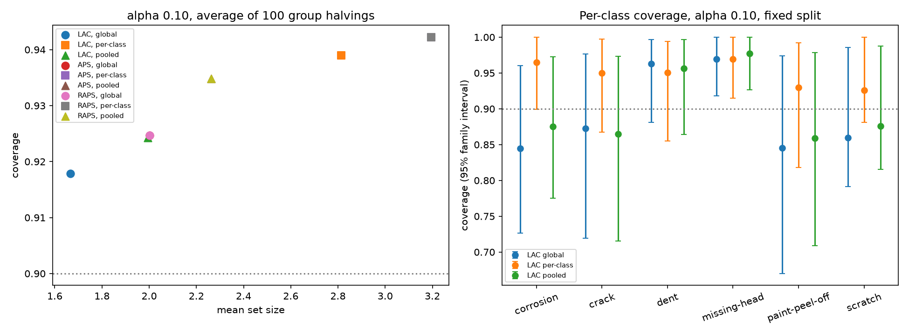

# Architecture A, step 3: LAC vs APS vs RAPS; global vs per-class vs pooled thresholds

prob-T probabilities (T = 1.342); family-weighted thresholds fitted on the cal half; measured on the test half (2,417 crops, 87 families). RAPS tuned on val: lambda = 0.0, k_reg = 2. No retraining.

Calibration families per class in the cal half (a per-class threshold needs >= 9 at alpha 0.10 and >= 19 at 0.05; below that the class is always included):

| corrosion | crack | dent | missing-head | paint-peel-off | scratch |
|---:|---:|---:|---:|---:|---:|
| 13 | 34 | 34 | 12 | 21 | 16 |

## Fixed split

| score | thresholds | alpha | coverage | family coverage | worst class | mean set size | single class | all 6 | empty | classes always included |
|---|---|---:|---:|---:|---:|---:|---:|---:|---:|---:|
| LAC | global | 0.05 | 95.7% | 96.3% | 92.6% | 2.62 | 45.8% | 17.5% | 0.0% | 0 |
| LAC | global | 0.10 | 91.5% | 91.7% | 84.4% | 1.65 | 65.2% | 0.4% | 0.0% | 0 |
| LAC | per-class | 0.05 | 98.6% | 98.8% | 96.5% | 5.12 | 0.0% | 33.3% | 0.0% | 3 |
| LAC | per-class | 0.10 | 95.0% | 95.1% | 92.6% | 2.41 | 36.0% | 1.3% | 0.0% | 0 |
| LAC | pooled | 0.05 | 97.0% | 97.1% | 90.9% | 2.80 | 30.2% | 18.1% | 0.0% | 0 |
| LAC | pooled | 0.10 | 91.5% | 91.1% | 85.9% | 1.83 | 64.0% | 2.0% | 0.0% | 0 |
| APS | global | 0.05 | 97.3% | 96.0% | 95.0% | 3.12 | 0.0% | 0.0% | 0.0% | 0 |
| APS | global | 0.10 | 93.9% | 92.1% | 83.5% | 2.17 | 8.4% | 0.0% | 0.0% | 0 |
| APS | per-class | 0.05 | 99.2% | 99.4% | 98.0% | 5.56 | 0.0% | 58.2% | 0.0% | 3 |
| APS | per-class | 0.10 | 95.4% | 94.0% | 93.1% | 2.91 | 3.0% | 0.0% | 0.0% | 0 |
| APS | pooled | 0.05 | 97.6% | 96.8% | 95.6% | 3.20 | 0.0% | 0.0% | 0.0% | 0 |
| APS | pooled | 0.10 | 95.2% | 92.9% | 90.1% | 2.27 | 2.6% | 0.0% | 0.0% | 0 |
| RAPS (lambda=0.0, k_reg=2) | global | 0.05 | 97.3% | 96.0% | 95.0% | 3.12 | 0.0% | 0.0% | 0.0% | 0 |
| RAPS (lambda=0.0, k_reg=2) | global | 0.10 | 93.9% | 92.1% | 83.5% | 2.17 | 8.4% | 0.0% | 0.0% | 0 |
| RAPS (lambda=0.0, k_reg=2) | per-class | 0.05 | 99.2% | 99.4% | 98.0% | 5.56 | 0.0% | 58.2% | 0.0% | 3 |
| RAPS (lambda=0.0, k_reg=2) | per-class | 0.10 | 95.4% | 94.0% | 93.1% | 2.91 | 3.0% | 0.0% | 0.0% | 0 |
| RAPS (lambda=0.0, k_reg=2) | pooled | 0.05 | 97.6% | 96.8% | 95.6% | 3.20 | 0.0% | 0.0% | 0.0% | 0 |
| RAPS (lambda=0.0, k_reg=2) | pooled | 0.10 | 95.2% | 92.9% | 90.1% | 2.27 | 2.6% | 0.0% | 0.0% | 0 |

## Stability: 100 random group halvings (averages)

| score | thresholds | alpha | coverage (min-max) | family coverage | worst class | mean set size | single class |
|---|---|---:|---|---:|---:|---:|---:|
| LAC | global | 0.05 | 96.0% (88.8%-98.7%) | 95.8% | 90.3% | 2.66 | 42.7% |
| LAC | global | 0.10 | 91.8% (83.4%-97.0%) | 90.6% | 79.3% | 1.67 | 64.5% |
| LAC | per-class | 0.05 | 97.7% (93.3%-99.7%) | 97.8% | 94.7% | 4.92 | 0.0% |
| LAC | per-class | 0.10 | 93.9% (88.3%-97.5%) | 94.0% | 86.5% | 2.81 | 20.0% |
| LAC | pooled | 0.05 | 96.4% (90.2%-98.7%) | 96.2% | 91.6% | 2.98 | 31.9% |
| LAC | pooled | 0.10 | 92.4% (83.9%-97.0%) | 91.4% | 83.9% | 1.99 | 60.2% |
| APS | global | 0.05 | 96.8% (92.6%-98.9%) | 95.8% | 92.3% | 3.00 | 0.0% |
| APS | global | 0.10 | 92.5% (84.5%-97.6%) | 90.6% | 79.1% | 2.00 | 23.5% |
| APS | per-class | 0.05 | 98.4% (95.8%-99.8%) | 98.1% | 96.2% | 5.12 | 0.0% |
| APS | per-class | 0.10 | 94.2% (87.2%-98.4%) | 93.6% | 87.8% | 3.19 | 2.9% |
| APS | pooled | 0.05 | 97.3% (93.6%-99.1%) | 96.5% | 93.5% | 3.43 | 0.0% |
| APS | pooled | 0.10 | 93.5% (86.1%-97.8%) | 91.7% | 84.7% | 2.26 | 12.0% |
| RAPS (lambda=0.0, k_reg=2) | global | 0.05 | 96.8% (92.6%-98.9%) | 95.8% | 92.3% | 3.00 | 0.0% |
| RAPS (lambda=0.0, k_reg=2) | global | 0.10 | 92.5% (84.5%-97.6%) | 90.6% | 79.1% | 2.00 | 23.5% |
| RAPS (lambda=0.0, k_reg=2) | per-class | 0.05 | 98.4% (95.8%-99.8%) | 98.1% | 96.2% | 5.12 | 0.0% |
| RAPS (lambda=0.0, k_reg=2) | per-class | 0.10 | 94.2% (87.2%-98.4%) | 93.6% | 87.8% | 3.19 | 2.9% |
| RAPS (lambda=0.0, k_reg=2) | pooled | 0.05 | 97.3% (93.6%-99.1%) | 96.5% | 93.5% | 3.43 | 0.0% |
| RAPS (lambda=0.0, k_reg=2) | pooled | 0.10 | 93.5% (86.1%-97.8%) | 91.7% | 84.7% | 2.26 | 12.0% |

## Per-class coverage, LAC, alpha 0.10 (fixed split, 95% interval resampling whole test families)

| class | test crops | global | per-class | pooled |
|---|---:|---|---|---|
| corrosion | 257 | 84.4% (72.7%-96.0%) | 96.5% (90.0%-100.0%) | 87.5% (77.5%-97.3%) |
| crack | 636 | 87.3% (71.9%-97.7%) | 95.0% (86.7%-99.7%) | 86.5% (71.5%-97.3%) |
| dent | 1129 | 96.3% (88.1%-99.7%) | 95.0% (85.5%-99.4%) | 95.7% (86.4%-99.7%) |
| missing-head | 132 | 97.0% (91.8%-100.0%) | 97.0% (91.5%-100.0%) | 97.7% (92.7%-100.0%) |
| paint-peel-off | 142 | 84.5% (67.0%-97.4%) | 93.0% (81.8%-99.2%) | 85.9% (70.9%-97.9%) |
| scratch | 121 | 86.0% (79.2%-98.6%) | 92.6% (88.1%-100.0%) | 87.6% (81.5%-98.8%) |

Per-class coverage averaged over the 100 halvings, alpha 0.10:

| score | thresholds | corrosion | crack | dent | missing-head | paint-peel-off | scratch |
|---|---|---:|---:|---:|---:|---:|---:|
| LAC | global | 82.6% | 90.4% | 95.7% | 96.6% | 86.1% | 84.1% |
| LAC | per-class | 96.1% | 93.7% | 93.2% | 95.9% | 92.0% | 95.4% |
| LAC | pooled | 87.1% | 89.8% | 95.1% | 98.1% | 89.8% | 89.1% |
| APS | global | 85.2% | 90.8% | 96.5% | 96.1% | 88.3% | 80.1% |
| APS | per-class | 96.9% | 93.9% | 93.3% | 96.9% | 92.2% | 96.3% |
| APS | pooled | 91.8% | 90.7% | 96.2% | 96.6% | 90.8% | 87.3% |
| RAPS (lambda=0.0, k_reg=2) | global | 85.2% | 90.8% | 96.5% | 96.1% | 88.3% | 80.1% |
| RAPS (lambda=0.0, k_reg=2) | per-class | 96.9% | 93.9% | 93.3% | 96.9% | 92.2% | 96.3% |
| RAPS (lambda=0.0, k_reg=2) | pooled | 91.8% | 90.7% | 96.2% | 96.6% | 90.8% | 87.3% |

