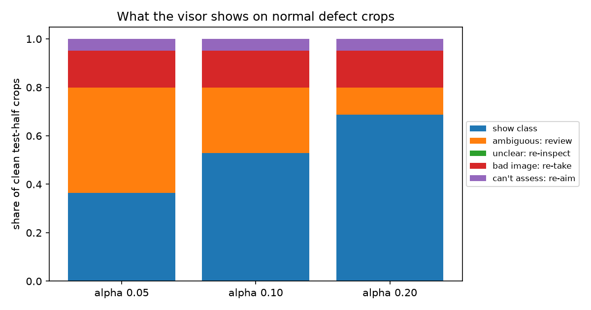

# Architecture A, step 4: from prediction set to visor action

Quality gate alpha 0.1, unfamiliar-input gate alpha 0.1, then prob-T + family-weighted global LAC. Thresholds from the cal half; everything below on the test half. No retraining.

## The action table

| pipeline outcome | visor shows | inspector |
|---|---|---|
| quality gate fails (blur, dark, overexposed, glare) | **Bad image: re-take** | re-takes the shot |
| unfamiliar-input gate fails (not like any training crop) | **Can't assess: re-aim** | re-aims the camera |
| CP set has 1 class | **Crack 88%** (class + prob-T calibrated score) | no step needed |
| CP set has 2+ classes | **Ambiguous: crack or dent** | reviews; screenshot saved for later |
| CP set is empty | **Unclear: re-inspect** | inspects by eye |

Human attention = everything except a single shown class. The costly case is a single class that is wrong: it is shown with no warning.

## Normal defect crops (all 2,417 test-half crops)

| CP alpha | single class shown | ...right | ...wrong (no warning) | ambiguous | ambiguous holds truth | unclear | re-take | re-aim | **human attention** |
|---:|---:|---:|---:|---:|---:|---:|---:|---:|---:|
| 0.05 | 36.5% | 33.6% | 2.9% | 43.5% | 97.9% | 0.0% | 15.1% | 4.9% | **63.5%** |
| 0.10 | 52.9% | 46.8% | 6.2% | 27.1% | 96.2% | 0.0% | 15.1% | 4.9% | **47.1%** |
| 0.20 | 68.8% | 58.2% | 10.6% | 11.2% | 88.9% | 0.0% | 15.1% | 4.9% | **31.2%** |

## Every test set at CP alpha 0.10

| set | single class: right | single class: wrong | ambiguous | unclear | re-take | re-aim | human attention |
|---|---:|---:|---:|---:|---:|---:|---:|
| clean (all 2,417 test-half crops) | 46.8% | 6.2% | 27.1% | 0.0% | 15.1% | 4.9% | 47.1% |
| clean | 44.3% | 6.9% | 33.5% | 0.0% | 8.1% | 7.2% | 48.8% |
| blur s1 | 32.5% | 4.9% | 28.9% | 0.0% | 19.2% | 14.5% | 62.6% |
| blur s2 | 28.0% | 7.4% | 26.0% | 0.0% | 23.1% | 15.4% | 64.6% |
| motion blur s1 | 36.2% | 5.6% | 31.5% | 0.0% | 10.8% | 15.9% | 58.2% |
| motion blur s2 | 26.2% | 9.8% | 25.5% | 0.0% | 14.8% | 23.7% | 64.0% |
| dark s1 | 16.1% | 2.4% | 10.8% | 0.0% | 61.8% | 8.9% | 81.6% |
| dark s2 | 0.0% | 0.0% | 0.0% | 0.0% | 100.0% | 0.0% | 100.0% |
| overexposed s1 | 13.6% | 1.4% | 9.8% | 0.0% | 73.6% | 1.6% | 85.0% |
| overexposed s2 | 1.4% | 0.4% | 1.4% | 0.0% | 96.6% | 0.2% | 98.2% |
| glare s1 | 12.7% | 3.6% | 10.3% | 0.0% | 66.5% | 6.9% | 83.7% |
| glare s2 | 1.3% | 0.0% | 0.7% | 0.0% | 97.1% | 0.9% | 98.7% |
| noise s1 | 20.4% | 5.6% | 28.9% | 0.0% | 4.5% | 40.5% | 74.0% |
| noise s2 | 4.5% | 0.2% | 1.4% | 0.0% | 2.2% | 91.7% | 95.3% |
| jpeg s1 | 19.7% | 1.1% | 13.9% | 0.0% | 5.8% | 59.5% | 79.2% |
| jpeg s2 | 3.8% | 0.0% | 2.9% | 0.0% | 9.8% | 83.5% | 96.2% |
| off-target | - | 9.8% | 7.8% | 0.0% | 32.0% | 50.5% | 90.2% |

## Human attention on every set, by CP alpha

| set | alpha 0.05 | alpha 0.10 | alpha 0.20 |
|---|---:|---:|---:|
| clean (all 2,417 test-half crops) | 63.5% | 47.1% | 31.2% |
| clean | 66.7% | 48.8% | 30.4% |
| blur s1 | 74.5% | 62.6% | 45.0% |
| blur s2 | 79.4% | 64.6% | 50.3% |
| motion blur s1 | 73.1% | 58.2% | 40.3% |
| motion blur s2 | 77.9% | 64.0% | 48.3% |
| dark s1 | 88.4% | 81.6% | 75.0% |
| dark s2 | 100.0% | 100.0% | 100.0% |
| overexposed s1 | 89.3% | 85.0% | 80.5% |
| overexposed s2 | 99.5% | 98.2% | 97.1% |
| glare s1 | 91.1% | 83.7% | 76.5% |
| glare s2 | 98.7% | 98.7% | 98.2% |
| noise s1 | 89.5% | 74.0% | 60.4% |
| noise s2 | 98.7% | 95.3% | 93.9% |
| jpeg s1 | 85.7% | 79.2% | 70.2% |
| jpeg s2 | 98.9% | 96.2% | 94.0% |
| off-target | 94.8% | 90.2% | 85.0% |

