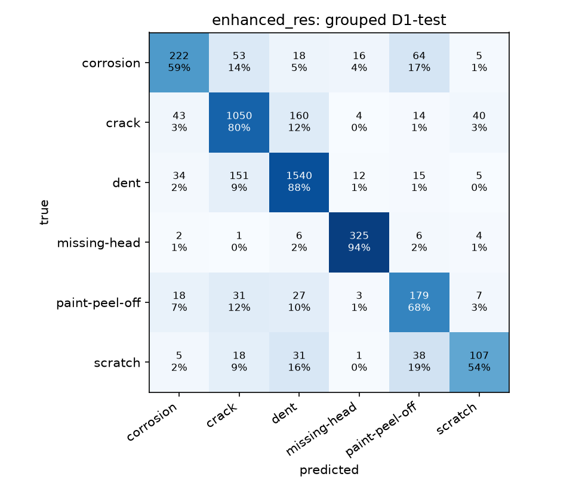

# enhanced_res: ResNet-18 + MLP head, improved, on the leak-free D1 split

Final model: backbone **r2** (+ balanced sampling + training recipe) with the full head (h4). Picked on val; test and D5 were read only for this report.

## Headline (grouped D1-test, 4,255 crops / 175 source groups)

| model | accuracy | macro-F1 (95% group CI) | balanced accuracy |
|---|---|---|---|
| baseline (plain retrain + original head) | 0.781 | 0.715 (0.670-0.754) | 0.711 |
| **enhanced_res** | 0.804 | 0.738 (0.692-0.776) | 0.737 |

macro-F1 gain +0.022, 95% group-bootstrap CI of the gain +0.002 to +0.045. Same test crops: enhanced_res right where the baseline is wrong 251 times, the reverse 152 times (McNemar p = 9.3e-07).

## Per-class recall on test

| class | baseline | enhanced_res |
|---|---|---|
| corrosion | 0.603 | 0.587 |
| crack | 0.736 | 0.801 |
| dent | 0.879 | 0.876 |
| missing-head | 0.939 | 0.945 |
| paint-peel-off | 0.626 | 0.675 |
| scratch | 0.485 | 0.535 |

## Outside test: D5 photos not in D1 (1040 crops: 853 missing-head, 187 dent)

| model | accuracy | dent recall | missing-head recall |
|---|---|---|---|
| baseline | 0.760 | 0.797 | 0.751 |
| enhanced_res | 0.840 | 0.647 | 0.883 |

## What each change did (val picks, test shown for reference)

| backbone | head | val macro-F1 | test macro-F1 | test accuracy | D5 accuracy |
|---|---|---|---|---|---|
| r0: plain retrain | h0: original MLP head (layer4) | 0.651 | 0.715 | 0.781 | 0.760 |
| r0: plain retrain | h1: + layer3 features | 0.660 | 0.722 | 0.786 | 0.768 |
| r0: plain retrain | h2: + test-time augmentation | 0.665 | 0.727 | 0.782 | 0.841 |
| r0: plain retrain | h3: + augmented training views | 0.670 | 0.731 | 0.791 | 0.840 |
| r0: plain retrain | h4: + class-prior correction | 0.670 | 0.731 | 0.791 | 0.840 |
| r1: + balanced sampling | h0: original MLP head (layer4) | 0.648 | 0.713 | 0.774 | 0.767 |
| r1: + balanced sampling | h1: + layer3 features | 0.647 | 0.715 | 0.776 | 0.784 |
| r1: + balanced sampling | h2: + test-time augmentation | 0.666 | 0.720 | 0.781 | 0.824 |
| r1: + balanced sampling | h3: + augmented training views | 0.666 | 0.723 | 0.783 | 0.815 |
| r1: + balanced sampling | h4: + class-prior correction | 0.666 | 0.723 | 0.783 | 0.815 |
| r2: + balanced sampling + training recipe | h0: original MLP head (layer4) | 0.678 | 0.724 | 0.789 | 0.801 |
| r2: + balanced sampling + training recipe | h1: + layer3 features | 0.679 | 0.726 | 0.789 | 0.798 |
| r2: + balanced sampling + training recipe | h2: + test-time augmentation | 0.685 | 0.743 | 0.805 | 0.836 |
| r2: + balanced sampling + training recipe | h3: + augmented training views | 0.688 | 0.738 | 0.804 | 0.840 |
| r2: + balanced sampling + training recipe | h4: + class-prior correction | 0.688 | 0.738 | 0.804 | 0.840 |

