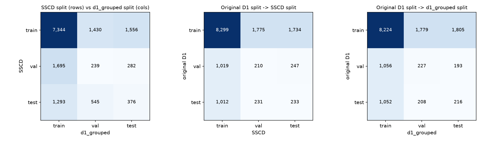
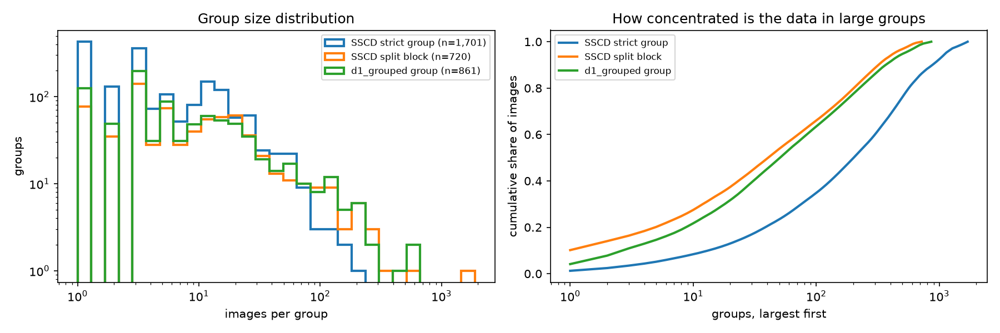
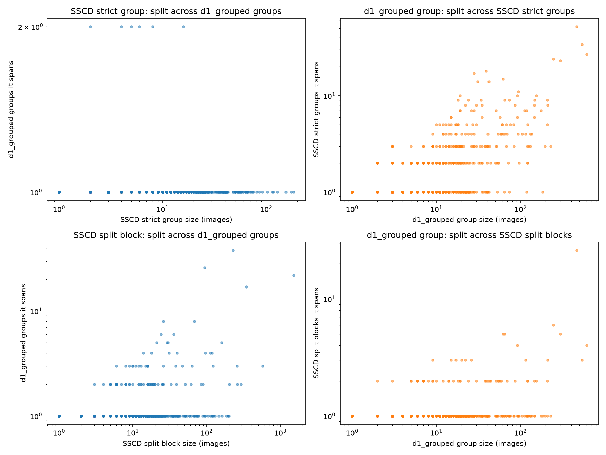
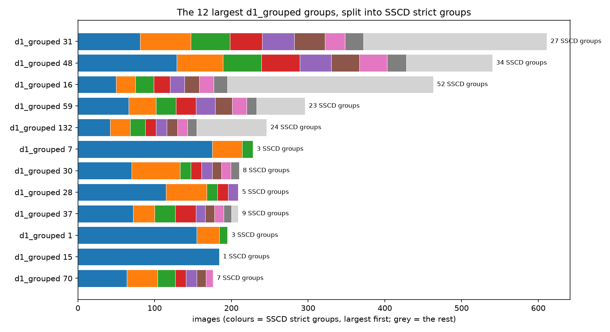
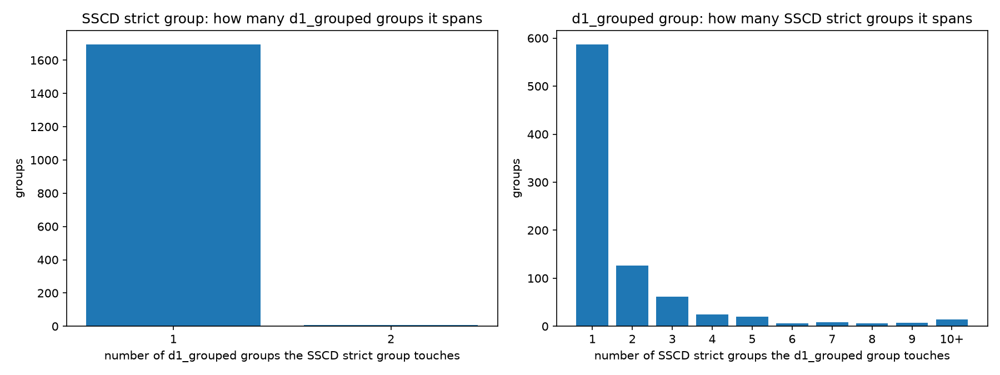

# d1_sscd_grouped vs d1_grouped

## 1. Split assignment (images)

Same split in both: **7,959 / 14,760 (53.9%)**.

Rows: SSCD split, columns: d1_grouped split.

| sscd_split | train | val | test |
|---|---|---|---|
| train | 7,344 | 1,430 | 1,556 |
| val | 1,695 | 239 | 282 |
| test | 1,293 | 545 | 376 |

Per-split overlap:

| split | SSCD | d1_grouped | intersection | Jaccard |
|---|---:|---:|---:|---:|
| train | 10,330 | 10,332 | 7,344 | 55.1% |
| val | 2,216 | 2,214 | 239 | 5.7% |
| test | 2,214 | 2,214 | 376 | 9.3% |

## 2. Grouping structure

| grouping | images | groups | singletons | median size | mean | max |
|---|---:|---:|---:|---:|---:|---:|
| SSCD strict group (algorithmic source family) | 14,760 | 1,701 | 428 | 3 | 8.7 | 184 |
| SSCD split block (what was actually kept together) | 14,760 | 720 | 77 | 7 | 20.5 | 1,500 |
| d1_grouped group | 14,760 | 861 | 125 | 6 | 17.1 | 611 |

## 3. Pair-level agreement

A pair of images is *co-grouped* if both are in the same group. 'Kept' = also co-grouped in the other grouping.

| A | B | pairs in A | pairs in B | in both | Jaccard | A pairs kept in B | B pairs kept in A | ARI |
|---|---|---:|---:|---:|---:|---:|---:|---:|
| sscd_group | dg_group | 226,116 | 930,541 | 226,077 | 24.3% | 100.0% | 24.3% | 0.389 |
| sscd_block | dg_group | 1,819,965 | 930,541 | 639,714 | 30.3% | 35.1% | 68.7% | 0.459 |

## 4. Where one grouping's families sit inside the other

**sscd_group groups vs d1_grouped**: 1,701 groups; 1,695 (99.6%) lie entirely inside one d1_grouped group, covering 14,719 images (99.7%). Median groups spanned: 1, max 2. Image-weighted mean share in the largest overlapping group: 99.9%.

**d1_grouped groups vs sscd_group**: 861 groups; 587 (68.2%) lie entirely inside one sscd_group group, covering 3,952 images (26.8%). Median groups spanned: 1, max 52. Image-weighted mean share in the largest overlapping group: 61.3%.

**sscd_block groups vs d1_grouped**: 720 groups; 632 (87.8%) lie entirely inside one d1_grouped group, covering 8,880 images (60.2%). Median groups spanned: 1, max 38. Image-weighted mean share in the largest overlapping group: 82.0%.

**d1_grouped groups vs sscd_block**: 861 groups; 804 (93.4%) lie entirely inside one sscd_block group, covering 10,302 images (69.8%). Median groups spanned: 1, max 26. Image-weighted mean share in the largest overlapping group: 89.6%.

## 5. Cross-checking leakage: one grouping judged by the other's splits

If grouping A's families were truly the same source, they should not straddle splits of B.

| A groups | split of | groups straddling >1 split | images in them | co-grouped pairs across splits |
|---|---|---:|---:|---:|
| SSCD strict group (algorithmic source family) | SSCD | 0 | 0 | 0 |
| SSCD strict group (algorithmic source family) | d1_grouped | 6 | 41 | 39 |
| SSCD split block (what was actually kept together) | SSCD | 0 | 0 | 0 |
| SSCD split block (what was actually kept together) | d1_grouped | 66 | 5,091 | 414,401 |
| d1_grouped group | SSCD | 28 | 2,883 | 145,188 |
| d1_grouped group | d1_grouped | 0 | 0 | 0 |

## 6. Per-class view (dominant class of d1_grouped)

| dominant | images | same_split_% |
|---|---|---|
| background | 143 | 49.7 |
| corrosion | 1,220 | 54.8 |
| crack | 5,645 | 53.5 |
| dent | 6,052 | 54.6 |
| missing-head | 782 | 60.2 |
| paint-peel-off | 620 | 46.5 |
| scratch | 298 | 44.6 |

## Figures

