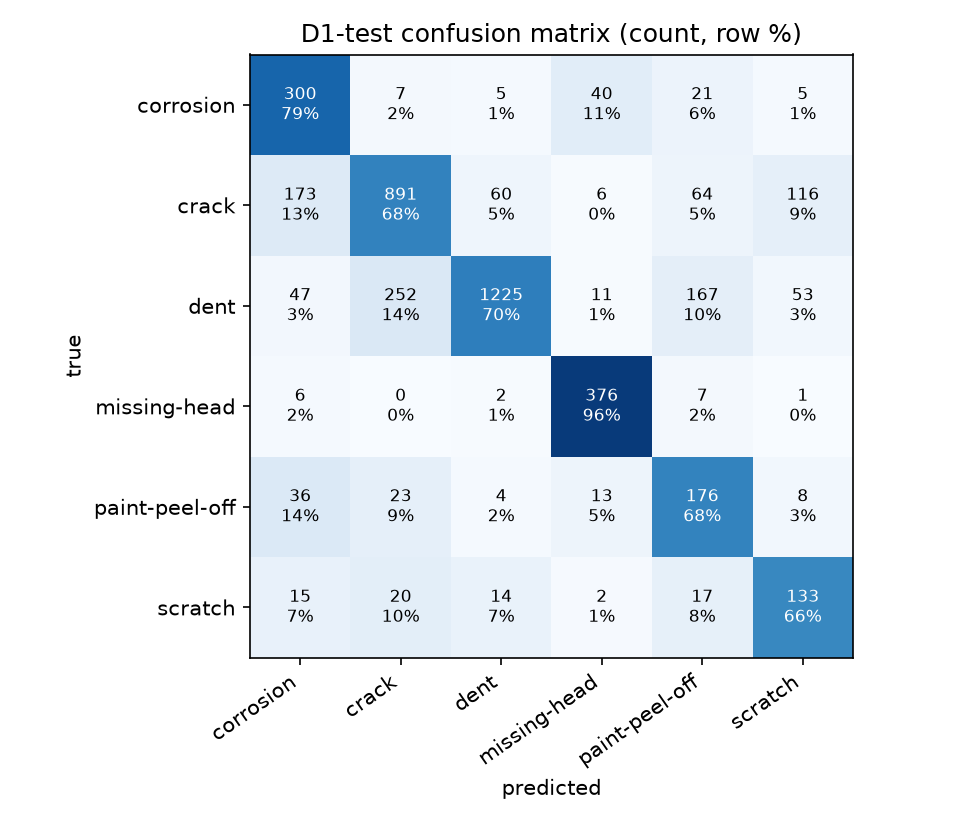
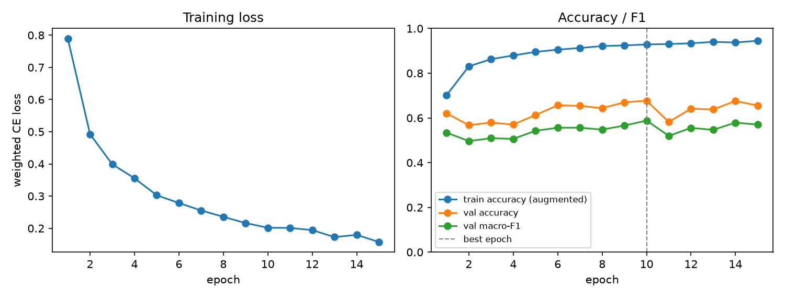

# D1 classifier report

Best epoch 10 of 15; 20046 train / 4295 val / 4296 test crops.

| metric | value |
|---|---|
| test accuracy | 0.7218 |
| test macro-F1 | 0.6739 |
| test balanced accuracy | 0.7449 |
| val macro-F1 | 0.5882 |
| train macro-F1 (no augmentation, 5000 crops) | 0.9075 |

| class | test recall | test crops |
|---|---|---|
| corrosion | 0.7937 | 378 |
| crack | 0.6802 | 1310 |
| dent | 0.6980 | 1755 |
| missing-head | 0.9592 | 392 |
| paint-peel-off | 0.6769 | 260 |
| scratch | 0.6617 | 201 |

