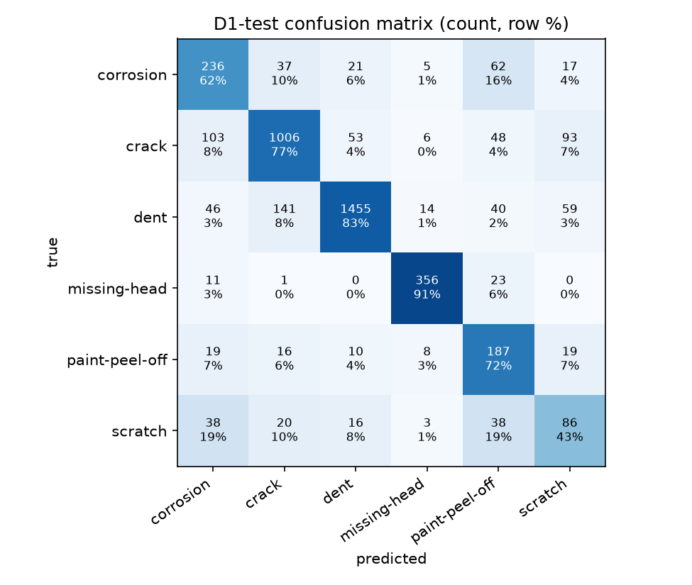
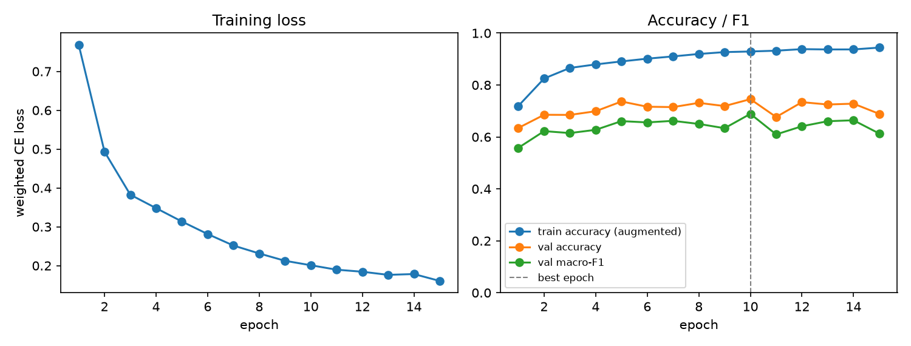

# D1 classifier report

Best epoch 10 of 15; 20025 train / 4319 val / 4293 test crops.

| metric | value |
|---|---|
| test accuracy | 0.7747 |
| test macro-F1 | 0.6805 |
| test balanced accuracy | 0.7137 |
| val macro-F1 | 0.6889 |
| train macro-F1 (no augmentation, 5000 crops) | 0.9211 |

| class | test recall | test crops |
|---|---|---|
| corrosion | 0.6243 | 378 |
| crack | 0.7685 | 1309 |
| dent | 0.8291 | 1755 |
| missing-head | 0.9105 | 391 |
| paint-peel-off | 0.7220 | 259 |
| scratch | 0.4279 | 201 |

