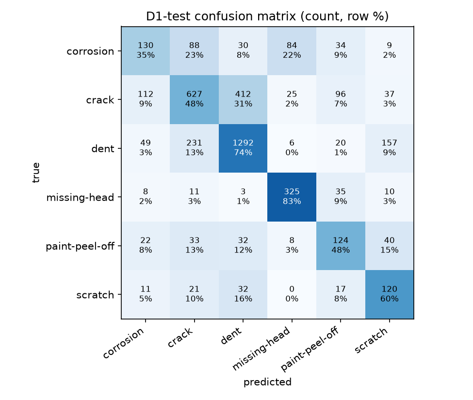
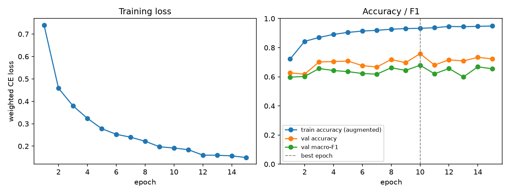

# D1 classifier report

Best epoch 10 of 15; 19970 train / 4376 val / 4291 test crops.

| metric | value |
|---|---|
| test accuracy | 0.6101 |
| test macro-F1 | 0.5418 |
| test balanced accuracy | 0.5778 |
| val macro-F1 | 0.6794 |
| train macro-F1 (no augmentation, 5000 crops) | 0.9312 |

| class | test recall | test crops |
|---|---|---|
| corrosion | 0.3467 | 375 |
| crack | 0.4790 | 1309 |
| dent | 0.7362 | 1755 |
| missing-head | 0.8291 | 392 |
| paint-peel-off | 0.4788 | 259 |
| scratch | 0.5970 | 201 |

