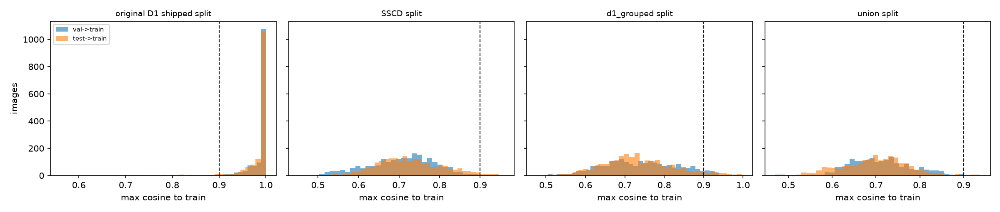

# Siamese audit of the splits

## Held-out check (2,025 images from 255 SSCD strict groups unseen in training)

- Nearest neighbour is in the same strict group for **99.8%** of held-out images that have a group-mate.
- Pair AUROC (same strict group vs different group in *both* other groupings): **0.994**.
- Alert threshold tau = 0.674 (99.9th percentile of unrelated pairs). It flags 76.6% of known same-group pairs.

## Val+test images whose best train match scores at least t

The original shipped D1 split is the reference: it is known to be full of copies. The held-out alert threshold tau = 0.674 is too loose to read as 'copy' here, because the Siamese also scores same-hardware, different-scene crops highly, so a sweep is shown instead.

| split | >= 0.80 | >= 0.90 | >= 0.95 | val-test pairs >= 0.90 |
|---|---:|---:|---:|---:|
| original D1 shipped split | 98.9% (2,919) | 96.6% (2,852) | 91.6% (2,703) | 2,579 |
| SSCD split | 15.9% (703) | 1.3% (59) | 0.0% (2) | 33 |
| d1_grouped split | 25.4% (1,126) | 5.2% (230) | 1.2% (53) | 7 |
| union split | 9.8% (381) | 0.4% (17) | 0.0% (0) | 3 |

Strongest val/test -> train pairs in the union split: `sheet_union_top_cross_split.jpg`. Dashed line in the histogram: 0.90.