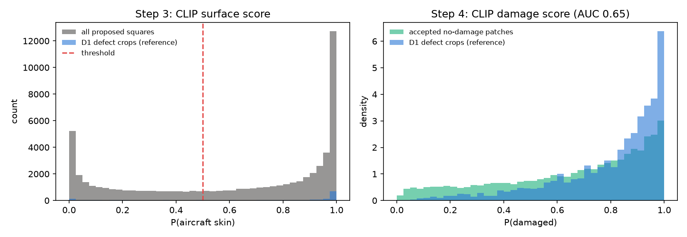
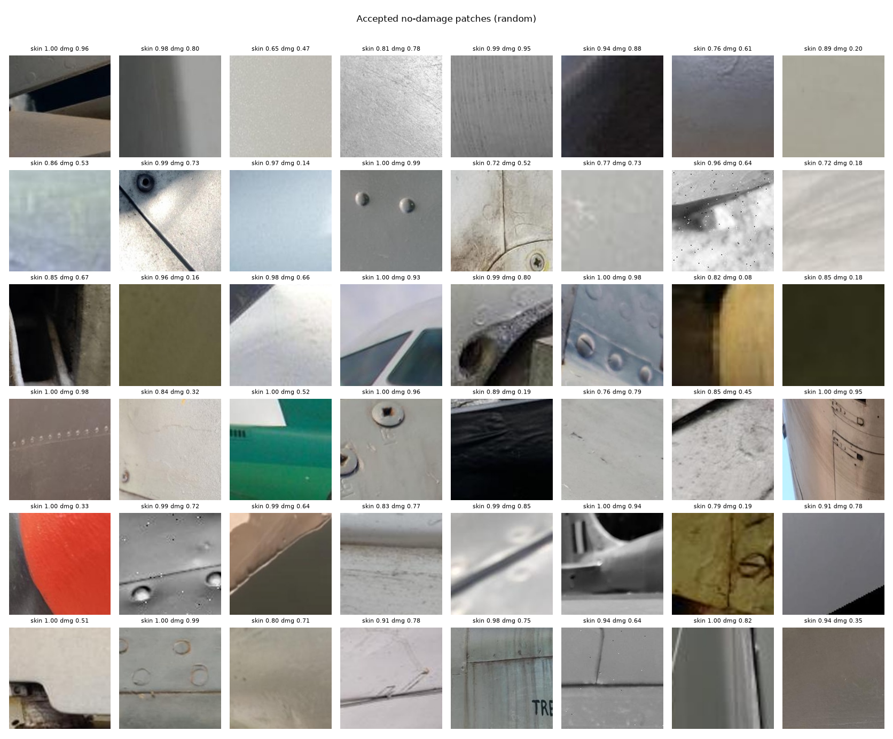
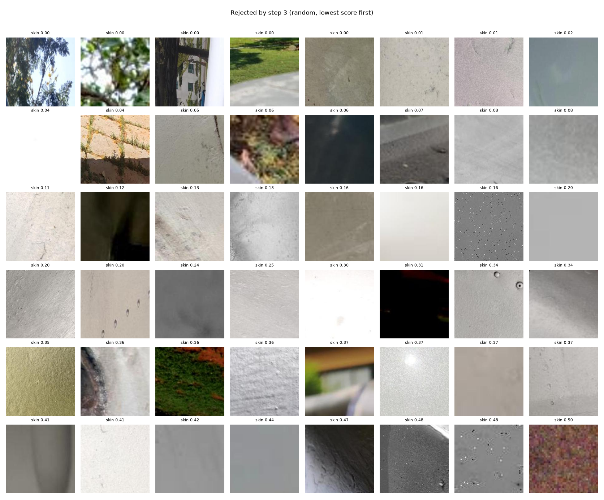

# Cropper report: D1nc (from D1)

| step | count |
|---|---|
| photos | 14760 (14615 with defect boxes) |
| 1+2. squares proposed clear of every defect box (of 116920 requested) | 59170 |
| 3. dropped: not aircraft skin (CLIP surface score < 0.5) | 21856 |
| 4. dropped: looks damaged | 0 (filter off, score recorded only) |
| passed, but over the 2-per-photo limit | 19591 |
| **accepted patches** | **17723** from 9612 photos |

## Checks without hand labels

- D1 defect crops (always on aircraft skin) pass the surface threshold 69% of the time (median score 0.865). This is a rough recall estimate for step 3.
- The damage score ranks a real defect crop above an accepted patch with probability 0.65 (0.5 = no better than chance). It is also affected by how the patches differ in other ways, so treat it as a rough guide.








## Hand check

`check_list.csv` lists 200 random accepted patches, shown in `check_sheet_*.png` by number. Fill in `is_skin` and `has_damage` (y/n) to measure the Cropper's precision and its missed-label rate.

## Settings

```yaml
candidates_per_image: 8
keep_per_image: 2
margin: 0.25
min_side: 32
max_tries: 200
clip_model: ViT-B-32
clip_pretrained: laion2b_s34b_b79k
surface_prompts:
- a close-up photo of an aircraft's metal skin
- a close-up photo of a painted metal panel
- a close-up photo of an airplane fuselage surface with rivets
- a close-up photo of an aircraft wing surface
other_prompts:
- a photo of grass
- a photo of the sky
- a photo of trees and leaves
- a photo of the ground
- a photo of a concrete floor
- a photo of asphalt
- a photo of a person
- a photo of a building
surface_threshold: 0.5
damage_prompts:
- a close-up photo of a crack in metal
- a close-up photo of a dent in a metal panel
- a close-up photo of corrosion on metal
- a close-up photo of a scratch on metal
- a close-up photo of peeling paint
- a close-up photo of a missing rivet
clean_prompts:
- a close-up photo of clean undamaged metal
- a close-up photo of a smooth intact painted panel
damage_threshold: null
seed: 0
```