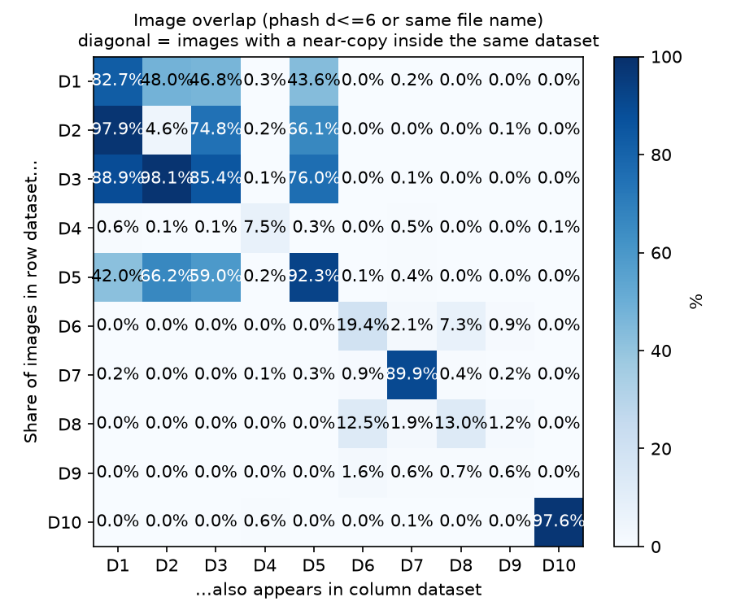
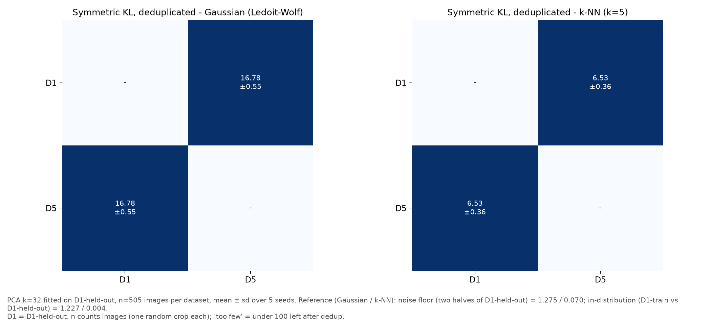
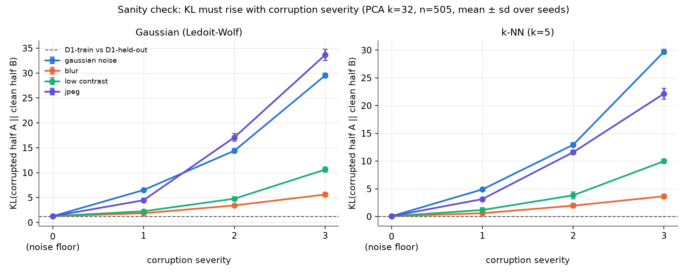
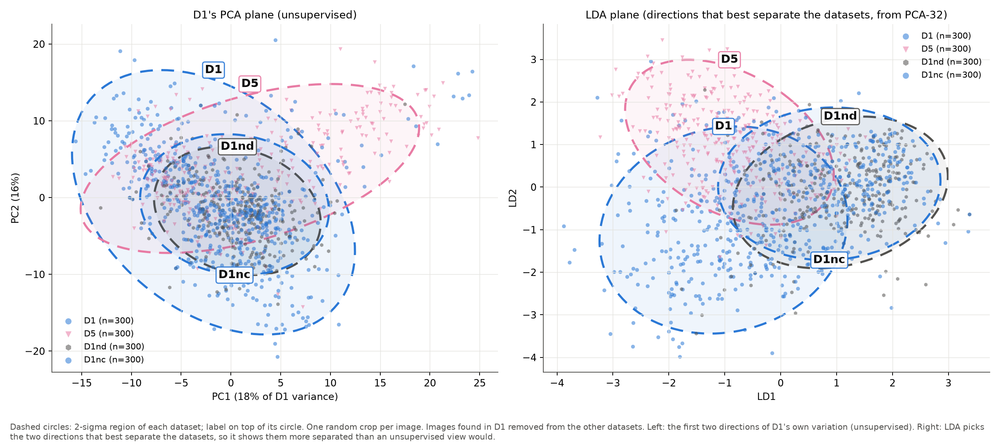
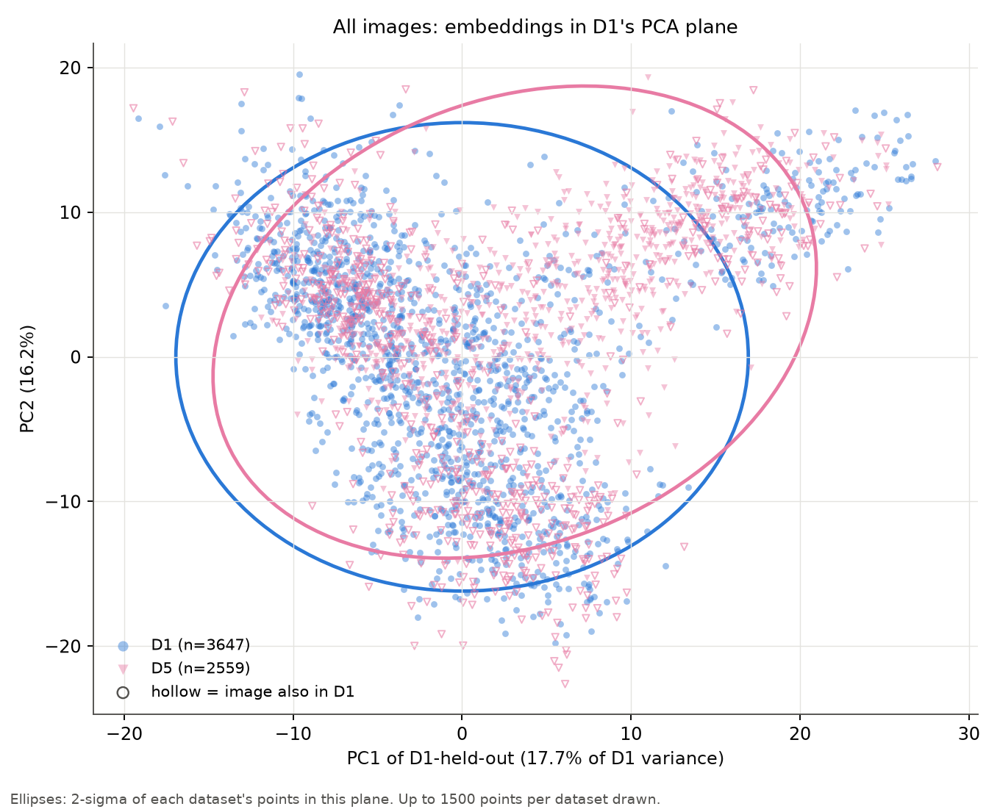
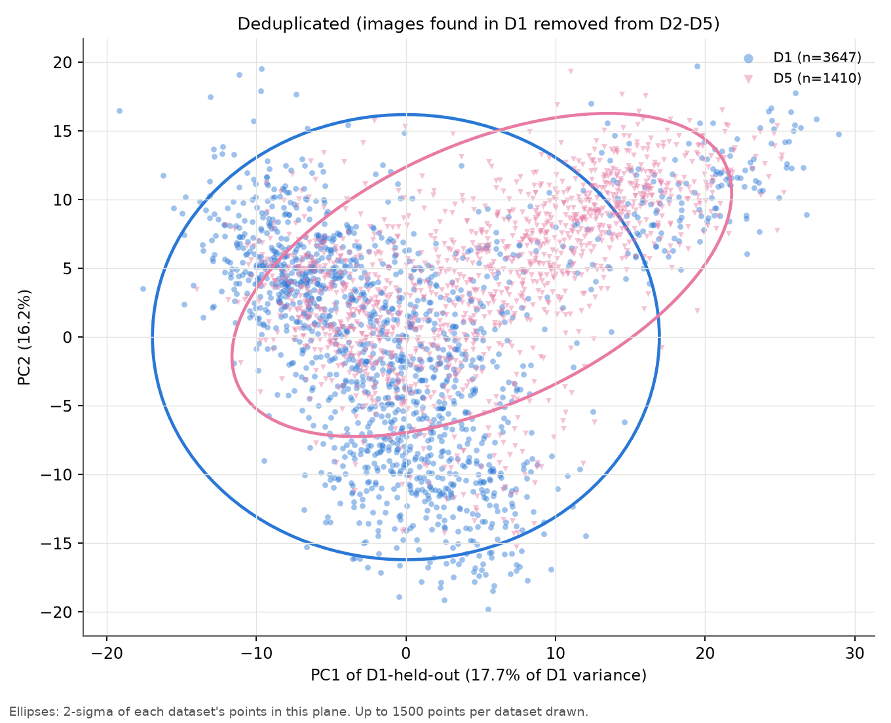
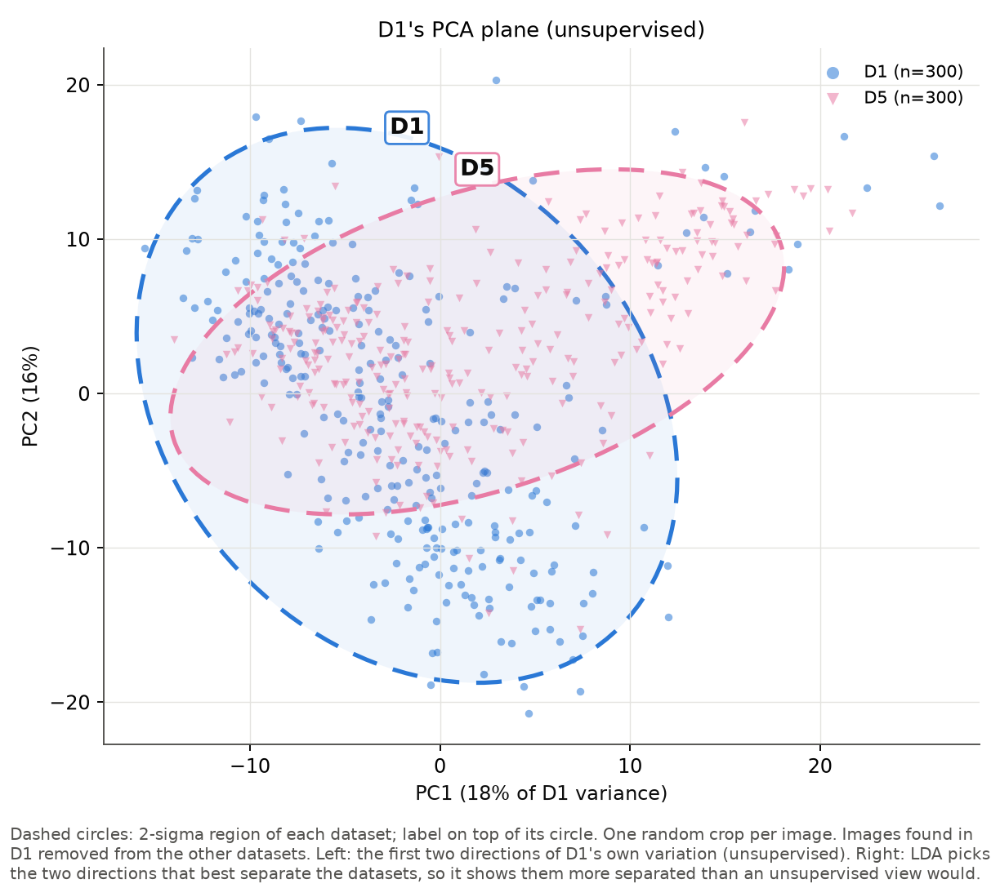
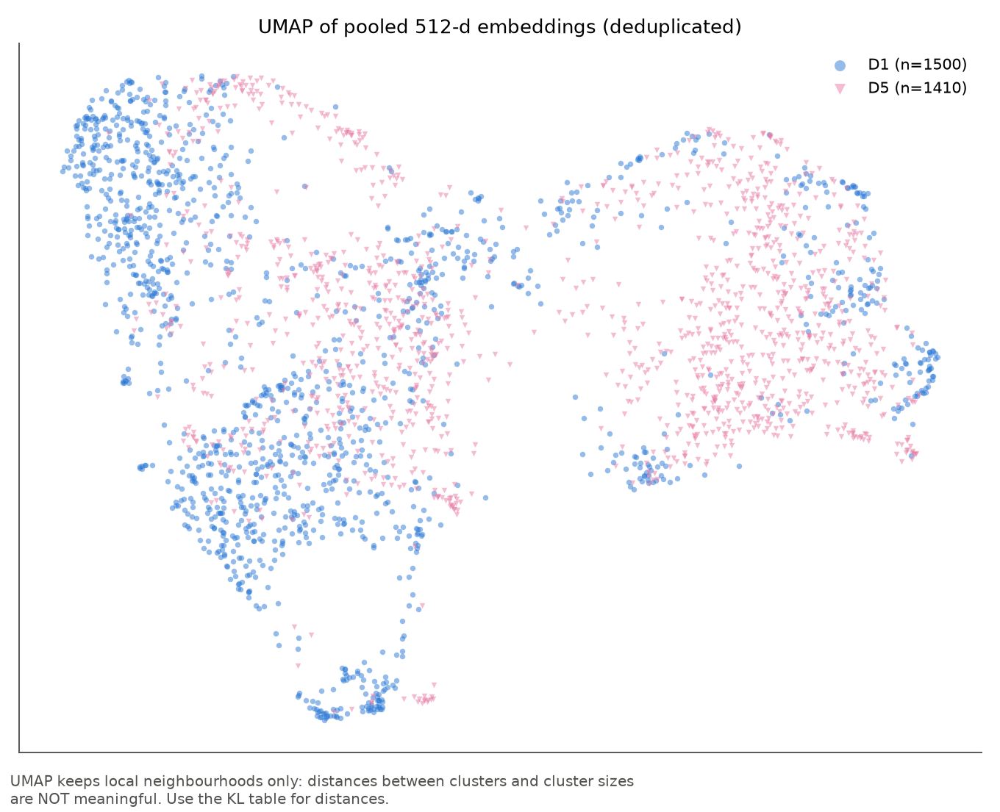

# Distribution shift between D1-D5 (KL divergence on ResNet-18 embeddings)

_Generated by `shift.py`. Numbers are relative: compare them only against the reference values at the same k and n._

**Within-dataset near-copies:** KL samples keep one image (all its crops) per near-copy cluster (same photo stem, phash ≤ threshold, or same original file name), so copies of one photo do not pull the sample together. The classifier was trained on all of D1-train.

## 1. Dataset sizes

| dataset | images | crops | median_w | median_h | most_common_size | median_aspect | square_share | crops_in_d1 | clusters | crops_1_per_cluster |
|---|---|---|---|---|---|---|---|---|---|---|
| D1 | 14760 | 28637 | 640 | 640 | 640x640 | 1.000 | 0.805 | - | 5514 | 12096 |
| D10 (overlap only) | 6415 | 12830 | 1280 | 720 | 1280x720 | 1.778 | 0.000 | 0 | 1019 | 2038 |
| D1nd | 14760 | 19071 | 640 | 640 | 640x640 | 1.000 | 0.805 | 19071 | 3886 | 7282 |
| D2 (overlap only) | 1218 | 1974 | 3000 | 3000 | 3000x3000 | 1.000 | 0.587 | 1936 | 1173 | 1938 |
| D3 (overlap only) | 2179 | 3716 | 640 | 640 | 640x640 | 1.000 | 1.000 | - | - | - |
| D4 (overlap only) | 3601 | 11872 | 640 | 640 | 640x640 | 1.000 | 1.000 | 84 | 3437 | 11466 |
| D5 | 6803 | 11663 | 640 | 640 | 640x640 | 1.000 | 1.000 | 8975 | 1531 | 3122 |
| D6 (overlap only) | 10000 | 10000 | 1024 | 679 | 1024x675 | 1.515 | 0.000 | 3 | 10000 | 10000 |
| D6p (overlap only) | 10000 | 19998 | 1024 | 679 | 1024x675 | 1.515 | 0.000 | 6 | 9999 | 19998 |
| D7 (overlap only) | 13208 | 13607 | 880 | 495 | 880x495 | 1.778 | 0.000 | 65 | 5372 | 5670 |
| D7p (overlap only) | 13208 | 25640 | 880 | 495 | 880x495 | 1.778 | 0.000 | 114 | 5184 | 10830 |
| D8 (overlap only) | 3188 | 3470 | 420 | 280 | 420x280 | 1.500 | 0.002 | 0 | 3188 | 3470 |
| D8p (overlap only) | 3188 | 5968 | 420 | 280 | 420x280 | 1.500 | 0.002 | 0 | 2965 | 5968 |
| D9 (overlap only) | 3071 | 4133 | 1024 | 683 | 1024x683 | 1.499 | 0.016 | 1 | 3071 | 4133 |
| D9p (overlap only) | 3071 | 7488 | 1024 | 683 | 1024x683 | 1.499 | 0.016 | 2 | 3049 | 7488 |

Available for the KL analysis, as crops / distinct images (D1 = D1-held-out). Each sample takes at most one random crop per image, because crops of one image are strongly correlated; n is therefore a number of images.

| version | D1 | D5 | D1nd | D1nc | common n |
|---|---|---|---|---|---|
| all | 3647 / 1660 | 2559 / 1246 | 2185 / 1163 | 2200 / 1163 | 759 |
| dedup | 3647 / 1660 | 1410 / 505 | 2185 / 1163 | 2200 / 1163 | 505 |

## 2. Image overlap between datasets

Share (%) of images in the row dataset that also appear in the column dataset (phash Hamming ≤ threshold or same original file name). Diagonal = near-copies inside the dataset.

| row \ col | D1 | D2 | D3 | D4 | D5 | D6 | D7 | D8 | D9 | D10 |
|---|---|---|---|---|---|---|---|---|---|---|
| D1 | 82.7 | 47.9 | 46.8 | 0.2 | 43.6 | 0.0 | 0.2 | 0.0 | 0.0 | 0.0 |
| D2 | 98.0 | 4.6 | 74.8 | 0.2 | 66.1 | 0.0 | 0.0 | 0.0 | 0.1 | 0.0 |
| D3 | 88.9 | 98.1 | 85.4 | 0.1 | 76.0 | 0.0 | 0.1 | 0.0 | 0.0 | 0.0 |
| D4 | 0.6 | 0.1 | 0.1 | 7.5 | 0.3 | 0.0 | 0.5 | 0.0 | 0.0 | 0.1 |
| D5 | 42.0 | 66.2 | 59.0 | 0.2 | 92.3 | 0.1 | 0.4 | 0.0 | 0.0 | 0.0 |
| D6 | 0.0 | 0.0 | 0.0 | 0.0 | 0.0 | 19.4 | 2.1 | 7.3 | 0.9 | 0.0 |
| D7 | 0.2 | 0.0 | 0.0 | 0.1 | 0.3 | 0.9 | 89.9 | 0.4 | 0.2 | 0.0 |
| D8 | 0.0 | 0.0 | 0.0 | 0.0 | 0.0 | 12.5 | 1.9 | 13.0 | 1.2 | 0.0 |
| D9 | 0.0 | 0.0 | 0.0 | 0.0 | 0.0 | 1.6 | 0.6 | 0.7 | 0.5 | 0.0 |
| D10 | 0.0 | 0.0 | 0.0 | 0.6 | 0.0 | 0.0 | 0.1 | 0.0 | 0.0 | 97.6 |

Pairs sheet for checking the threshold: `../../duplicate_pairs_sheet.png`.

## 3. D1 classifier (feature extractor)

Test accuracy **0.880**, macro-F1 **0.812**, balanced accuracy **0.819**. Train macro-F1 (no augmentation) 0.939 vs test 0.812 (gap +0.126).

| class | test recall | test crops |
|---|---|---|
| corrosion | 0.709 | 378 |
| crack | 0.941 | 1310 |
| dent | 0.899 | 1755 |
| missing-head | 0.967 | 392 |
| paint-peel-off | 0.689 | 257 |
| scratch | 0.711 | 201 |

Details: `../../d1_report.md`, `../../d1_confusion.png`, `../../d1_training_curves.png`.

## 4. KL divergence (PCA k = 32, fitted on D1-held-out)

D1 variance kept by PCA: k=8: 70.2%, k=16: 79.3%, k=32: 86.3%, k=64: 91.5%

### Deduplicated (quote these) — n = 505

| P | Q | kind | gaussian KL(P‖Q) | gaussian KL(Q‖P) | gaussian sym | knn KL(P‖Q) | knn KL(Q‖P) | knn sym |
|---|---|---|---|---|---|---|---|---|
| D1-half-A | D1-half-B | noise_floor | 1.269 | 1.280 | 1.275 ± 0.249 | 0.067 | 0.072 | 0.070 ± 0.148 |
| D1-train | D1 | in_distribution | 1.226 | 1.228 | 1.227 ± 0.267 | 0.230 | -0.222 | 0.004 ± 0.232 |
| D1 | D5 | pair | 23.702 | 9.860 | 16.781 ± 0.547 | 4.290 | 8.766 | 6.528 ± 0.361 |
| D1 | D1nd | pair | 13.628 | 7.393 | 10.510 ± 1.131 | 5.176 | 8.595 | 6.886 ± 0.533 |
| D1 | D1nc | pair | 11.967 | 6.573 | 9.270 ± 0.452 | 4.832 | 7.114 | 5.973 ± 0.468 |
| D5 | D1nd | pair | 18.287 | 15.500 | 16.894 ± 1.088 | 8.890 | 6.058 | 7.474 ± 0.317 |
| D5 | D1nc | pair | 15.661 | 13.446 | 14.553 ± 0.327 | 8.320 | 4.597 | 6.459 ± 0.277 |
| D1nd | D1nc | pair | 1.226 | 1.370 | 1.298 ± 0.205 | 0.366 | -0.205 | 0.080 ± 0.102 |

### All images — n = 759

| P | Q | kind | gaussian KL(P‖Q) | gaussian KL(Q‖P) | gaussian sym | knn KL(P‖Q) | knn KL(Q‖P) | knn sym |
|---|---|---|---|---|---|---|---|---|
| D1-half-A | D1-half-B | noise_floor | 0.910 | 0.903 | 0.906 ± 0.087 | 0.014 | -0.012 | 0.001 ± 0.131 |
| D1-train | D1 | in_distribution | 0.952 | 0.846 | 0.899 ± 0.116 | 0.348 | -0.181 | 0.084 ± 0.076 |
| D1 | D5 | pair | 5.210 | 3.439 | 4.325 ± 0.272 | 1.141 | 3.007 | 2.074 ± 0.129 |
| D1 | D1nd | pair | 13.053 | 6.885 | 9.969 ± 0.939 | 5.509 | 8.929 | 7.219 ± 0.187 |
| D1 | D1nc | pair | 11.320 | 6.168 | 8.744 ± 0.720 | 5.136 | 6.992 | 6.064 ± 0.244 |
| D5 | D1nd | pair | 15.710 | 9.096 | 12.403 ± 1.090 | 7.855 | 7.245 | 7.550 ± 0.451 |
| D5 | D1nc | pair | 12.849 | 8.284 | 10.566 ± 0.544 | 7.058 | 5.384 | 6.221 ± 0.364 |
| D1nd | D1nc | pair | 0.970 | 1.089 | 1.030 ± 0.162 | 0.466 | -0.473 | -0.003 ± 0.079 |

### Sensitivity to k (deduplicated, symmetric KL vs D1, Gaussian / k-NN)

| k | noise floor | D1-train | D5 |
|---|---|---|---|
| 8 | 0.119 / 0.025 | 0.094 / 0.014 | 3.394 / 2.017 |
| 16 | 0.353 / 0.069 | 0.319 / 0.012 | 7.403 / 3.608 |
| 32 | 1.275 / 0.070 | 1.227 / 0.004 | 16.781 / 6.528 |
| 64 | 4.589 / 0.117 | 4.366 / 0.015 | 35.730 / 11.744 |

### Known-shift sanity check

| estimator | corruption | sev 1 | sev 2 | sev 3 | noise_floor | rises |
|---|---|---|---|---|---|---|
| gaussian | blur | 1.861 | 3.424 | 5.613 | 1.275 | yes |
| gaussian | gaussian_noise | 6.515 | 14.407 | 29.516 | 1.275 | yes |
| gaussian | jpeg | 4.469 | 17.097 | 33.646 | 1.275 | yes |
| gaussian | low_contrast | 2.256 | 4.774 | 10.626 | 1.275 | yes |
| knn | blur | 0.595 | 1.962 | 3.651 | 0.070 | yes |
| knn | gaussian_noise | 4.890 | 12.937 | 29.719 | 0.070 | yes |
| knn | jpeg | 3.145 | 11.591 | 22.153 | 0.070 | yes |
| knn | low_contrast | 1.181 | 3.826 | 9.978 | 0.070 | yes |

KL rises with severity for every corruption and both estimators, so the setup responds to known shift.

### Per-class KL vs the mapped D1 class (k = 16, symmetric, mean over seeds)

| version | dataset | d1_class | estimator | n | sym_mean | class_noise_floor |
|---|---|---|---|---|---|---|
| all | D5 | Dent | gaussian | 357.000 | 1.203 | 0.433 |
| all | D5 | Dent | knn | 357.000 | 0.412 | 0.013 |

No per-class value (fewer than 100 images on one side; the D1 side is a group-split half of the D1-held-out class): D5→Missing-Head (all; D5: 335, D1 half: 38), D5→Dent (dedup; D5: 51, D1 half: 357), D5→Missing-Head (dedup; D5: 207, D1 half: 38)

`class_noise_floor` = two halves of the D1-held-out class at the same n. D4 is wind-turbine blades (different material); D5 Fastener Damage → Missing-Head is a loose match.

### No-damage datasets (deduplicated, k = 32, n = 505, symmetric KL, Gaussian / k-NN)

D6-D9 are whole-aircraft photos; `p` = skin patches cut from the middle of each aircraft box; D1nd = patches of D1-held-out photos away from every defect box (same cameras as D1, no labelled damage). If a no-damage set is far from D1nd, using it as the 'no damage' class would let a model separate classes by where the photo came from.

| set | vs D1 (defects) | vs D1nd (D1 no-damage) |
|---|---|---|
| noise floor (two halves of D1-held-out) | 1.27 / 0.07 |  |
| D1nd (D1 no-damage patches) | 10.51 / 6.89 | — |

Linear separability (logistic regression on the same 32 features, 5-fold CV, balanced; 50% = cannot tell apart). Two halves of D1-held-out: 53%.

| set | vs D1 (defects) | vs D1nd (D1 no-damage) |
|---|---|---|
| D1nd | 83% | — |

Full pairwise table for every set: `kl_heatmap_all_sets.png` and `kl_matrix.csv`.

**Dashed circles for the compared sets** (D1, D5, D1nd, D1nc), deduplicated, one crop per image.

## 5. Figures

**Figure 1a.** D1-held-out and D2–D5 in the first two principal components of D1-held-out, with 2-σ ellipses. Hollow markers are crops whose original image also appears in D1.

**Figure 1b.** Same, with images found in D1 removed from D2–D5.

**Figure 1c.** Dashed 2-σ circles per dataset (deduplicated, one crop per image), in D1's PCA plane (left) and in an LDA plane that best separates the datasets (right). `overlap_circles_all.png` is the same with all images.

**Figure 2.** UMAP of the pooled 512-d embeddings (deduplicated). Distances between clusters are not meaningful in UMAP; only local neighbourhoods are.

**Figure 3.** `kl_heatmap_dedup.png` (above). **Figure 4.** `kl_corruption.png` (above).

## 6. What the numbers say (auto-generated)

- Closest to D1 (deduplicated, Gaussian symmetric KL): **D5** (16.78, 13× the noise floor of 1.275). Farthest: **D5** (16.78, 13×).
- Ranking by Gaussian KL: D5; by k-NN KL: D5 (same order).
- For scale: D1-train vs D1-held-out = 1.227. Every dataset is far above this in-distribution reference.

_These sentences are generated from the table; read them together with the figures._

## 7. Caveats

- **Viewpoint.** KL is measured through a network trained on D1, so it measures shift *as this model sees it*.
- **Duplicates.** Quote the deduplicated numbers. The all-images numbers mainly show how much the datasets share. Deduplication only removes images found in D1; D2–D5 can still share images with each other (see the overlap table), which lowers their mutual KL.
- **Gaussian assumption.** Gaussian KL treats each dataset as one blob, which is why the k-NN estimator is reported too.
- **Relative numbers only.** KL values depend on k and n. Compare them at fixed k and n against the reference values, never as absolute numbers.
- **One crop per image.** Crops of one image are strongly correlated (with free crop sampling the k-NN noise floor was about 100× higher), so each sample takes at most one random crop per image. This limits n to the smallest dataset's number of distinct images.
- **Hash limits.** Hash matching misses heavily cropped or edited copies, so "deduplicated" means "no near-identical copies found". It also over-matches low-detail images: plain grey or white blade tiles in D4, and photos of a single plane on plain sky (D6 and D8 match each other and themselves heavily, mostly falsely). So the overlap table overstates D6-D9's internal and D6-D8 overlap, and inside D6-D9 copies are grouped by file name only.
- **No-damage sets.** D6-D9 were measured through a network trained only on D1 defects, which never saw a 'no damage' example. D1nd patches are random areas away from labelled defects, so they include background (ground, sky, shadow) and possibly unlabelled damage. D6 comes from a Kaggle copy of the FGVC-Aircraft 2013b archive (complete: 10,000 images and boxes) because the official server was too slow; its 20 px copyright banner was cut off. D9 uses only Open Images' validation and test images. Licences: FGVC is for non-commercial research, D7/D8 are CC BY 4.0, Open Images images are CC BY 2.0.
- **D10 (fuselage mock-up).** Video frames, so near-copies were found without chaining (a frame is kept only if it differs from every kept frame). Each frame gives two 720×720 squares, a wider view than D1's defect crops. Its anomalies are placed objects, and normal and anomaly frames were filmed separately, so part of their difference is the recording session. Analysed in its own run (`results/d10/`). Licence: CC BY 4.0.
- **k-NN values near zero.** The k-NN estimator is unbiased only on average, so values for identical distributions scatter around 0 and can be slightly negative. Read them as "no measurable shift".
- **Feature extractor.** The D1 classifier reaches test macro-F1 of about 0.8 and is weakest on scratch, corrosion and paint-peel-off. Its features are good enough to rank datasets, not to judge fine differences within those classes.
- **Dataset versions.** D2 = Roboflow v22 (raw), D4 = v2, D5 = v3 (no augmentation listed, yet it holds many same-photo copies, which the near-copy clustering collapses). D3 was dropped because it exists only as a 3× augmented export and 98% of it is D2; it appears in the overlap table only.
- **Licensing.** D1's license is unknown and its sources carry their own licenses. That is fine for this analysis, but worth noting before D1 is used in anything published.
