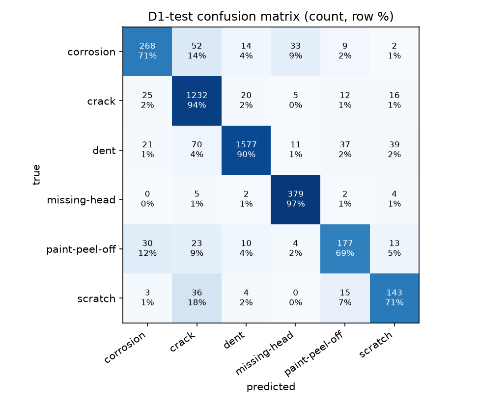
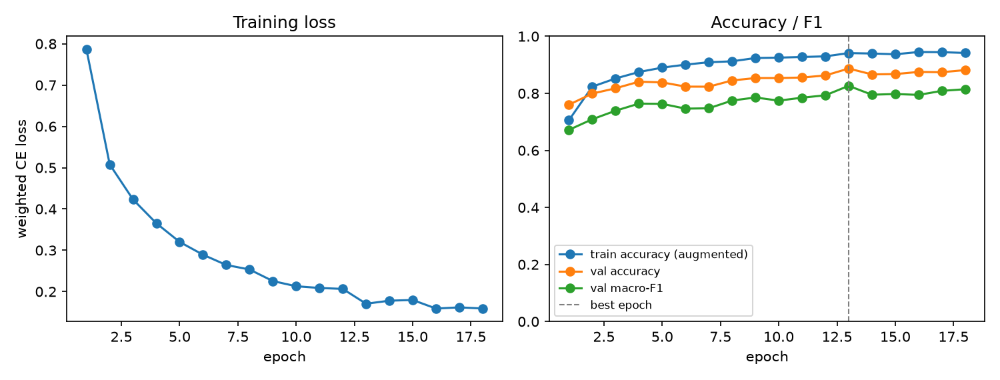

# D1 classifier report

Best epoch 13 of 18; 20051 train / 4293 val / 4293 test crops.

| metric | value |
|---|---|
| test accuracy | 0.8796 |
| test macro-F1 | 0.8125 |
| test balanced accuracy | 0.8192 |
| val macro-F1 | 0.8264 |
| train macro-F1 (no augmentation, 5000 crops) | 0.9387 |

| class | test recall | test crops |
|---|---|---|
| corrosion | 0.7090 | 378 |
| crack | 0.9405 | 1310 |
| dent | 0.8986 | 1755 |
| missing-head | 0.9668 | 392 |
| paint-peel-off | 0.6887 | 257 |
| scratch | 0.7114 | 201 |

