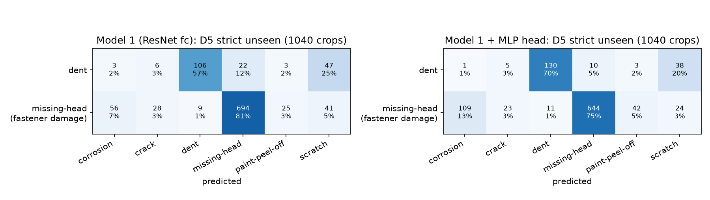

# Outside test on D5: model 1 (ResNet-18 trained on D1)

Model: `data/work/model_best.pt` (the main model, trained on the original D1 split; not d1_grouped), alone and with its MLP head (`data/work/mlp_head.pt`). Nothing was retrained or tuned on D5. D5 classes mapped to D1: Dent → dent, Fastener Damage → missing-head. Rupture has no D1 class and is listed separately. Device: mps.

| test set | crops | photos | ResNet fc accuracy | + MLP head accuracy | fc balanced acc | MLP balanced acc | dent recall (fc / MLP) | missing-head recall (fc / MLP) |
|---|---|---|---|---|---|---|---|---|
| **A. strict unseen (fair outside test)** | 1040 | 278 | **0.7692** | **0.7442** | 0.6902 | 0.7251 | 0.567 / 0.695 | 0.814 / 0.755 |
| B1. all D5 dent + fastener damage | 7875 | 4362 | 0.9308 | 0.9318 | 0.9303 | 0.9299 | 0.941 / 0.966 | 0.920 / 0.893 |
| B2. photo also in D1-train (seen) | 4498 | 2850 | 0.9811 | 0.9920 | 0.9836 | 0.9928 | 0.974 / 0.990 | 0.993 / 0.996 |
| B3. photo not in D1-train (project check) | 3377 | 1512 | 0.8638 | 0.8516 | 0.8642 | 0.8637 | 0.866 / 0.914 | 0.862 / 0.813 |

For comparison, on D1-test (same model): ResNet fc accuracy 0.8796, + MLP head 0.9010; recall dent 0.899 / 0.941, missing-head 0.967 / 0.969.

## What the model calls the strict-unseen crops

| true class | model | corrosion | crack | dent | missing-head | paint-peel-off | scratch |
|---|---|---|---|---|---|---|---|
| dent | ResNet fc | 3 (2%) | 6 (3%) | 106 (57%) | 22 (12%) | 3 (2%) | 47 (25%) |
| dent | + MLP head | 1 (1%) | 5 (3%) | 130 (70%) | 10 (5%) | 3 (2%) | 38 (20%) |
| missing-head | ResNet fc | 56 (7%) | 28 (3%) | 9 (1%) | 694 (81%) | 25 (3%) | 41 (5%) |
| missing-head | + MLP head | 109 (13%) | 23 (3%) | 11 (1%) | 644 (75%) | 42 (5%) | 24 (3%) |

## Rupture (no D1 class): what the model calls it

3788 crops. ResNet fc: crack 3257, scratch 171, dent 145, corrosion 123, paint-peel-off 51, missing-head 41. MLP head: crack 3236, dent 205, scratch 167, corrosion 86, paint-peel-off 51, missing-head 43.

