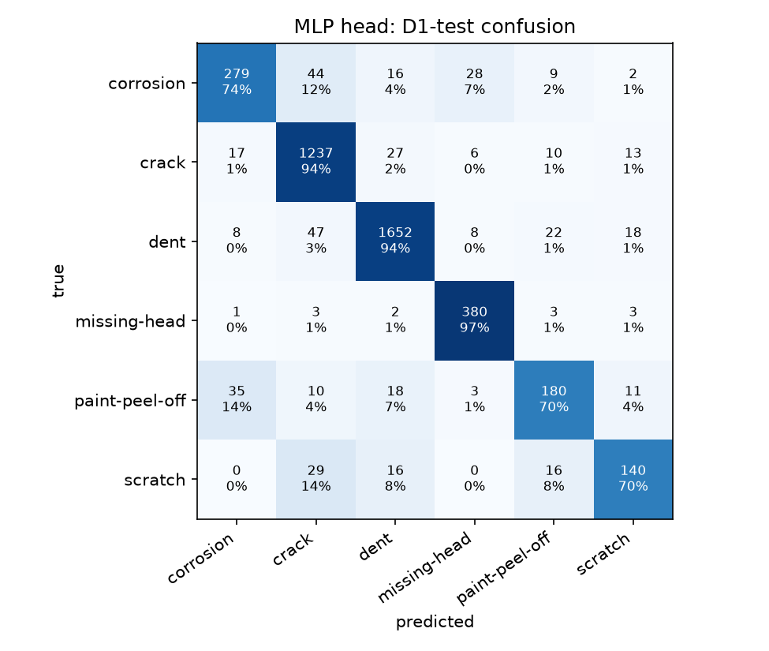
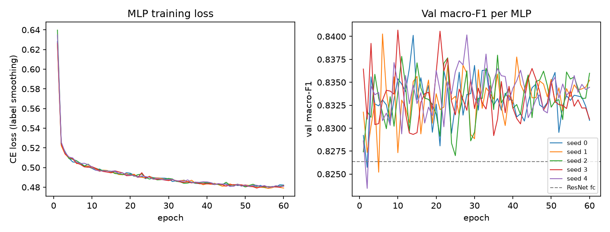

# MLP head on the ResNet-18 embeddings: D1 report

Trained on 20051 embeddings (20051 D1-train crops); 5 MLPs 1024x512x256, blended with 5-NN at weight 0.5 (picked on val). Device: mps.

## D1-test (4,293 crops, never used for training or model selection)

| model | accuracy | macro-F1 | balanced accuracy |
|---|---|---|---|
| ResNet-18 with its own fc layer | 0.8796 | 0.8125 | 0.8192 |
| MLP ensemble only | 0.8952 | 0.8330 | 0.8185 |
| **MLP head (final: MLPs + kNN)** | 0.9010 | 0.8374 | 0.8317 |

On the same test crops, the MLP head is right where the ResNet fc is wrong 144 times, and the other way round 52 times (exact McNemar test p = 3.5e-11).

## D1-val (used to pick epochs and the blend weight)

| model | accuracy | macro-F1 | balanced accuracy |
|---|---|---|---|
| ResNet-18 fc | 0.8870 | 0.8264 | 0.8319 |
| MLP head | 0.9054 | 0.8460 | 0.8388 |

## Per-class recall on D1-test

| class | ResNet-18 fc | MLP head | test crops |
|---|---|---|---|
| corrosion | 0.7090 | 0.7381 | 378 |
| crack | 0.9405 | 0.9443 | 1310 |
| dent | 0.8986 | 0.9413 | 1755 |
| missing-head | 0.9668 | 0.9694 | 392 |
| paint-peel-off | 0.6887 | 0.7004 | 257 |
| scratch | 0.7114 | 0.6965 | 201 |

