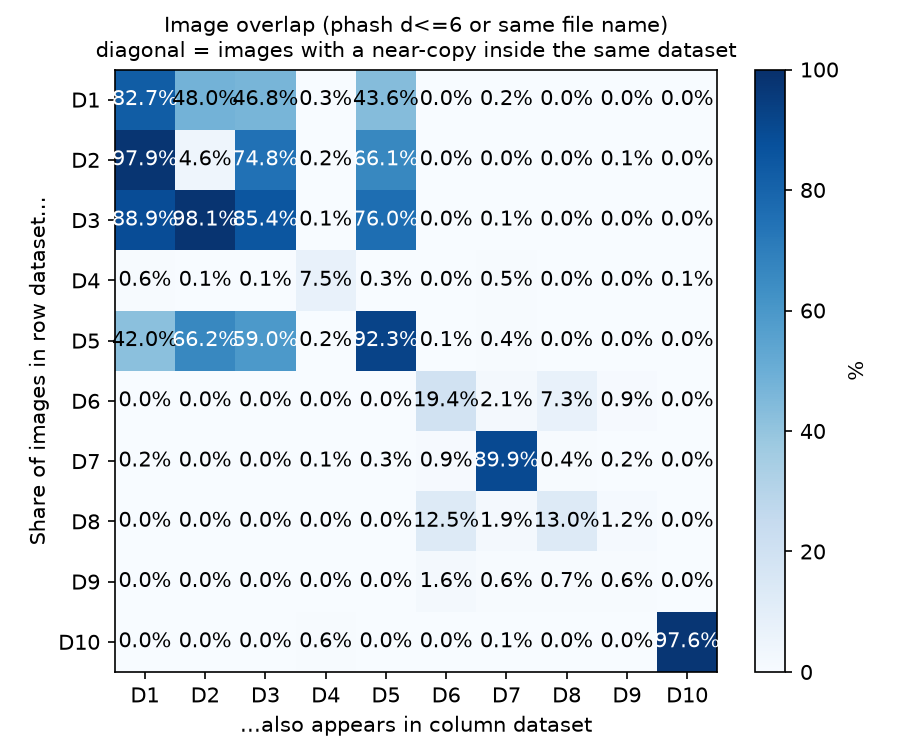
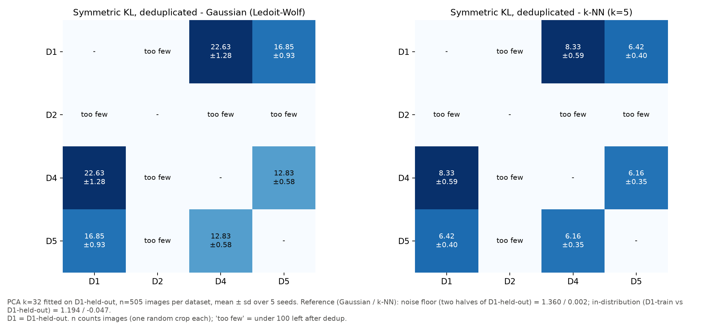
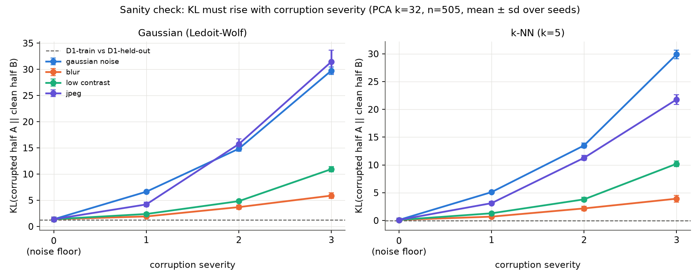
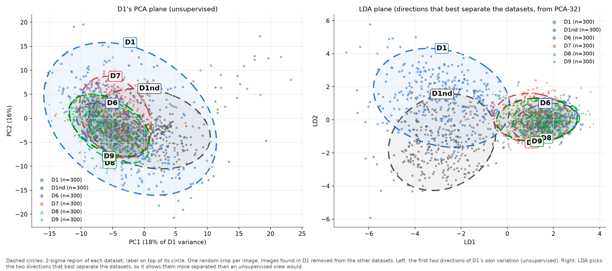
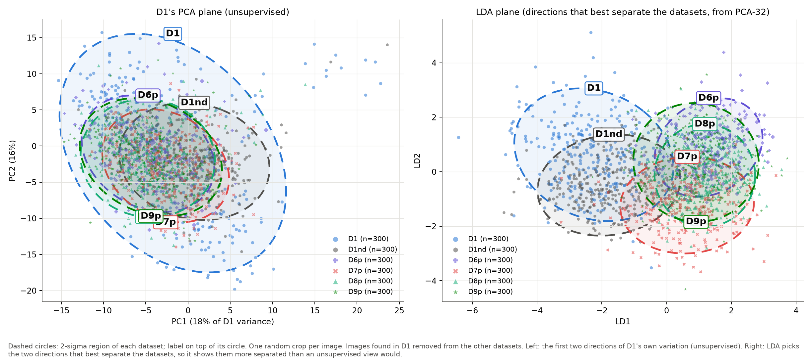
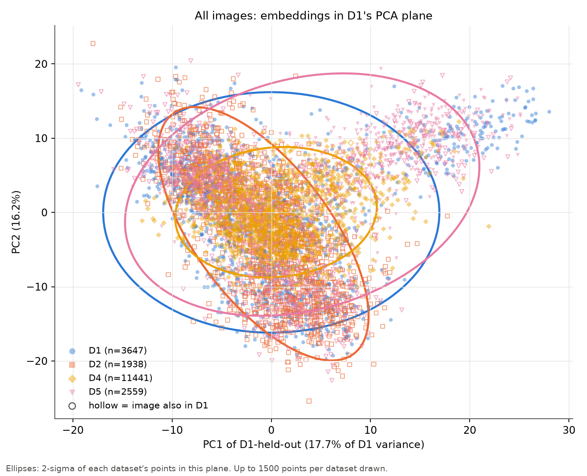
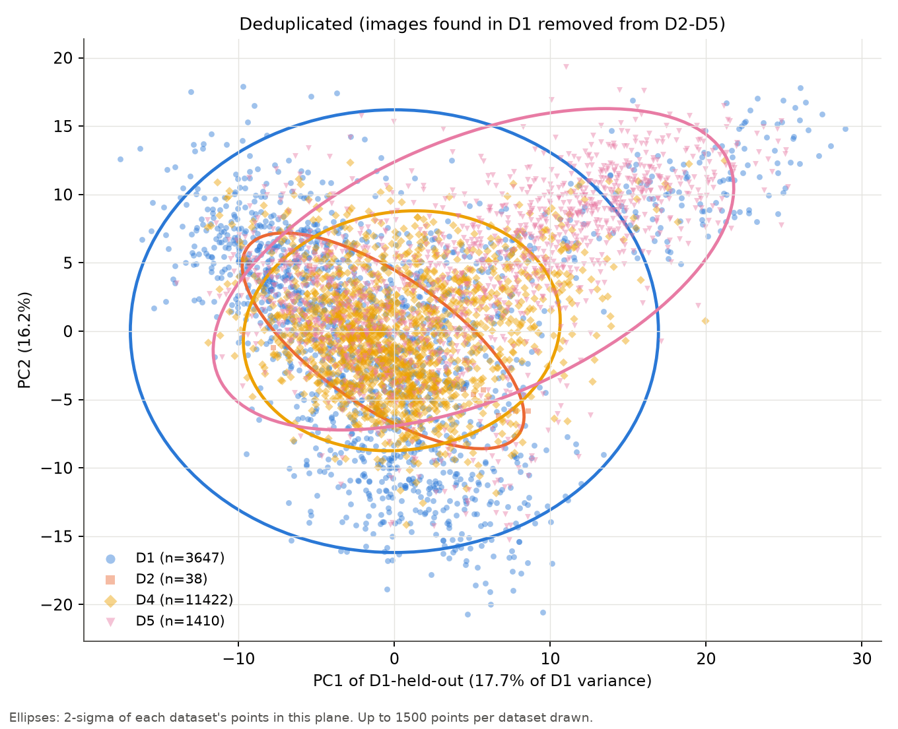
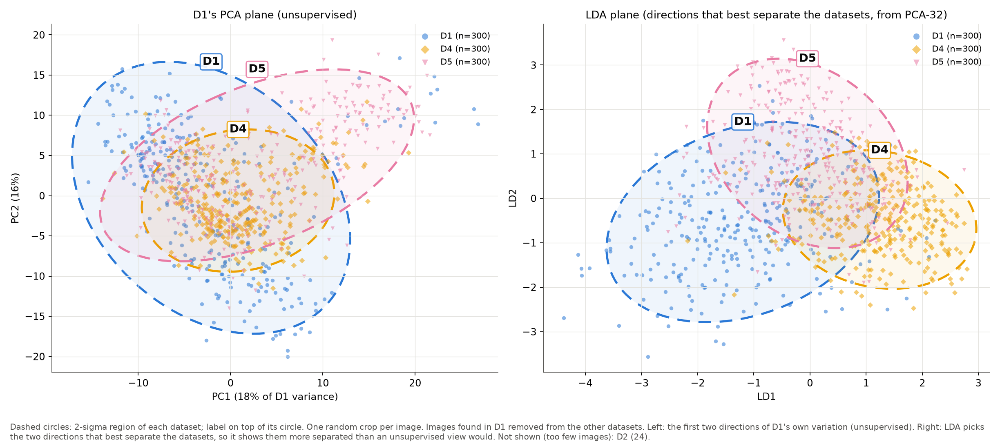
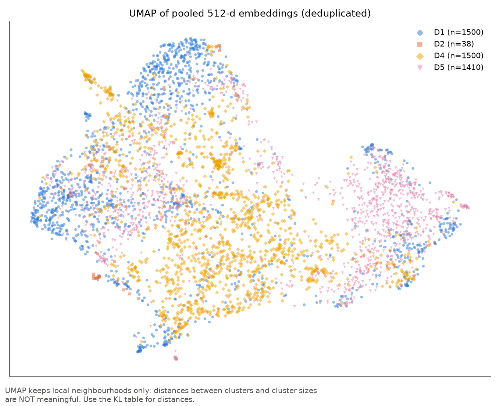

# Distribution shift between D1-D5 (KL divergence on ResNet-18 embeddings)

_Generated by `shift.py`. Numbers are relative: compare them only against the reference values at the same k and n._

**Within-dataset near-copies:** KL samples keep one image (all its crops) per near-copy cluster (same photo stem, phash ≤ threshold, or same original file name), so copies of one photo do not pull the sample together. The classifier was trained on all of D1-train.

## 1. Dataset sizes

| dataset | images | crops | median_w | median_h | most_common_size | median_aspect | square_share | crops_in_d1 | clusters | crops_1_per_cluster |
|---|---|---|---|---|---|---|---|---|---|---|
| D1 | 14760 | 28637 | 640 | 640 | 640x640 | 1.000 | 0.805 | - | 5514 | 12096 |
| D10 (overlap only) | 6415 | 12830 | 1280 | 720 | 1280x720 | 1.778 | 0.000 | 0 | 1019 | 2038 |
| D1nd | 14760 | 19071 | 640 | 640 | 640x640 | 1.000 | 0.805 | 19071 | 3886 | 7282 |
| D2 | 1218 | 1974 | 3000 | 3000 | 3000x3000 | 1.000 | 0.587 | 1936 | 1173 | 1938 |
| D3 (overlap only) | 2179 | 3716 | 640 | 640 | 640x640 | 1.000 | 1.000 | - | - | - |
| D4 | 3601 | 11872 | 640 | 640 | 640x640 | 1.000 | 1.000 | 84 | 3437 | 11466 |
| D5 | 6803 | 11663 | 640 | 640 | 640x640 | 1.000 | 1.000 | 8975 | 1531 | 3122 |
| D6 | 10000 | 10000 | 1024 | 679 | 1024x675 | 1.515 | 0.000 | 3 | 10000 | 10000 |
| D6p | 10000 | 19998 | 1024 | 679 | 1024x675 | 1.515 | 0.000 | 6 | 9999 | 19998 |
| D7 | 13208 | 13607 | 880 | 495 | 880x495 | 1.778 | 0.000 | 65 | 5372 | 5670 |
| D7p | 13208 | 25640 | 880 | 495 | 880x495 | 1.778 | 0.000 | 114 | 5184 | 10830 |
| D8 | 3188 | 3470 | 420 | 280 | 420x280 | 1.500 | 0.002 | 0 | 3188 | 3470 |
| D8p | 3188 | 5968 | 420 | 280 | 420x280 | 1.500 | 0.002 | 0 | 2965 | 5968 |
| D9 | 3071 | 4133 | 1024 | 683 | 1024x683 | 1.499 | 0.016 | 1 | 3071 | 4133 |
| D9p | 3071 | 7488 | 1024 | 683 | 1024x683 | 1.499 | 0.016 | 2 | 3049 | 7488 |

Available for the KL analysis, as crops / distinct images (D1 = D1-held-out). Each sample takes at most one random crop per image, because crops of one image are strongly correlated; n is therefore a number of images.

| version | D1 | D2 | D4 | D5 | D6 | D7 | D8 | D9 | D6p | D7p | D8p | D9p | D1nd | common n |
|---|---|---|---|---|---|---|---|---|---|---|---|---|---|---|
| all | 3647 / 1660 | 1938 / 1173 | 11441 / 3432 | 2559 / 1246 | 10000 / 10000 | 5668 / 5372 | 3470 / 3188 | 4127 / 3071 | 19998 / 9999 | 10830 / 5184 | 5968 / 2965 | 7487 / 3049 | 2185 / 1163 | 759 |
| dedup | 3647 / 1660 | 38 / 24 | 11422 / 3421 | 1410 / 505 | 9997 / 9997 | 5644 / 5348 | 3470 / 3188 | 4126 / 3070 | 19992 / 9996 | 10784 / 5161 | 5968 / 2965 | 7485 / 3048 | 2185 / 1163 | 505 |

**Too few for a KL value (under 100):** D2 (dedup: 24)

## 2. Image overlap between datasets

Share (%) of images in the row dataset that also appear in the column dataset (phash Hamming ≤ threshold or same original file name). Diagonal = near-copies inside the dataset.

| row \ col | D1 | D2 | D3 | D4 | D5 | D6 | D7 | D8 | D9 | D10 |
|---|---|---|---|---|---|---|---|---|---|---|
| D1 | 82.7 | 47.9 | 46.8 | 0.2 | 43.6 | 0.0 | 0.2 | 0.0 | 0.0 | 0.0 |
| D2 | 98.0 | 4.6 | 74.8 | 0.2 | 66.1 | 0.0 | 0.0 | 0.0 | 0.1 | 0.0 |
| D3 | 88.9 | 98.1 | 85.4 | 0.1 | 76.0 | 0.0 | 0.1 | 0.0 | 0.0 | 0.0 |
| D4 | 0.6 | 0.1 | 0.1 | 7.5 | 0.3 | 0.0 | 0.5 | 0.0 | 0.0 | 0.1 |
| D5 | 42.0 | 66.2 | 59.0 | 0.2 | 92.3 | 0.1 | 0.4 | 0.0 | 0.0 | 0.0 |
| D6 | 0.0 | 0.0 | 0.0 | 0.0 | 0.0 | 19.4 | 2.1 | 7.3 | 0.9 | 0.0 |
| D7 | 0.2 | 0.0 | 0.0 | 0.1 | 0.3 | 0.9 | 89.9 | 0.4 | 0.2 | 0.0 |
| D8 | 0.0 | 0.0 | 0.0 | 0.0 | 0.0 | 12.5 | 1.9 | 13.0 | 1.2 | 0.0 |
| D9 | 0.0 | 0.0 | 0.0 | 0.0 | 0.0 | 1.6 | 0.6 | 0.7 | 0.5 | 0.0 |
| D10 | 0.0 | 0.0 | 0.0 | 0.6 | 0.0 | 0.0 | 0.1 | 0.0 | 0.0 | 97.6 |

Pairs sheet for checking the threshold: `duplicate_pairs_sheet.png`.

## 3. D1 classifier (feature extractor)

Test accuracy **0.880**, macro-F1 **0.812**, balanced accuracy **0.819**. Train macro-F1 (no augmentation) 0.939 vs test 0.812 (gap +0.126).

| class | test recall | test crops |
|---|---|---|
| corrosion | 0.709 | 378 |
| crack | 0.941 | 1310 |
| dent | 0.899 | 1755 |
| missing-head | 0.967 | 392 |
| paint-peel-off | 0.689 | 257 |
| scratch | 0.711 | 201 |

Details: `d1_report.md`, `d1_confusion.png`, `d1_training_curves.png`.

## 4. KL divergence (PCA k = 32, fitted on D1-held-out)

D1 variance kept by PCA: k=8: 70.2%, k=16: 79.3%, k=32: 86.3%, k=64: 91.5%

### Deduplicated (quote these) — n = 505

| P | Q | kind | gaussian KL(P‖Q) | gaussian KL(Q‖P) | gaussian sym | knn KL(P‖Q) | knn KL(Q‖P) | knn sym |
|---|---|---|---|---|---|---|---|---|
| D1-half-A | D1-half-B | noise_floor | 1.378 | 1.342 | 1.360 ± 0.347 | 0.105 | -0.100 | 0.002 ± 0.147 |
| D1-train | D1 | in_distribution | 1.213 | 1.175 | 1.194 ± 0.053 | 0.252 | -0.346 | -0.047 ± 0.072 |
| D1 | D4 | pair | 32.385 | 12.879 | 22.632 ± 1.275 | 6.358 | 10.297 | 8.327 ± 0.585 |
| D1 | D5 | pair | 23.761 | 9.930 | 16.845 ± 0.929 | 4.156 | 8.693 | 6.425 ± 0.398 |
| D1 | D6 | pair | 133.016 | 21.446 | 77.231 ± 6.541 | 8.127 | 18.405 | 13.266 ± 0.519 |
| D1 | D7 | pair | 81.174 | 17.704 | 49.439 ± 3.355 | 7.411 | 15.731 | 11.571 ± 0.562 |
| D1 | D8 | pair | 125.156 | 21.003 | 73.079 ± 4.884 | 7.929 | 17.989 | 12.959 ± 0.516 |
| D1 | D9 | pair | 69.793 | 15.870 | 42.831 ± 2.740 | 7.215 | 13.273 | 10.244 ± 0.532 |
| D1 | D6p | pair | 47.113 | 18.680 | 32.896 ± 2.185 | 7.430 | 12.823 | 10.127 ± 0.490 |
| D1 | D7p | pair | 40.838 | 14.110 | 27.474 ± 1.032 | 6.701 | 10.229 | 8.465 ± 0.564 |
| D1 | D8p | pair | 50.804 | 20.142 | 35.473 ± 2.322 | 7.808 | 13.229 | 10.518 ± 0.507 |
| D1 | D9p | pair | 33.474 | 13.365 | 23.420 ± 1.572 | 6.912 | 9.198 | 8.055 ± 0.552 |
| D1 | D1nd | pair | 14.536 | 7.649 | 11.093 ± 0.568 | 5.346 | 9.114 | 7.230 ± 0.426 |
| D4 | D5 | pair | 9.256 | 16.399 | 12.828 ± 0.583 | 5.579 | 6.735 | 6.157 ± 0.353 |
| D4 | D6 | pair | 101.308 | 24.353 | 62.830 ± 4.303 | 9.613 | 15.695 | 12.654 ± 0.447 |
| D4 | D7 | pair | 52.958 | 23.022 | 37.990 ± 2.923 | 9.171 | 13.730 | 11.451 ± 0.303 |
| D4 | D8 | pair | 96.241 | 24.473 | 60.357 ± 3.572 | 10.218 | 15.955 | 13.087 ± 0.478 |
| D4 | D9 | pair | 55.403 | 21.491 | 38.447 ± 1.481 | 9.604 | 11.639 | 10.621 ± 0.443 |
| D4 | D6p | pair | 46.621 | 30.541 | 38.581 ± 1.721 | 9.444 | 11.958 | 10.701 ± 0.131 |
| D4 | D7p | pair | 27.657 | 18.861 | 23.259 ± 1.327 | 7.510 | 7.800 | 7.655 ± 0.415 |
| D4 | D8p | pair | 47.604 | 31.259 | 39.431 ± 2.500 | 10.081 | 12.462 | 11.271 ± 0.398 |
| D4 | D9p | pair | 35.248 | 23.907 | 29.577 ± 1.204 | 9.665 | 8.509 | 9.087 ± 0.659 |
| D4 | D1nd | pair | 14.915 | 12.102 | 13.508 ± 0.313 | 6.295 | 3.971 | 5.133 ± 0.242 |
| D5 | D6 | pair | 149.435 | 22.754 | 86.095 ± 7.030 | 12.998 | 15.988 | 14.493 ± 0.091 |
| D5 | D7 | pair | 79.869 | 21.164 | 50.516 ± 2.364 | 11.800 | 13.259 | 12.529 ± 0.283 |
| D5 | D8 | pair | 137.421 | 23.566 | 80.494 ± 5.469 | 13.233 | 15.898 | 14.566 ± 0.206 |
| D5 | D9 | pair | 75.964 | 19.057 | 47.511 ± 2.816 | 12.288 | 11.254 | 11.771 ± 0.278 |
| D5 | D6p | pair | 48.418 | 24.469 | 36.444 ± 1.935 | 10.974 | 11.209 | 11.092 ± 0.125 |
| D5 | D7p | pair | 33.287 | 18.277 | 25.782 ± 1.134 | 9.800 | 8.974 | 9.387 ± 0.143 |
| D5 | D8p | pair | 47.668 | 27.908 | 37.788 ± 2.160 | 11.662 | 12.447 | 12.054 ± 0.419 |
| D5 | D9p | pair | 37.287 | 19.927 | 28.607 ± 1.584 | 11.020 | 7.955 | 9.487 ± 0.230 |
| D5 | D1nd | pair | 18.644 | 15.520 | 17.082 ± 0.580 | 9.026 | 6.375 | 7.700 ± 0.158 |
| D6 | D7 | pair | 5.922 | 13.077 | 9.499 ± 1.065 | 3.708 | 2.945 | 3.327 ± 0.197 |
| D6 | D8 | pair | 2.248 | 2.401 | 2.324 ± 0.144 | 0.697 | 0.590 | 0.644 ± 0.210 |
| D6 | D9 | pair | 3.213 | 5.505 | 4.359 ± 0.592 | 2.903 | -0.277 | 1.313 ± 0.091 |
| D6 | D6p | pair | 8.498 | 22.865 | 15.681 ± 1.220 | 8.031 | 3.171 | 5.601 ± 0.052 |
| D6 | D7p | pair | 15.027 | 37.166 | 26.097 ± 2.120 | 11.056 | 3.975 | 7.515 ± 0.277 |
| D6 | D8p | pair | 10.445 | 28.754 | 19.599 ± 1.399 | 9.124 | 3.935 | 6.529 ± 0.328 |
| D6 | D9p | pair | 9.971 | 27.273 | 18.622 ± 1.383 | 9.218 | 1.600 | 5.409 ± 0.252 |
| D6 | D1nd | pair | 21.542 | 85.476 | 53.509 ± 2.914 | 16.817 | 10.475 | 13.646 ± 0.169 |
| D7 | D8 | pair | 12.356 | 5.654 | 9.005 ± 0.837 | 3.350 | 3.510 | 3.430 ± 0.078 |
| D7 | D9 | pair | 6.709 | 6.207 | 6.458 ± 0.384 | 4.146 | 1.689 | 2.917 ± 0.189 |
| D7 | D6p | pair | 14.779 | 22.916 | 18.848 ± 1.787 | 9.169 | 5.712 | 7.441 ± 0.240 |
| D7 | D7p | pair | 16.890 | 21.584 | 19.237 ± 1.424 | 10.753 | 4.274 | 7.514 ± 0.481 |
| D7 | D8p | pair | 17.576 | 23.247 | 20.412 ± 2.100 | 10.370 | 5.865 | 8.118 ± 0.335 |
| D7 | D9p | pair | 14.525 | 21.625 | 18.075 ± 1.568 | 10.205 | 3.173 | 6.689 ± 0.294 |
| D7 | D1nd | pair | 21.182 | 48.372 | 34.777 ± 2.182 | 15.469 | 10.317 | 12.893 ± 0.360 |
| D8 | D9 | pair | 3.524 | 5.795 | 4.659 ± 0.404 | 3.054 | -0.015 | 1.520 ± 0.065 |
| D8 | D6p | pair | 8.985 | 22.575 | 15.780 ± 0.998 | 8.512 | 3.799 | 6.155 ± 0.155 |
| D8 | D7p | pair | 15.095 | 35.468 | 25.281 ± 0.895 | 11.331 | 4.488 | 7.910 ± 0.368 |
| D8 | D8p | pair | 9.838 | 24.197 | 17.018 ± 0.465 | 8.984 | 3.900 | 6.442 ± 0.290 |
| D8 | D9p | pair | 10.266 | 27.492 | 18.879 ± 0.544 | 9.562 | 2.076 | 5.819 ± 0.307 |
| D8 | D1nd | pair | 21.369 | 81.692 | 51.530 ± 3.160 | 17.010 | 10.936 | 13.973 ± 0.331 |
| D9 | D6p | pair | 5.883 | 10.897 | 8.390 ± 0.217 | 4.329 | 3.149 | 3.739 ± 0.246 |
| D9 | D7p | pair | 13.397 | 18.367 | 15.882 ± 0.802 | 7.717 | 4.475 | 6.096 ± 0.193 |
| D9 | D8p | pair | 8.734 | 14.015 | 11.375 ± 0.436 | 5.707 | 4.347 | 5.027 ± 0.335 |
| D9 | D9p | pair | 6.095 | 10.563 | 8.329 ± 0.344 | 4.935 | 1.232 | 3.083 ± 0.144 |
| D9 | D1nd | pair | 17.316 | 45.664 | 31.490 ± 1.330 | 12.491 | 9.943 | 11.217 ± 0.307 |
| D6p | D7p | pair | 10.002 | 11.231 | 10.617 ± 0.326 | 5.090 | 3.822 | 4.456 ± 0.165 |
| D6p | D8p | pair | 3.998 | 5.020 | 4.509 ± 0.124 | 1.825 | 2.053 | 1.939 ± 0.165 |
| D6p | D9p | pair | 2.715 | 3.659 | 3.187 ± 0.189 | 1.993 | -0.074 | 0.960 ± 0.154 |
| D6p | D1nd | pair | 19.850 | 29.860 | 24.855 ± 1.023 | 11.469 | 8.488 | 9.979 ± 0.596 |
| D7p | D8p | pair | 8.058 | 6.626 | 7.342 ± 0.524 | 2.600 | 3.751 | 3.175 ± 0.285 |
| D7p | D9p | pair | 5.854 | 7.627 | 6.740 ± 0.419 | 3.267 | 2.238 | 2.753 ± 0.139 |
| D7p | D1nd | pair | 13.125 | 21.244 | 17.185 ± 0.480 | 8.148 | 6.677 | 7.413 ± 0.196 |
| D8p | D9p | pair | 3.815 | 4.765 | 4.290 ± 0.328 | 2.730 | 0.567 | 1.648 ± 0.248 |
| D8p | D1nd | pair | 22.439 | 34.474 | 28.457 ± 1.499 | 12.047 | 9.467 | 10.757 ± 0.387 |
| D9p | D1nd | pair | 14.485 | 20.141 | 17.313 ± 0.874 | 7.969 | 8.179 | 8.074 ± 0.657 |

### All images — n = 759

| P | Q | kind | gaussian KL(P‖Q) | gaussian KL(Q‖P) | gaussian sym | knn KL(P‖Q) | knn KL(Q‖P) | knn sym |
|---|---|---|---|---|---|---|---|---|
| D1-half-A | D1-half-B | noise_floor | 0.946 | 0.931 | 0.938 ± 0.115 | 0.055 | 0.037 | 0.046 ± 0.149 |
| D1-train | D1 | in_distribution | 0.839 | 0.772 | 0.806 ± 0.182 | 0.297 | -0.178 | 0.059 ± 0.112 |
| D1 | D2 | pair | 7.111 | 3.479 | 5.295 ± 0.558 | 1.194 | 2.799 | 1.997 ± 0.196 |
| D1 | D4 | pair | 33.747 | 13.261 | 23.504 ± 1.753 | 6.942 | 10.690 | 8.816 ± 0.208 |
| D1 | D5 | pair | 5.321 | 3.506 | 4.413 ± 0.393 | 1.134 | 3.046 | 2.090 ± 0.180 |
| D1 | D6 | pair | 137.202 | 21.728 | 79.465 ± 3.428 | 9.261 | 18.717 | 13.989 ± 0.227 |
| D1 | D7 | pair | 80.842 | 17.901 | 49.372 ± 3.210 | 8.285 | 16.289 | 12.287 ± 0.266 |
| D1 | D8 | pair | 126.846 | 21.116 | 73.981 ± 2.098 | 8.897 | 18.273 | 13.585 ± 0.189 |
| D1 | D9 | pair | 74.293 | 16.216 | 45.254 ± 1.967 | 8.387 | 13.757 | 11.072 ± 0.213 |
| D1 | D6p | pair | 47.481 | 19.041 | 33.261 ± 0.590 | 8.371 | 13.012 | 10.691 ± 0.255 |
| D1 | D7p | pair | 40.133 | 14.255 | 27.194 ± 1.329 | 7.423 | 10.660 | 9.042 ± 0.244 |
| D1 | D8p | pair | 49.834 | 21.032 | 35.433 ± 1.948 | 8.506 | 13.610 | 11.058 ± 0.264 |
| D1 | D9p | pair | 31.482 | 13.212 | 22.347 ± 0.550 | 7.452 | 9.208 | 8.330 ± 0.226 |
| D1 | D1nd | pair | 13.183 | 7.031 | 10.107 ± 0.719 | 5.517 | 9.020 | 7.269 ± 0.192 |
| D2 | D4 | pair | 42.947 | 30.038 | 36.493 ± 2.023 | 11.534 | 12.508 | 12.021 ± 0.229 |
| D2 | D5 | pair | 8.136 | 16.210 | 12.173 ± 0.267 | 4.109 | 6.170 | 5.139 ± 0.279 |
| D2 | D6 | pair | 133.835 | 23.430 | 78.633 ± 2.299 | 12.864 | 19.426 | 16.145 ± 0.355 |
| D2 | D7 | pair | 81.072 | 24.664 | 52.868 ± 2.449 | 12.095 | 17.604 | 14.849 ± 0.273 |
| D2 | D8 | pair | 121.228 | 22.614 | 71.921 ± 2.928 | 12.358 | 19.151 | 15.754 ± 0.359 |
| D2 | D9 | pair | 73.605 | 18.590 | 46.098 ± 0.916 | 12.000 | 14.537 | 13.268 ± 0.174 |
| D2 | D6p | pair | 49.222 | 22.059 | 35.641 ± 1.878 | 12.458 | 13.416 | 12.937 ± 0.056 |
| D2 | D7p | pair | 46.594 | 17.935 | 32.264 ± 1.121 | 11.901 | 11.732 | 11.817 ± 0.366 |
| D2 | D8p | pair | 53.852 | 24.444 | 39.148 ± 1.467 | 12.821 | 14.447 | 13.634 ± 0.327 |
| D2 | D9p | pair | 34.792 | 15.832 | 25.312 ± 0.640 | 11.612 | 9.992 | 10.802 ± 0.162 |
| D2 | D1nd | pair | 14.041 | 10.405 | 12.223 ± 0.194 | 8.446 | 8.637 | 8.542 ± 0.210 |
| D4 | D5 | pair | 11.239 | 30.215 | 20.727 ± 1.938 | 8.362 | 8.198 | 8.280 ± 0.488 |
| D4 | D6 | pair | 108.850 | 25.110 | 66.980 ± 2.926 | 10.925 | 16.383 | 13.654 ± 0.285 |
| D4 | D7 | pair | 53.825 | 23.982 | 38.903 ± 0.954 | 10.204 | 14.468 | 12.336 ± 0.196 |
| D4 | D8 | pair | 105.529 | 25.360 | 65.445 ± 2.558 | 11.195 | 16.542 | 13.868 ± 0.387 |
| D4 | D9 | pair | 59.735 | 22.782 | 41.259 ± 1.471 | 10.883 | 12.575 | 11.729 ± 0.337 |
| D4 | D6p | pair | 48.401 | 32.337 | 40.369 ± 1.837 | 10.038 | 12.585 | 11.311 ± 0.276 |
| D4 | D7p | pair | 27.948 | 20.238 | 24.093 ± 1.311 | 8.508 | 8.368 | 8.438 ± 0.418 |
| D4 | D8p | pair | 48.074 | 32.793 | 40.434 ± 1.898 | 10.879 | 12.982 | 11.930 ± 0.399 |
| D4 | D9p | pair | 35.210 | 25.454 | 30.332 ± 2.562 | 10.429 | 8.999 | 9.714 ± 0.272 |
| D4 | D1nd | pair | 15.611 | 13.143 | 14.377 ± 0.441 | 7.225 | 4.409 | 5.817 ± 0.193 |
| D5 | D6 | pair | 152.535 | 20.864 | 86.699 ± 4.306 | 12.908 | 17.486 | 15.197 ± 0.162 |
| D5 | D7 | pair | 86.720 | 18.341 | 52.530 ± 2.936 | 11.804 | 15.293 | 13.548 ± 0.262 |
| D5 | D8 | pair | 141.055 | 20.609 | 80.832 ± 3.162 | 12.664 | 17.295 | 14.979 ± 0.258 |
| D5 | D9 | pair | 82.891 | 16.597 | 49.744 ± 1.885 | 11.962 | 12.884 | 12.423 ± 0.122 |
| D5 | D6p | pair | 47.161 | 21.130 | 34.145 ± 1.483 | 10.818 | 12.265 | 11.542 ± 0.356 |
| D5 | D7p | pair | 36.442 | 16.008 | 26.225 ± 0.810 | 9.575 | 10.247 | 9.911 ± 0.317 |
| D5 | D8p | pair | 45.002 | 24.741 | 34.872 ± 1.727 | 11.068 | 13.583 | 12.325 ± 0.358 |
| D5 | D9p | pair | 32.251 | 15.716 | 23.984 ± 0.830 | 10.115 | 8.912 | 9.513 ± 0.196 |
| D5 | D1nd | pair | 16.013 | 9.573 | 12.793 ± 0.610 | 8.159 | 7.855 | 8.007 ± 0.124 |
| D6 | D7 | pair | 5.862 | 13.754 | 9.808 ± 0.813 | 3.800 | 3.586 | 3.693 ± 0.249 |
| D6 | D8 | pair | 1.992 | 2.141 | 2.066 ± 0.128 | 0.831 | 0.762 | 0.797 ± 0.122 |
| D6 | D9 | pair | 2.885 | 4.911 | 3.898 ± 0.287 | 2.808 | -0.182 | 1.313 ± 0.154 |
| D6 | D6p | pair | 8.557 | 22.249 | 15.403 ± 1.181 | 8.163 | 3.607 | 5.885 ± 0.097 |
| D6 | D7p | pair | 15.811 | 39.472 | 27.641 ± 1.525 | 11.489 | 4.682 | 8.086 ± 0.260 |
| D6 | D8p | pair | 10.587 | 29.130 | 19.858 ± 1.809 | 9.495 | 4.593 | 7.044 ± 0.241 |
| D6 | D9p | pair | 9.915 | 27.884 | 18.900 ± 1.525 | 9.132 | 1.899 | 5.515 ± 0.312 |
| D6 | D1nd | pair | 21.150 | 89.483 | 55.316 ± 1.468 | 17.134 | 11.224 | 14.179 ± 0.228 |
| D7 | D8 | pair | 12.915 | 5.515 | 9.215 ± 0.722 | 3.852 | 3.662 | 3.757 ± 0.348 |
| D7 | D9 | pair | 6.462 | 5.645 | 6.053 ± 0.462 | 4.461 | 1.830 | 3.146 ± 0.252 |
| D7 | D6p | pair | 15.914 | 21.965 | 18.940 ± 1.074 | 9.938 | 5.958 | 7.948 ± 0.324 |
| D7 | D7p | pair | 18.507 | 21.905 | 20.206 ± 0.697 | 11.519 | 4.876 | 8.197 ± 0.285 |
| D7 | D8p | pair | 18.132 | 22.591 | 20.361 ± 0.554 | 10.924 | 6.165 | 8.545 ± 0.246 |
| D7 | D9p | pair | 14.362 | 20.661 | 17.512 ± 0.823 | 10.569 | 3.278 | 6.924 ± 0.329 |
| D7 | D1nd | pair | 21.755 | 48.680 | 35.218 ± 0.862 | 15.865 | 10.861 | 13.363 ± 0.242 |
| D8 | D9 | pair | 3.163 | 5.239 | 4.201 ± 0.157 | 2.927 | 0.102 | 1.515 ± 0.082 |
| D8 | D6p | pair | 8.960 | 22.438 | 15.699 ± 0.466 | 8.602 | 4.159 | 6.380 ± 0.211 |
| D8 | D7p | pair | 15.791 | 36.777 | 26.284 ± 0.737 | 11.582 | 5.081 | 8.331 ± 0.144 |
| D8 | D8p | pair | 9.718 | 24.038 | 16.878 ± 0.589 | 9.128 | 4.287 | 6.707 ± 0.154 |
| D8 | D9p | pair | 9.938 | 26.497 | 18.217 ± 0.650 | 9.484 | 2.250 | 5.867 ± 0.181 |
| D8 | D1nd | pair | 20.891 | 84.347 | 52.619 ± 1.971 | 17.272 | 10.977 | 14.124 ± 0.264 |
| D9 | D6p | pair | 5.918 | 11.686 | 8.802 ± 0.347 | 4.477 | 3.550 | 4.014 ± 0.191 |
| D9 | D7p | pair | 13.980 | 19.811 | 16.896 ± 0.361 | 8.104 | 4.991 | 6.547 ± 0.155 |
| D9 | D8p | pair | 8.928 | 15.237 | 12.082 ± 0.593 | 6.168 | 4.828 | 5.498 ± 0.182 |
| D9 | D9p | pair | 6.024 | 10.814 | 8.419 ± 0.172 | 5.115 | 1.386 | 3.250 ± 0.077 |
| D9 | D1nd | pair | 17.177 | 49.408 | 33.292 ± 1.240 | 12.826 | 10.554 | 11.690 ± 0.379 |
| D6p | D7p | pair | 10.011 | 11.316 | 10.664 ± 0.331 | 5.131 | 3.952 | 4.542 ± 0.160 |
| D6p | D8p | pair | 3.968 | 5.030 | 4.499 ± 0.201 | 2.092 | 2.304 | 2.198 ± 0.132 |
| D6p | D9p | pair | 2.637 | 3.402 | 3.020 ± 0.179 | 2.083 | -0.032 | 1.026 ± 0.139 |
| D6p | D1nd | pair | 17.407 | 28.948 | 23.178 ± 0.977 | 11.361 | 8.361 | 9.861 ± 0.362 |
| D7p | D8p | pair | 7.593 | 6.309 | 6.951 ± 0.376 | 2.596 | 3.622 | 3.109 ± 0.056 |
| D7p | D9p | pair | 5.391 | 7.057 | 6.224 ± 0.193 | 3.168 | 2.048 | 2.608 ± 0.134 |
| D7p | D1nd | pair | 12.795 | 20.939 | 16.867 ± 0.527 | 8.648 | 6.954 | 7.801 ± 0.366 |
| D8p | D9p | pair | 3.567 | 4.437 | 4.002 ± 0.210 | 2.831 | 0.691 | 1.761 ± 0.112 |
| D8p | D1nd | pair | 19.413 | 32.952 | 26.182 ± 1.897 | 12.085 | 9.573 | 10.829 ± 0.187 |
| D9p | D1nd | pair | 12.717 | 19.936 | 16.327 ± 0.661 | 7.840 | 8.278 | 8.059 ± 0.287 |

### Sensitivity to k (deduplicated, symmetric KL vs D1, Gaussian / k-NN)

| k | noise floor | D1-train | D2 | D4 | D5 |
|---|---|---|---|---|---|
| 8 | 0.136 / 0.011 | 0.098 / -0.003 | — / — | 5.301 / 2.623 | 3.426 / 1.973 |
| 16 | 0.383 / 0.010 | 0.321 / -0.009 | — / — | 10.832 / 4.628 | 7.398 / 3.541 |
| 32 | 1.360 / 0.002 | 1.194 / -0.047 | — / — | 22.632 / 8.327 | 16.845 / 6.425 |
| 64 | 4.802 / -0.006 | 4.212 / -0.134 | — / — | 47.974 / 15.182 | 36.088 / 11.615 |

### Known-shift sanity check

| estimator | corruption | sev 1 | sev 2 | sev 3 | noise_floor | rises |
|---|---|---|---|---|---|---|
| gaussian | blur | 1.911 | 3.692 | 5.889 | 1.360 | yes |
| gaussian | gaussian_noise | 6.629 | 14.835 | 29.753 | 1.360 | yes |
| gaussian | jpeg | 4.203 | 15.726 | 31.449 | 1.360 | yes |
| gaussian | low_contrast | 2.378 | 4.830 | 10.942 | 1.360 | yes |
| knn | blur | 0.694 | 2.174 | 3.926 | 0.002 | yes |
| knn | gaussian_noise | 5.104 | 13.499 | 29.896 | 0.002 | yes |
| knn | jpeg | 3.117 | 11.273 | 21.781 | 0.002 | yes |
| knn | low_contrast | 1.296 | 3.806 | 10.206 | 0.002 | yes |

KL rises with severity for every corruption and both estimators, so the setup responds to known shift.

### Per-class KL vs the mapped D1 class (k = 16, symmetric, mean over seeds)

| version | dataset | d1_class | estimator | n | sym_mean | class_noise_floor |
|---|---|---|---|---|---|---|
| all | D2 | Crack | gaussian | 318.000 | 2.121 | 0.490 |
| all | D2 | Crack | knn | 318.000 | 0.670 | -0.039 |
| all | D2 | Dent | gaussian | 357.000 | 1.327 | 0.410 |
| all | D2 | Dent | knn | 357.000 | 0.651 | -0.013 |
| all | D4 | Crack | gaussian | 318.000 | 12.893 | 0.508 |
| all | D4 | Crack | knn | 318.000 | 5.543 | -0.041 |
| all | D5 | Dent | gaussian | 357.000 | 1.203 | 0.433 |
| all | D5 | Dent | knn | 357.000 | 0.412 | 0.013 |
| dedup | D4 | Crack | gaussian | 318.000 | 12.893 | 0.508 |
| dedup | D4 | Crack | knn | 318.000 | 5.543 | -0.041 |

No per-class value (fewer than 100 images on one side; the D1 side is a group-split half of the D1-held-out class): D2→Corrosion (all; D2: 237, D1 half: 56), D4→Corrosion (all; D4: 890, D1 half: 56), D4→Paint-Peel-Off (all; D4: 2108, D1 half: 32), D5→Missing-Head (all; D5: 335, D1 half: 38), D2→Corrosion (dedup; D2: 6, D1 half: 56), D2→Crack (dedup; D2: 3, D1 half: 318), D2→Dent (dedup; D2: 15, D1 half: 357), D4→Corrosion (dedup; D4: 887, D1 half: 56), D4→Paint-Peel-Off (dedup; D4: 2104, D1 half: 32), D5→Dent (dedup; D5: 51, D1 half: 357), D5→Missing-Head (dedup; D5: 207, D1 half: 38)

`class_noise_floor` = two halves of the D1-held-out class at the same n. D4 is wind-turbine blades (different material); D5 Fastener Damage → Missing-Head is a loose match.

### No-damage datasets (deduplicated, k = 32, n = 505, symmetric KL, Gaussian / k-NN)

D6-D9 are whole-aircraft photos; `p` = skin patches cut from the middle of each aircraft box; D1nd = patches of D1-held-out photos away from every defect box (same cameras as D1, no labelled damage). If a no-damage set is far from D1nd, using it as the 'no damage' class would let a model separate classes by where the photo came from.

| set | vs D1 (defects) | vs D1nd (D1 no-damage) |
|---|---|---|
| noise floor (two halves of D1-held-out) | 1.36 / 0.00 |  |
| D1nd (D1 no-damage patches) | 11.09 / 7.23 | — |
| D6 (whole aircraft) | 77.23 / 13.27 | 53.51 / 13.65 |
| D7 (whole aircraft) | 49.44 / 11.57 | 34.78 / 12.89 |
| D8 (whole aircraft) | 73.08 / 12.96 | 51.53 / 13.97 |
| D9 (whole aircraft) | 42.83 / 10.24 | 31.49 / 11.22 |
| D6p (D6 skin patches) | 32.90 / 10.13 | 24.85 / 9.98 |
| D7p (D7 skin patches) | 27.47 / 8.46 | 17.18 / 7.41 |
| D8p (D8 skin patches) | 35.47 / 10.52 | 28.46 / 10.76 |
| D9p (D9 skin patches) | 23.42 / 8.06 | 17.31 / 8.07 |

Linear separability (logistic regression on the same 32 features, 5-fold CV, balanced; 50% = cannot tell apart). Two halves of D1-held-out: 53%.

| set | vs D1 (defects) | vs D1nd (D1 no-damage) |
|---|---|---|
| D1nd | 83% | — |
| D6 | 99% | 99% |
| D7 | 96% | 97% |
| D8 | 99% | 99% |
| D9 | 97% | 97% |
| D6p | 96% | 95% |
| D7p | 94% | 91% |
| D8p | 96% | 95% |
| D9p | 94% | 91% |

Full pairwise table for every set: `kl_heatmap_all_sets.png` and `kl_matrix.csv`.

## 5. Figures

**Figure 1a.** D1-held-out and D2–D5 in the first two principal components of D1-held-out, with 2-σ ellipses. Hollow markers are crops whose original image also appears in D1.

**Figure 1b.** Same, with images found in D1 removed from D2–D5.

**Figure 1c.** Dashed 2-σ circles per dataset (deduplicated, one crop per image), in D1's PCA plane (left) and in an LDA plane that best separates the datasets (right). `overlap_circles_all.png` is the same with all images.

**Figure 2.** UMAP of the pooled 512-d embeddings (deduplicated). Distances between clusters are not meaningful in UMAP; only local neighbourhoods are.

**Figure 3.** `kl_heatmap_dedup.png` (above). **Figure 4.** `kl_corruption.png` (above).

## Findings (written by the team; numbers from the run of 2026-10-16)

All numbers below are symmetric KL at PCA k = 32, one random crop per image, mean of 5 seeds. Deduplicated version: n = 505 images per dataset. All-images version: n = 759.

**1. The public datasets overlap far more than their sizes suggest.**
- 98% of D2's images are also in D1, and 98% of D3's are in D2. We dropped D3 from the KL analysis: it exists only as a 3× augmented export and is essentially D2.
- 42% of D5 is in D1.
- D4 (wind turbines) shares almost nothing with the aircraft sets.
- D1 itself holds about 5,600 distinct photos among its 14,760 images; most of the rest are brightness, grayscale or exposure variants.
- D1's shipped split leaks: 77% of its shipped test images have a near-copy in shipped train. Any accuracy reported on that split is optimistic. We re-split by photo group instead.

**2. D2's shift cannot be measured honestly.**
After removing images found in D1, only 24 D2 images are left, too few for a KL value. With all images, D2 vs D1 is 5.3 (Gaussian) against a noise floor of 0.9, even though nearly every D2 photo is in D1. The likely cause is preprocessing: D2 is stored at about 3000 px, while D1's copies are 640 px and often stretched. Resolution and resizing alone move the embeddings noticeably.

**3. After deduplication, D5 and D4 are both far from D1.**

| comparison | Gaussian | k-NN |
|---|---|---|
| noise floor (two halves of D1-held-out) | 1.4 | ≈ 0 |
| D1-train vs D1-held-out | 1.2 | ≈ 0 |
| D1 vs D5 (aircraft) | 16.8 | 6.4 |
| D1 vs D4 (wind-turbine blades) | 22.6 | 8.3 |

- **Scale.** D5 is about as far from D1 as D1 is from itself after severity-2 Gaussian noise or JPEG compression (KL 14.9 and 16.3). D4 sits between severity 2 and 3.
- **Order.** Both estimators, and every k from 8 to 64, agree on it: D5 is closer to D1 than D4 is.
- **Material barely matters to this model.** The gap between D5 (aircraft) and D4 (blades) is small. Close-up surface patches look alike to it whatever the material.

**4. With all images, D5 looks much closer to D1 (4.4) than it really is (16.8).**
The 42% of D5 that is already in D1 hides most of the shift. This is the effect CLAUDE.md warned about, measured.

**5. The shift is not only a different mix of classes.**
D4 crack vs D1 crack gives 12.9, against a class noise floor of 0.5. The other per-class comparisons have too few images on the D1 side to give a value.

**6. The direction of KL tells us coverage.**
KL(D1‖D5) = 23.8 is much larger than KL(D5‖D1) = 9.9, and the D4 pair shows the same pattern. D1, assembled from 24 sources, spreads over a wider region than D4 or D5, and each of them covers only part of it. The PCA plot shows D5 filling one side of D1's cloud.

**7. The no-damage datasets (D6 to D9) are far from everything in D1, and easy to tell apart from it.**
D6 is FGVC-Aircraft, D7 and D8 are Roboflow aircraft sets, D9 is the Open Images "Fixed-wing aircraft" subset. All four are photos of whole planes taken from a distance. We measured them two ways: as whole-plane crops, and as skin patches cut from the middle of each plane. We also cut D1nd, patches of D1's own held-out photos away from every defect box, as a "no damage from the same cameras" reference.

| set | KL vs D1 defects | KL vs D1nd | classifier tells it from D1nd |
|---|---|---|---|
| D1nd (D1 no-damage patches) | 11.1 | | |
| D6 to D9, whole planes | 43 to 77 | 31 to 54 | 97% to 99% |
| D6p to D9p, skin patches | 23 to 35 | 17 to 28 | 91% to 95% |

The KL values are Gaussian, symmetric, deduplicated, at n = 505 and k = 32. The noise floor is 1.4, and a linear classifier tells two halves of D1 apart 53% of the time, which is chance.

- Even the skin patches are farther from D1's no-damage patches (17 to 28) than D1's own defect crops are (11).
- A simple classifier separates any D6 to D9 set from D1nd more easily (91% to 99%) than it separates D1's defects from D1's no-damage patches (83%).

So if these sets became the "no damage" class next to D1 to D5 defects, the model could get the class right just by recognising the kind of photo. It would learn "distant airport photo = no damage" instead of what damage looks like. This is the shortcut-learning risk, measured.

The four no-damage sets are much closer to each other (2.3 to 9.5) than to D1. D6 vs D8, both airport-spotter photo collections, is only 2.3, not far above the noise floor of 1.4. Pooling them with each other is reasonable; pooling them with the defect sets is the problem.

**8. Where a no-damage class should come from.**
Undamaged areas of the same kind of close-up photos are a better source: D1nd-style patches, or close-ups of intact skin from GAES or our own photos. Even D1nd is not clean. Many of its patches are background (ground, grass, shadow) rather than aircraft skin, and D1's labels may miss some defects. So it should be filtered before being used as a training class.

**9. D10 (fuselage mock-up) is the farthest dataset from D1 we have measured.**
D10 is a Kaggle anomaly-detection set: 6,415 video frames (1280×720) from inside a fuselage mock-up, two panels filmed at 15, 25 and 35 cm. It has no boxes, only "normal" or "anomaly" per frame. The anomalies are objects placed on the panel (tape or paper pieces, thin wire-like bits) rather than cracks, dents or corrosion. Each frame gave two overlapping 720×720 squares. Consecutive video frames are near-identical, so we kept only frames that differ from every frame already kept: 528 distinct normal views and 550 anomaly views. Full tables are in `results/d10/summary.md`.

| comparison | Gaussian | k-NN | classifier tells it from D1 |
|---|---|---|---|
| noise floor (two halves of D1-held-out) | 1.2 | ≈ 0 | 53% |
| D1 vs D5 (for scale) | 16.8 | 6.5 | 83% |
| D1 vs D10 normal frames | 213 | 21.3 | 99.5% |
| D1 vs D10 anomaly frames | 153 | 18.9 | 99.5% |
| D5 vs D10 normal / anomaly | 192 / 162 | 24.6 / 21.6 | |
| D10 normal vs D10 anomaly | 8.3 | 5.3 | 78% (67% on an unseen panel and distance) |

- D10 is about ten times farther from D1 than D5 is, and farther than the whole-plane photos (D6 to D9, at most 77). It is equally far from D5. Lab mock-up, primer colour, wide frames, video camera and placed objects all differ from real defect photos at once.
- Inside D10, normal and anomaly frames differ (8.3 against a floor of 1.2). A classifier separates them 78% of the time on random frames, but only 67% when tested on a panel and distance it did not train on. So part of the difference comes from the separate recording sessions, not from the anomalies.
- D10 cannot be added to the D1/D5 training data without the model learning "mock-up look". It is better suited as a separate test of an anomaly-detection approach, keeping in mind that its anomalies are placed objects, not real damage.

**10. The Cropper: a standard way to cut "no damage" patches (tested on D1).**
`klshift/cropper.py`, run by `crop.py` with settings from `cropper.yaml`, sends every photo through four steps:
1. Propose random squares sized like that photo's own defect crops.
2. Drop any square touching a defect box (enlarged by 25%).
3. Keep squares that CLIP (a general image-and-text model, used without training) scores as aircraft skin rather than sky, grass or ground.
4. Record a CLIP "looks damaged" score.

It keeps at most 2 squares per photo. On D1 the run gave 19,224 patches (set `D1nc`) from 10,083 photos. 4,532 photos got none, because their defect boxes fill the frame.

- **The surface threshold has to be calibrated.** A fixed threshold of 0.5 rejected 37% of squares, but it would also have rejected 31% of real defect crops, which are always on aircraft skin. Most of what it removed was plain metal that CLIP mistook for concrete or ground. The Cropper now sets the threshold so that 90% of the dataset's own defect crops pass (0.066 for D1). Then it rejects 14% of squares, mostly grass, trees, sky and ground.
- **Cleaning removes obvious background but barely changes the overall picture.** D1nc and the earlier rule-based D1nd are about as different as two halves of D1 (KL 1.3, noise floor 1.3; a classifier separates them 57% of the time). D1 defects vs D1nc is 9.3, against 10.5 for D1nd. Only 9% to 14% of D1nd falls below the calibrated threshold. My earlier remark that "many D1nd patches are background" was based on one sample sheet and overstated it.
- **Missed labels are the bigger problem.** In a visual check of 50 random accepted patches (by Claude, not yet by the team), about 85% were clearly aircraft skin. But about 6 to 8 showed marks that could be unlabelled damage: scraped or chipped paint, a scratch, a hole, rust. CLIP's damage score is a weak guide (it ranks a real defect crop above an accepted patch only 66% of the time, where 50% is chance), so it is recorded but not used as a filter.
- **Next steps.**
  - Hand-check the 200 patches in `results/cropper/D1nc/check_list.csv` to measure precision and the missed-label rate properly.
  - Run the Cropper on D5 too, so each source supplies both classes.
  - Only then decide on a damage filter.

**What this means for the helmet model.**
- **No-damage data.** Don't take a "no damage" class from D6 to D9 as they are. Use undamaged areas of close-up photos taken like the defect photos.
- **Test sets.** A model trained on D1 and tested on D1's own split (or on D2) will look better than it is. Test on deduplicated, out-of-source data.
- **D5 as the real benchmark.** Of the public sets, D5 minus its D1 overlap is the most useful aircraft test of generalisation. D4 is a useful "different material" test.
- **Image preprocessing.** Resolution and resizing are a shift source in their own right, so the helmet's camera pipeline should match the training data's.

## 6. What the numbers say (auto-generated)

- Closest to D1 (deduplicated, Gaussian symmetric KL): **D5** (16.85, 12× the noise floor of 1.360). Farthest: **D4** (22.63, 17×).
- Ranking by Gaussian KL: D5 < D4; by k-NN KL: D5 < D4 (same order).
- For scale: D1-train vs D1-held-out = 1.194. Every dataset is far above this in-distribution reference.

_These sentences are generated from the table; read them together with the figures._

## 7. Caveats

- **Viewpoint.** KL is measured through a network trained on D1, so it measures shift *as this model sees it*.
- **Duplicates.** Quote the deduplicated numbers. The all-images numbers mainly show how much the datasets share. Deduplication only removes images found in D1; D2–D5 can still share images with each other (see the overlap table), which lowers their mutual KL.
- **Gaussian assumption.** Gaussian KL treats each dataset as one blob, which is why the k-NN estimator is reported too.
- **Relative numbers only.** KL values depend on k and n. Compare them at fixed k and n against the reference values, never as absolute numbers.
- **One crop per image.** Crops of one image are strongly correlated (with free crop sampling the k-NN noise floor was about 100× higher), so each sample takes at most one random crop per image. This limits n to the smallest dataset's number of distinct images.
- **Hash limits.** Hash matching misses heavily cropped or edited copies, so "deduplicated" means "no near-identical copies found". It also over-matches low-detail images: plain grey or white blade tiles in D4, and photos of a single plane on plain sky (D6 and D8 match each other and themselves heavily, mostly falsely). So the overlap table overstates D6-D9's internal and D6-D8 overlap, and inside D6-D9 copies are grouped by file name only.
- **No-damage sets.** D6-D9 were measured through a network trained only on D1 defects, which never saw a 'no damage' example. D1nd patches are random areas away from labelled defects, so they include background (ground, sky, shadow) and possibly unlabelled damage. D6 comes from a Kaggle copy of the FGVC-Aircraft 2013b archive (complete: 10,000 images and boxes) because the official server was too slow; its 20 px copyright banner was cut off. D9 uses only Open Images' validation and test images. Licences: FGVC is for non-commercial research, D7/D8 are CC BY 4.0, Open Images images are CC BY 2.0.
- **D10 (fuselage mock-up).** Video frames, so near-copies were found without chaining (a frame is kept only if it differs from every kept frame). Each frame gives two 720×720 squares, a wider view than D1's defect crops. Its anomalies are placed objects, and normal and anomaly frames were filmed separately, so part of their difference is the recording session. Analysed in its own run (`results/d10/`). Licence: CC BY 4.0.
- **k-NN values near zero.** The k-NN estimator is unbiased only on average, so values for identical distributions scatter around 0 and can be slightly negative. Read them as "no measurable shift".
- **Feature extractor.** The D1 classifier reaches test macro-F1 of about 0.8 and is weakest on scratch, corrosion and paint-peel-off. Its features are good enough to rank datasets, not to judge fine differences within those classes.
- **Dataset versions.** D2 = Roboflow v22 (raw), D4 = v2, D5 = v3 (no augmentation listed, yet it holds many same-photo copies, which the near-copy clustering collapses). D3 was dropped because it exists only as a 3× augmented export and 98% of it is D2; it appears in the overlap table only.
- **Licensing.** D1's license is unknown and its sources carry their own licenses. That is fine for this analysis, but worth noting before D1 is used in anything published.
