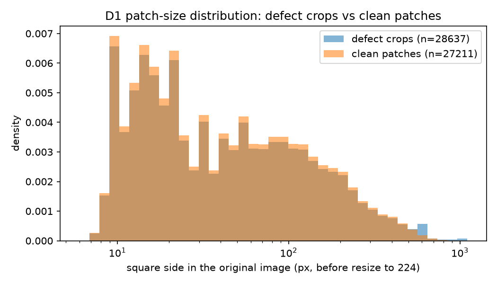
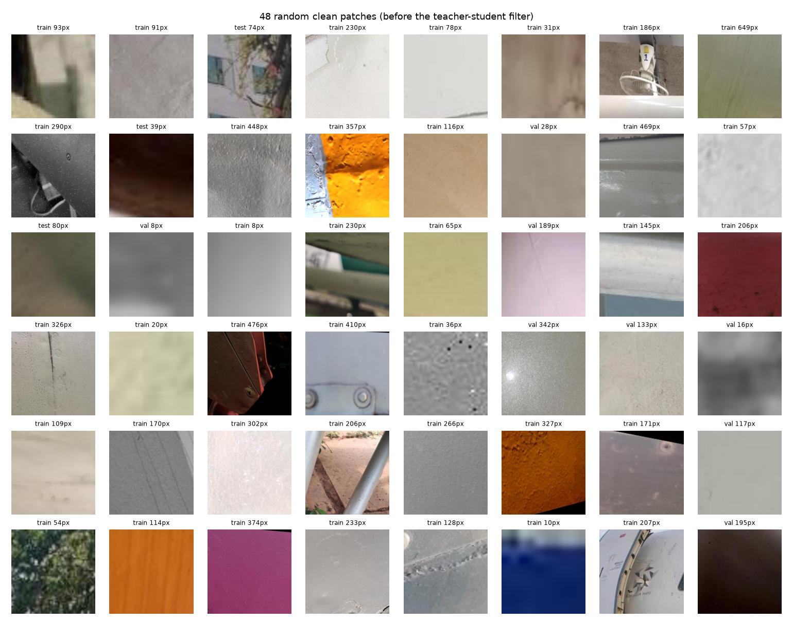

# Step 1: real clean-patch set from D1

Patches avoid every annotated box (incl. boxes < 4 px) enlarged by 25% of its size + 8 px; at most 3 non-overlapping patches per image; seed 0. Sizes are drawn from the same split's defect-crop sizes.

| split | defect crops | clean patches | shortfall | images used / available | median side clean / defect | KS stat (side) |
|---|---|---|---|---|---|---|
| train | 20051 | 18977 | 1074 | 8875 / 10293 | 151 / 161 | 0.051 |
| val | 4293 | 4114 | 179 | 1913 / 2194 | 142 / 153 | 0.040 |
| test | 4293 | 4120 | 173 | 1883 / 2128 | 157 / 164 | 0.039 |

Targets that could not be placed: 1426, side px min 474, median 640, max 1024. These are large crops (often the full short side of the image), where no box-free square exists.

| percentile | 10 | 25 | 50 | 75 | 90 | 95 | 99 |
|---|---|---|---|---|---|---|---|
| defect crop side (px) | 30 | 76 | 160 | 298 | 497 | 640 | 987 |
| clean patch side (px) | 29 | 72 | 151 | 267 | 417 | 504 | 687 |

Label noise: background regions can still hold unannotated damage. These patches are scored by the teacher-student model after Step 2 and the top 5% are dropped (grid saved then).