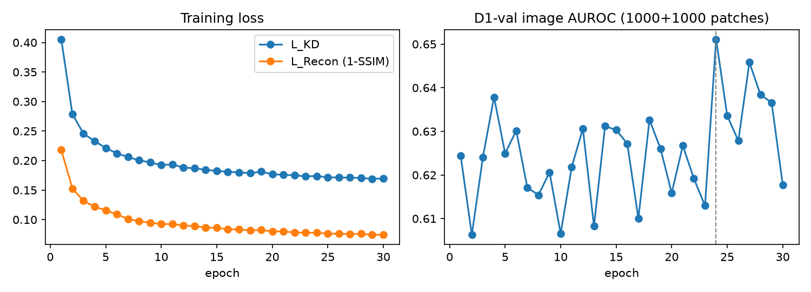
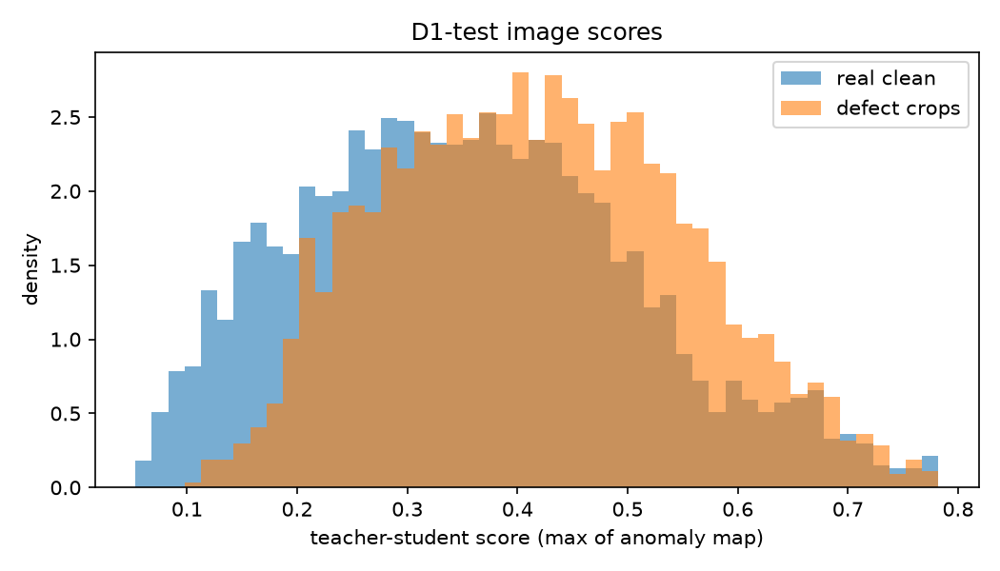
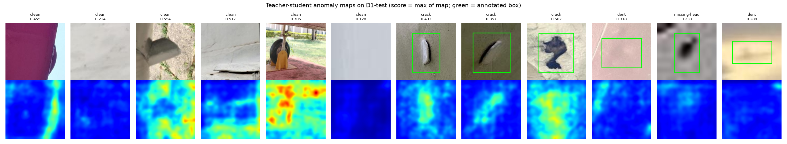
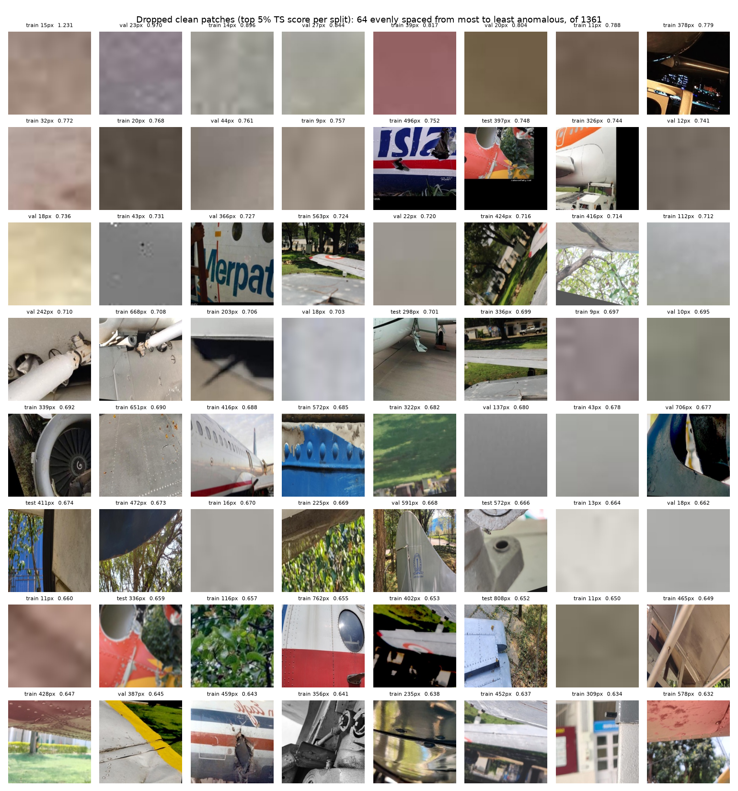

# Step 2: teacher-student (MSRD) baseline

`msrd_anomaly.py` unchanged; teacher `resnet18` (ImageNet, frozen), 224 px, batch 16, Adam lr 0.005, c = 0.9, seed 0. Trained on D1-train clean patches only (unfiltered), 30 epochs at about 5.6 min/epoch; checkpoint picked by D1-val image AUROC (epoch 24).

| metric | D1-val | D1-test | D1-test, filtered clean* |
|---|---|---|---|
| image AUROC (clean vs defect) | 0.628 | 0.621 | 0.652 |
| specificity @ 99% defect recall | 0.094 | 0.093 | 0.098 |
| specificity @ 95% defect recall | 0.183 | 0.181 | 0.191 |
| pixel AUROC, box vs rest (all patches) | 0.669 | 0.664 | 0.667 |
| pixel AUROC, box vs rest (inside defect crops) | 0.637 | 0.633 | 0.633 |
| pointing game (map max inside box) | 0.550 | 0.540 | 0.540 |
| share of map mass inside box | 0.363 | 0.357 | 0.357 |
| share of crop area that is box (chance level) | 0.312 | 0.307 | 0.307 |
| n clean / n defect | 4114 / 4293 | 4120 / 4293 | 3914 / 4293 |

*The filter drops the clean patches this same model scores highest, so this column flatters the baseline. Use the unfiltered column as the baseline.

| defect class | D1-test AUROC vs clean |
|---|---|
| corrosion | 0.655 |
| crack | 0.714 |
| dent | 0.593 |
| missing-head | 0.506 |
| paint-peel-off | 0.568 |
| scratch | 0.479 |

Pixel metrics are rough: boxes are not masks, and maps/masks are average-pooled to 56x56.

Clean-set filter: dropped the top 5% per split by TS score ({'train': 949, 'val': 206, 'test': 206}); see `step2_dropped_clean.png`.

## Reading the results

- **Weak baseline.** D1-test image AUROC is 0.62. Specificity at 99% defect recall is 9%: the model flags 91% of real clean patches to catch 99% of defects. Val AUROC sits at 0.61–0.65 from epoch 1 onward, and the training losses keep falling. The student learns to reconstruct D1 surfaces, but its error does not separate defects from clean patches. Our "normal" class covers all surfaces, liveries, structures, grass and sky, unlike one MVTec object type. The highest score goes to busy scenes, not damage.
- **Localization is near chance.** 36% of the anomaly-map mass falls inside the box, against 31% expected by chance. The map's maximum falls inside the box in 54% of crops.
- **Per class.** Crack (0.71) and corrosion (0.66) are somewhat detectable. Missing-head (0.51) and scratch (0.48) are at chance.
- **The score depends on patch size.** Median clean score by original side length: ≤30 px 0.18, 30–76 px 0.23, 76–160 px 0.32, 160–298 px 0.40, >298 px 0.47.
- **What the 5% filter drops.** It removes 17% of the tiny (≤30 px, heavily upscaled) patches and 9% of the large ones, but only 1–3% of mid-size ones. Most dropped patches are blurry upscaled flats or busy scenes. Only a handful show visible damage (e.g. "train 459px" hole, "train 578px" paint/corrosion spots, "train 496px" torn livery). Applying the filter would break the Step 1 size match and remove the hardest real clean patches. That makes the clean class easier and more uniform, which is exactly the shortcut risk.
