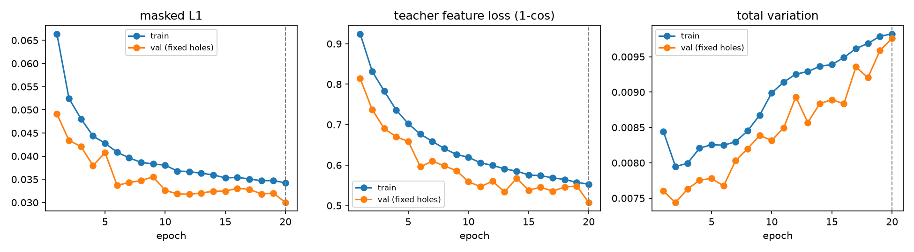
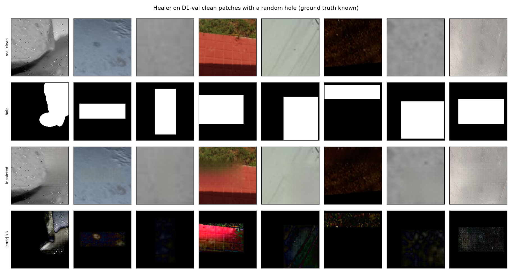
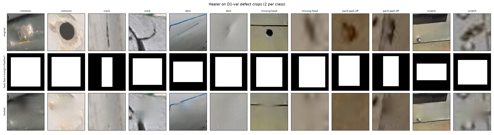

# Step 3: box-guided inpainting healer (option A, inside the 224 crop)

**What it is.** A small U-Net in plain PyTorch, `healer.py`.

- 4.9 M parameters, channels 32–256, 4 downsamplings.
- Input: the patch with the hole filled grey, plus the hole mask.
- Output: RGB through a sigmoid.

**Training.**

- Data: D1-train real clean patches only (18,977, unfiltered), with flips.
- Hole geometry: a real D1-train defect box, enlarged by 8 px margin plus 6 px feather. Half the time it stays at its original position, half the time it is placed at random.
- Hole shape: half rectangles, half irregular strokes and ellipses clipped to the box.
- Loss on the hole plus an 8 px border band: L1 (weight 1), frozen MSRD teacher (ImageNet ResNet-18, layers 1–3, 1 − cosine, weight 0.5), and total variation (weight 0.05). No adversarial loss.
- Optimizer: Adam 2e-4, batch 32, 20 epochs, seed 0.
- Checkpoint: picked on 1,000 D1-val clean patches with fixed holes (total loss). The best was epoch 20, the last one.

**Healing.**

- Hole = box + 8 px + 6 px.
- Paste-back: alpha is 1 on box + 8 px and ramps linearly to 0 across the 6 px band. Pixels outside the hole are unchanged; the crop is then re-saved as JPEG q95 like every crop.

**Generated sets** (`work/generated.csv`):

| set | crops |
|---|---|
| healed D1 (all splits) | 28,637 |
| healed D2 / D4 / D5 | 1,974 / 11,872 / 11,663 |
| D1 clean patches with a random region inpainted (artifact-probe control) | 27,211 |
| D1 defect crops with a random *non-defect* region inpainted (for C-artifact-matched) | 3,273 (see below) |

**Observations.**

- **Undertrained.** Validation L1 and feature loss were still falling at epoch 20. Epochs 13–16 ran 4–6× slower (the laptop slept or throttled); the rest took about 10 min each.
- **The hole is large.** The median hole covers 47% of the crop (60% at p90), so the fill is mostly invented from a thin border, about 23 px on the thinnest side.
- **What the fills look like.** They remove the defect and continue large-scale structure (edges, panel lines, colour gradients). They are smooth and blurry, and many show a faint regular grid or checkerboard texture inside the hole. This is visible in `step4_grid_crack.png` and the |error| row of `step3_val_clean_inpaint.png`. The rising total-variation curve is consistent with that texture growing.
- **Few defect crops can get a second region.** The "random non-defect region" control fits in only 11% of defect crops. Two holes of about half the crop each rarely fit side by side. This matters for config C-artifact-matched in Step 5.

