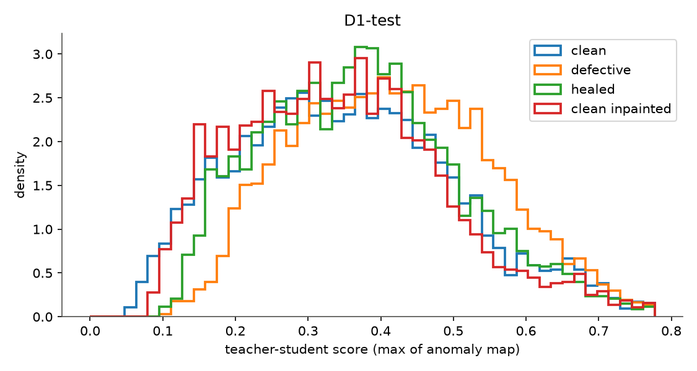
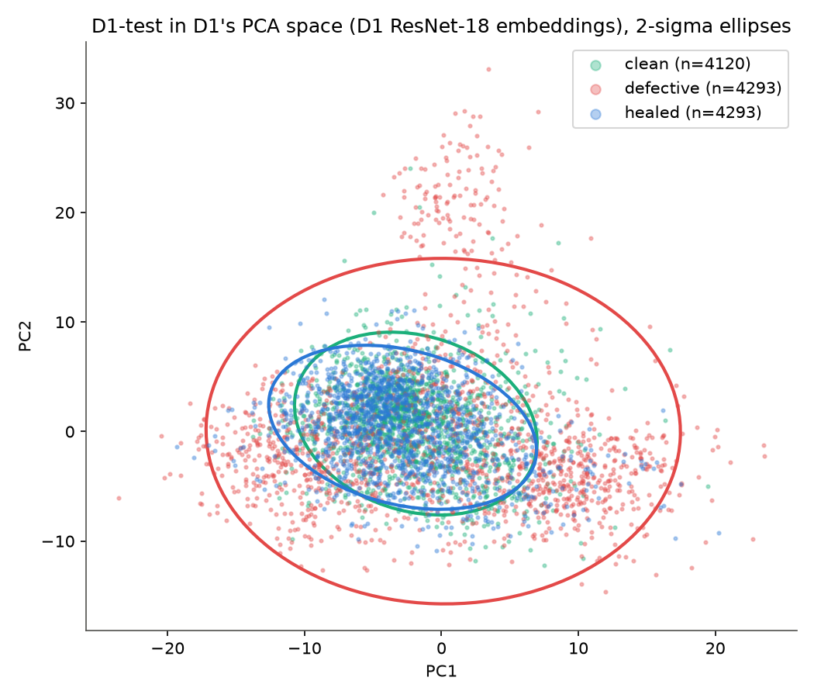

# Step 4: did the healing work?

All numbers on D1-test (4,293 defect crops, their healed versions, 4,120 real clean patches, unfiltered). Selection, where any, on D1-val.

## Artifact probe (the critical check)

| probe task | fine-tuned ResNet-18 test AUROC | linear probe on D1 embeddings, test AUROC |
|---|---|---|
| healed vs real clean | **1.000** | 0.968 |
| clean with random region inpainted vs real clean | **1.000** | 0.931 |

AUROC near 1 means the inpainting leaves a fingerprint a Stage 1 network can learn; 0.5 means it cannot tell.

Both probes reach about 0.9999 val AUROC after one epoch. Control: clean patches re-saved as JPEG q95 with nothing inpainted vs real clean give test AUROC **0.502** (`probe_reencode.py`, 2 epochs). The second JPEG save is therefore not the cue; the inpainted pixels are. The linear probe on frozen D1 embeddings (0.93 to 0.97) shows the fingerprint even survives into the features of a network that was never trained to look for it.

## Teacher-student score

| comparison | AUROC | target |
|---|---|---|
| original vs healed | 0.590 | high |
| healed vs real clean | 0.539 | about 0.5 |
| (reference) defective vs real clean | 0.621 | step-2 baseline |
| (reference) clean with random region inpainted vs real clean | 0.479 | about 0.5 |
| (sensitivity) healed vs filtered real clean | 0.566 | |

Share of crops whose score went down after healing: 82.0%. Mean score: defective 0.419, healed 0.376, clean 0.358, clean_inpainted 0.346.

## KL divergence in D1's PCA space (k = 32, one crop per image, mean ± std over 5 seeds)

| pair | estimator | n | KL(P‖Q) | KL(Q‖P) | symmetric |
|---|---|---|---|---|---|
| noise floor (clean half vs clean half) | gaussian | 900 | 1.15 ± 0.13 | 1.11 ± 0.21 | 1.13 ± 0.17 |
| noise floor (clean half vs clean half) | knn | 900 | 0.92 ± 0.81 | 0.03 ± 0.78 | 0.48 ± 0.21 |
| defective || clean | gaussian | 900 | 15.45 ± 0.94 | 8.11 ± 0.27 | 11.78 ± 0.59 |
| defective || clean | knn | 900 | 7.32 ± 0.34 | 10.59 ± 0.36 | 8.96 ± 0.22 |
| healed || clean | gaussian | 900 | 5.09 ± 0.14 | 6.49 ± 0.13 | 5.79 ± 0.12 |
| healed || clean | knn | 900 | 4.50 ± 0.24 | 3.47 ± 0.33 | 3.98 ± 0.19 |
| clean_inpainted || clean | gaussian | 900 | 3.24 ± 0.23 | 5.55 ± 0.70 | 4.40 ± 0.46 |
| clean_inpainted || clean | knn | 900 | 2.58 ± 0.21 | 0.91 ± 0.15 | 1.75 ± 0.18 |

## D1 classifier on healed crops (paired with their originals)

| class | P(original class) before | after | correct before | correct after |
|---|---|---|---|---|
| all | 0.852 | 0.458 | 0.880 | 0.485 |
| corrosion | 0.650 | 0.200 | 0.709 | 0.212 |
| crack | 0.917 | 0.373 | 0.940 | 0.382 |
| dent | 0.871 | 0.678 | 0.899 | 0.731 |
| missing-head | 0.957 | 0.139 | 0.967 | 0.133 |
| paint-peel-off | 0.650 | 0.214 | 0.689 | 0.202 |
| scratch | 0.688 | 0.508 | 0.711 | 0.567 |

Visual grids: `step4_grid_<class>.png` (10 random each) and `step4_grid_worst10.png`.
