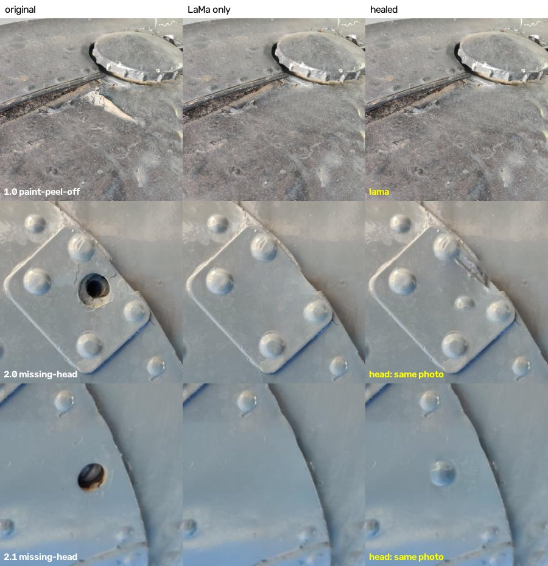

# 2. Healer: remove defects with LaMa, put missing screw heads back

Give it aircraft photos plus the defect boxes, and it returns the photos with the damage removed:

- **every defect** (crack, dent, corrosion, scratch, paint-peel-off) is painted over with **LaMa**, a pretrained
  inpainting model, so the spot looks like undamaged skin;
- a **missing-head** hole is first removed with LaMa, then a **real intact screw head** is copied from elsewhere in
  the same photo (or from a small bank of 16 heads), scaled to the hole and blended in.

It replaces the earlier healing experiment (U-Net inpainter + teacher-student), which was stopped because a
detector told its patches from real ones with AUROC 1.000.



*Original | LaMa only | healed. Row 1: paint peel removed. Rows 2-3: missing heads, each replaced by a rivet
copied from the same photo (row 2's is a little small).*

## 1. Setup (once)

**Downloads** (put each zip in the repo root `defect-inspection-sdp/` and unzip it there; files land in place):

| file | where | what |
|---|---|---|
| `lama_weights.zip` (206 MB) | team Google Drive, next to `enhanced_res_onnx.zip` | LaMa -> `2_lama_healing/weights/big-lama.pt` |
| `enhanced_res_model.zip` (136 MB) | GitHub Releases, `v2.0-enhanced-res` | our main model; its backbone is used to recognise screw heads |
| `D1_raw.zip` (756 MB), optional | team Google Drive | only for `--d1` mode and to open D1 photos with their labels |

SHA-256: `lama_weights.zip` `767f75bb4b4905e11255e64326c6688db74fe5eb15f7315509193c58f994a442`,
`big-lama.pt` `7ba7aa7ac37a4d41fdbbeba3a2af7ead18058552997e3a3cd1a3b2210c9e6b4c`
(PowerShell: `Get-FileHash lama_weights.zip -Algorithm SHA256`).

**Python 3.13**, from `2_lama_healing/` in PowerShell:

```powershell
py -3.13 -m venv .venv
.\.venv\Scripts\Activate.ps1
pip install torch==2.14.0 torchvision==0.29.0 --index-url https://download.pytorch.org/whl/cu130
pip install -r requirements.txt
```

An NVIDIA GPU is used automatically if there is one (about 1-2 s per photo); CPU works but is slower.
The first photo of a run takes ~10 s longer (models warming up).

## 2. The easy way: the GUI

```powershell
python heal_gui.py
```

1. Wait until the status says **Ready**.
2. **Open photo**. If it has a YOLO label file (D1 photos do, or `photo.txt` next to `photo.jpg`), its boxes load.
3. To add a box: choose the class in the dropdown, **left-drag** on the original. **Right-click** a box to delete it.
4. **Run healing**: original | LaMa only | healed, and a log of what was done to each box.
5. **Save result** writes the healed photo as PNG.

## 3. Many photos at once (command line)

The defect boxes can come from **YOLO label files** or from **one CSV file**.

**a) A folder of photos with YOLO label files** (`photo.jpg` + `photo.txt`, D1 class order:
0 crack, 1 dent, 2 corrosion, 3 scratch, 4 missing-head, 5 paint-peel-off):

```powershell
python heal.py C:\path\to\photos --out C:\path\to\healed
```

Label files are looked for next to each photo, in `--labels <folder>`, or in a sibling `labels/` folder
(the D1 layout `images/<split>/x.jpg` -> `labels/<split>/x.txt`).

**b) A folder of photos + a CSV of boxes** (easiest for your own photos; pixel coordinates, class names):

```csv
file,cls,x1,y1,x2,y2
panel_01.jpg,missing-head,296,380,391,465
panel_01.jpg,crack,120,80,260,190
panel_02.jpg,corrosion,40,55,210,160
```

```powershell
python heal.py C:\path\to\photos --boxes boxes.csv --out C:\path\to\healed
```

A photo can have several rows (several defects). Photos without any box are skipped and listed.
Excel-saved CSVs work.

**c) Other ways in**

```powershell
python heal.py a.jpg b.jpg c.jpg                                  # a list of photos (YOLO labels next to them)
python heal.py a.jpg --box 296 380 391 465 --cls missing-head     # one photo, boxes typed in (repeat --box/--cls)
python heal.py --d1 test --n 25                                   # 25 D1 test photos with missing heads (D1_raw.zip)
python heal.py --help                                             # all options
```

**What you get in the output folder** (default `out/run_<date_time>/`):

| file | what |
|---|---|
| `<photo>_healed.png` | the healed photo (same size as the input) |
| `<photo>_lama.png` | LaMa only, without screw heads (with `--save-lama`) |
| `sheet_*.png` | close-ups of every missing head: original / LaMa only / healed |
| `log.csv` | one line per box: what was done (`lama`, `head: same photo`, `head: donor bank`, `lama only (...)`) and why |
| `summary.md` | counts per route |
| `run.log` | live progress: `Get-Content out\<run>\run.log -Wait` in a second PowerShell |

## 4. How it decides, per box

```
defect box ──► LaMa removes it (all boxes of a photo in one pass)
   │
   ├─ not missing-head ──────────────────────────────────────────► done
   │
   └─ missing-head
        ├─ box under 16 px (distant shot) ───────────────────────► LaMa only ("too small for a head")
        ├─ measure the hole and its countersink ring
        ├─ intact head in the SAME photo?  (round, not a hole, similar size, nearby,
        │                                   and the screw-head scorer says >= 0.5)
        │      └─ paste (scaled, Poisson-blended) + quality check ─► "head: same photo"
        ├─ else best match from the DONOR BANK (16 heads) ─────────► "head: donor bank"
        └─ nothing passes the quality check ───────────────────────► LaMa only, flagged in log.csv
```

The class comes from the label (YOLO file, CSV, or GUI). Nothing decides the class automatically here; for
photos without labels, the main model (`1_main_model_resnet18/predict.py`) can classify a box first.

## 5. How well it works (D1 test photos, judged by eye)

On 25 unseen test photos (+8 photos of other defects), 33 missing heads were big enough to fix:

| result | heads |
|---|---|
| good (looks like the original screw/rivet) | 12 |
| passable (right idea; a bit small, pale or smudged) | 6 |
| poor (a blob, a dot, or a wrong donor such as a paint chip) | 10 |
| LaMa only, flagged (no donor passed the checks) | 5 |

Another 149 missing heads were in distant shots (boxes of 2-8 px) and got LaMa only. All 98 other defects got
LaMa. LaMa alone, on 10 mixed defects, healed 9 of 10 well enough that the damage is hard to spot.

**Known limits.** The screw-head scorer was trained on only 16 heads, so it sometimes accepts paint chips or blobs
as donors. Pasted heads can be slightly smaller or brighter than their neighbours. LaMa leaves out repeating detail
(rivet rows) inside large fills. These are images that look right to a person: they have **not** been checked
against a detector, so don't use them as "no damage" training data without that test.

## 6. Improving the screw-head scorer

The donor bank and the scorer come from D1 **train** photos (`build_donor_bank.py`):

```powershell
python build_donor_bank.py --mine --photos 140                  # candidates -> donor_bank/candidates_sheet_*.png
python build_donor_bank.py --keep 21 23 26 ...                   # the numbers that are clean intact heads -> bank
python build_donor_bank.py --train-scorer --ambiguous 5 7 ...    # retrain the "is it a screw head" scorer
```

The current bank keeps candidates 21 23 26 28 35 37 52 53 62 88 90 96 100 102 110 174; the scorer was trained
with 5 7 8 17 18 22 27 29 30 31 40 47 55 61 63 67 69 89 91 97 98 99 101 104 107 125 126 150 166 175 182 201 205
left out as ambiguous (5-fold CV: 15/16 heads found, 10/157 non-heads accepted). More heads and more "not a head"
examples (paint chips, stains, letters) are the main way to make it better. `--mine` overwrites the candidate
numbering, so re-pick `--keep` after it.

## Files

| file | what |
|---|---|
| `heal_gui.py` | the GUI |
| `heal.py` | command line: one photo, a folder, a CSV, or D1 samples |
| `fastener.py` | hole measurement, donor search, hole-vs-head test, quality check |
| `hcore.py` | box readers (YOLO, CSV), LaMa, the screw-head transplant |
| `build_donor_bank.py` | builds the donor bank and trains the screw-head scorer |
| `donor_bank/` | 16 heads (`heads/`, `bank.json`), the scorer (`head_scorer.npz`), the mined candidates |
| `weights/` | `big-lama.pt` (from `lama_weights.zip`, not in git) |
| `out/` | your runs (not in git) |
