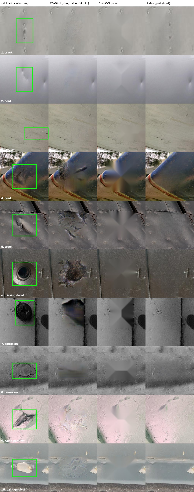

# Healing the 10 D1 defects with LaMa (pretrained) vs our CD-GAN

**Result in one line:** LaMa heals 9 of 10 images well enough that the damage is hard or impossible to spot at a
glance (CD-GAN: 4 of 10), in about 1 s per photo with no training. Close up, the main tell is that repeating
detail (rivets) inside the filled area is missing. One run. This comparison is why the healer uses LaMa.

*Columns: original (labelled box) | our CD-GAN (inspired by Yu et al., EMBC 2025; trained 62 min on self-mined
"normal" windows from D1; its code is not in the repo) | OpenCV inpainting | LaMa.*

## Setup
- Model: big-lama (TorchScript, `weights/big-lama.pt`, 205.8 MB, from github.com/enesmsahin/simple-lama-inpainting
  release v0.1.0). Pretrained on Places; nothing trained here.
- Same 10 images and **same mask** as the CD-GAN (labelled box grown 12% per side), so only the inpainter differs.
- LaMa sees the **whole photo at native resolution** (640x640 to 1024x1240) with the mask, then the window is cut out.
- Checked: pixels outside the mask are unchanged (max |diff| = 0).
- Time on the RTX 2050: ~0.9 s per photo (3 s for the first call / each new photo size, which triggers a re-compile).

## Verdicts (by eye, 256 px sheet + native-resolution spot checks)

| # | class | CD-GAN | **LaMa** | notes on LaMa |
|---|---|---|---|---|
| 1 | crack | good | passable | crack gone, but faint dark marks stay where it continued the rivet line |
| 2 | dent | good | **excellent** | seamless |
| 3 | scratch | passable | **excellent** | seamless |
| 4 | dent | failed | **excellent** | blue nose cone and red stripe continued through the patch |
| 5 | crack | failed | **good** | panel seam continued; close up, the rivets inside the patch are missing |
| 6 | missing-head | failed | **good** | hole replaced by plain panel (no fastener head is invented) |
| 7 | corrosion | failed | **good** | corroded screw head removed, faint speckle left |
| 8 | corrosion | passable | **excellent** | seamless |
| 9 | paint-peel-off | good | **good** | the peel's tip above the labelled box stays (outside the mask) |
| 10 | paint-peel-off | good | **excellent** | the second peel to the right is a separate, unmasked defect |

**Score: LaMa 9/10 good or better (5 excellent), 1 passable. CD-GAN 4 good, 2 passable, 4 failed.**

Classifier proxy (enhanced_res p(true class), weak: it has no "no damage" class and must pick a defect):
see `summary.md`. LaMa drops it on 8/10; #4 stays "dent" (0.96) and #5 "crack" (0.56) even though the damage is
visibly gone, which again shows the proxy is not a healing measure.

## What still gives it away, and how to fix it
1. **Missing repeating detail** (rivets, fastener heads) inside the fill: LaMa continues texture and lines, not
   objects. Fix: Stable Diffusion inpainting with a prompt ("riveted aluminium panel, no damage"), ~2 GB download.
2. **Damage that extends past the label box** stays (#9, and any unlabelled damage nearby). Fix: tighter-but-complete
   masks from SAM (Segment Anything), ~375 MB, or simply growing the box more.
3. **Slightly softer than the surroundings** at native resolution on big patches. Fix: add matched grain/noise.

**Caveat for training data:** looking right to a person is not the same as looking right to a network. The team's
healing experiment found a detector tells inpainted patches from real ones with AUROC 1.000. Before using healed
images as a "no damage" class, run that same check on these.

## Files
- `compare_sheet.jpg`: original | CD-GAN | OpenCV | LaMa for all 10
- `summary.md`: classifier proxy scores and timing
- The LaMa call used here is `hcore.lama` in the healer; `python ../../heal.py <photo> --box ... --cls ...` repeats
  it on any photo.
