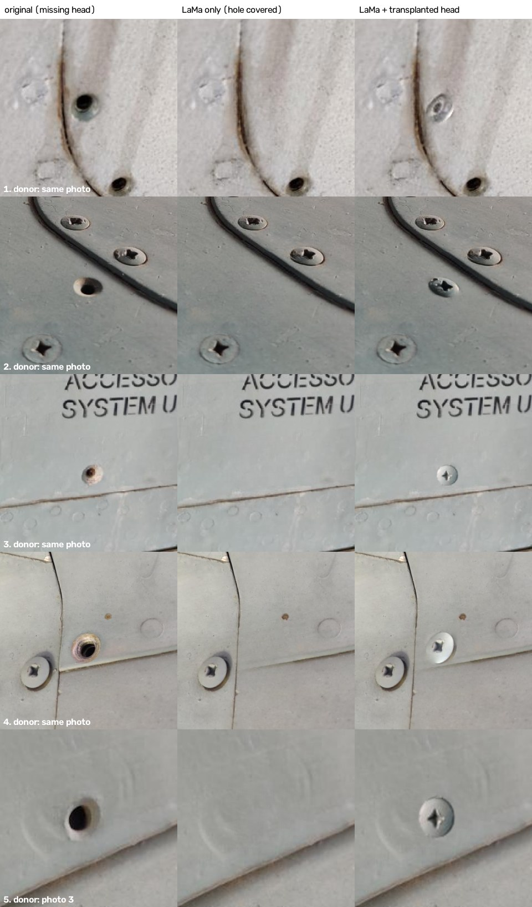

# Missing heads: replacing the fastener instead of covering the hole

LaMa alone (middle column) covers a missing-head hole with plain skin: it continues texture, it can't invent an
object. Here every hole gets a **real fastener head transplanted from the same photo** (photo 5 has no intact
fastener, so its head comes from photo 3), after LaMa has removed the hole.

This was the hand-made proof of concept; the healer (`heal.py`) now does the same automatically
(see [`../framework_report.md`](../framework_report.md); its run on these 5 photos is in `../runs/manual5/`).

## Method (the paste is `hcore.transplant` in the healer)
1. 5 missing-head defects from d1_grouped **test** photos, 5 different source groups, picked at random (seed 2);
   one head fixed per photo (photos 1 and 3 have 1 and 3 more missing heads, left as they are).
2. LaMa removes the hole (labelled box grown 12%, whole photo, native resolution).
3. Hole and donor centres and ellipse radii were read **by eye** from 4x zooms with pixel rulers (`zoom.jpg`).
   The donor is scaled separately in x and y to the hole's ellipse (handles perspective, e.g. photo 2) and 5% larger
   so it covers the countersink rim.
4. Poisson blending (`cv2.seamlessClone`, NORMAL_CLONE) over the head plus a thin ring of skin: head texture is
   kept, colour adapts to the new spot.

## Result (by eye)
| # | donor | verdict | note |
|---|---|---|---|
| 1 | same photo (flush rivet) | good | slightly small and shinier than its neighbours |
| 2 | same photo (Phillips, same row = same perspective) | passable | right type and angle, but darker: the donor's paint was chipped |
| 3 | same photo (Phillips) | **excellent** | looks original |
| 4 | same photo (Phillips) | good | a touch brighter than the neighbouring head |
| 5 | photo 3 (Phillips) | good | colours matched to the new panel |

enhanced_res's p(missing-head) goes 0.97 -> ~0.03 with LaMa only and back up to 0.36-0.88 with a head. That is
not a failure: the classifier has no "intact fastener" class and every centred fastener it was trained on was a
missing-head, so any fastener head looks like that class to it.

## Limits
- Semi-manual: a person picks the donor and measures the hole. Automating it needed a fastener detector (circle
  detection + a small classifier), which is what the healer's `fastener.py` + screw-head scorer now do.
- Brightness can be off (2 darker, 4 brighter): pick a cleaner donor, or match the head's mean brightness to its
  neighbours after blending.
- A cross-photo donor (5) works when the paint is similar; a very different finish would need a donor bank.
- The alternative without a donor is Stable Diffusion inpainting with a prompt such as "Phillips countersunk
  screw head" (~2 GB download), which invents the head rather than copying a real one.
