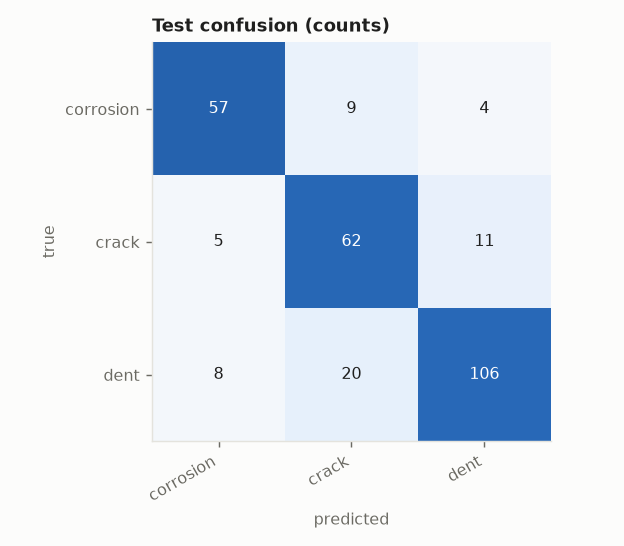
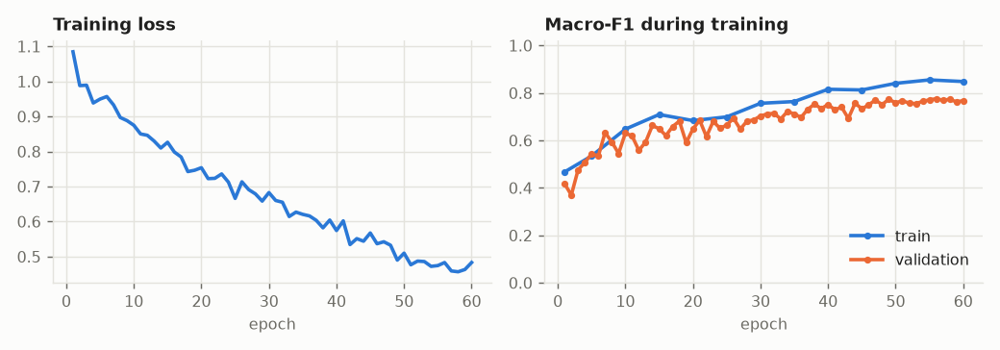
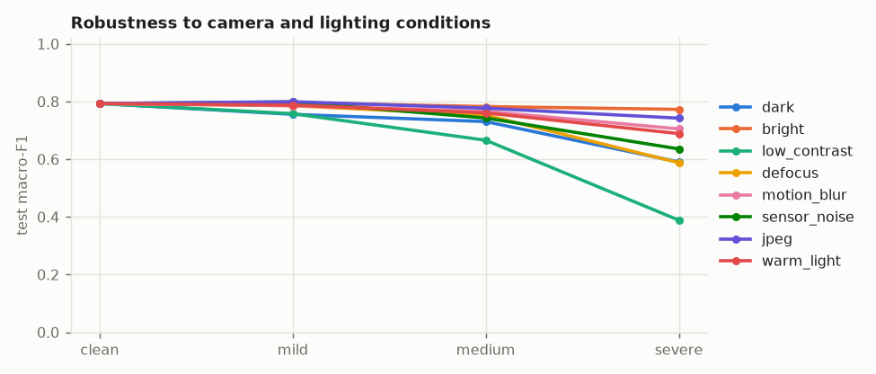
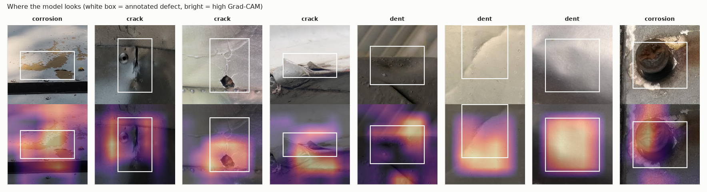
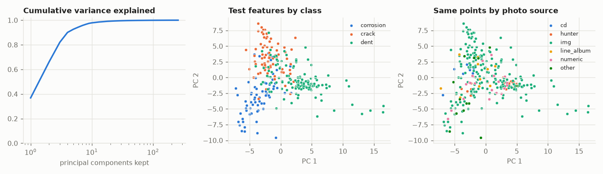

# Evaluation: baseline-simple on aircraft

## 1. Test scores (imbalance-aware)

282 test crops from 177 photos that the model never saw in any form.

| metric | value | 95% interval |
|---|---|---|
| macro-F1 | 0.793 | 0.731 to 0.838 |
| balanced accuracy | 0.800 | 0.744 to 0.848 |
| accuracy | 0.798 | always guessing the largest class scores 0.475 |
| calibration error (ECE) | 0.039 | 0 = the stated confidence is trustworthy |

| class | precision | recall | F1 | test crops |
|---|---|---|---|---|
| corrosion | 0.814 | 0.814 | 0.814 | 70 |
| crack | 0.681 | 0.795 | 0.734 | 78 |
| dent | 0.876 | 0.791 | 0.831 | 134 |

## 2. Overfitting

| split | macro-F1 | balanced accuracy |
|---|---|---|
| train | 0.858 | 0.863 |
| val | 0.776 | 0.777 |
| test | 0.793 | 0.800 |

Train minus test macro-F1: **+0.065**. A large gap means the model memorised training crops. Val is not a clean number: it chose the checkpoint.

## 3. Distribution shift

Same test crops, degraded the way a helmet camera in a hangar would degrade them. Macro-F1:

| condition | mild | medium | severe |
|---|---|---|---|
| dark | 0.756 | 0.730 | 0.590 |
| bright | 0.796 | 0.783 | 0.773 |
| low_contrast | 0.758 | 0.666 | 0.389 |
| defocus | 0.786 | 0.753 | 0.588 |
| motion_blur | 0.786 | 0.766 | 0.705 |
| sensor_noise | 0.798 | 0.743 | 0.636 |
| jpeg | 0.800 | 0.777 | 0.742 |
| warm_light | 0.788 | 0.761 | 0.689 |

Clean 0.793 -> mean under corruption **0.723** (91% retained). Weakest condition: low_contrast.

Score by photo source (guessed from filename prefixes). A source that scores far below the rest is a shift the model has not absorbed:

| source | test crops | accuracy | balanced accuracy |
|---|---|---|---|
| cd | 7 | 0.857 | 0.917 |
| hunter | 21 | 0.905 | 0.644 |
| img | 210 | 0.805 | 0.814 |
| line_album | 10 | 0.500 | 0.500 |
| numeric | 21 | 0.667 | 0.523 |
| other | 13 | 0.923 | 0.963 |

## 4. Shortcut learning

Each test crop comes with the annotator's box around the defect, so we can ask what the model actually used. Balanced accuracy over the defect classes:

| what the model can see | balanced accuracy | what we want |
|---|---|---|
| defect and context both visible | 0.800 | reference |
| defect painted over (context only) | 0.487 | should fall towards chance (0.333) |
| context painted over (defect only) | 0.661 | should stay near the reference (necessary, not sufficient) |

**Context reliance: 33%** of the model's above-chance skill survives with the defect hidden (0% = it needs to see the defect; 100% = it never needed to).

Grad-CAM: 50% of the heat lands inside the defect box, which covers 34% of the crop on average: **1.47x** what uniform attention would give (above 1 = looks at the defect; at or below 1 = looks elsewhere).

Caveats: the defect-hidden row is the decisive one. The context-hidden row cannot rule out a colour shortcut, because the surface colour is still visible inside the box. A painted rectangle also reveals the box's shape (a long thin box hints at a crack), so read these as a comparison between models, not as absolute proof.

## 5. PCA of the learned features

The model's feature vector has 256 dimensions. PCA on the training features: 4 components hold 90% of the variance, 7 hold 95%, 17 hold 99%.

Test macro-F1 of a plain linear classifier on only the first k principal components:

| components kept | 2 | 4 | 8 | 16 | 32 | 64 | 256 |
|---|---|---|---|---|---|---|---|
| macro-F1 | 0.768 | 0.784 | 0.797 | 0.812 | 0.822 | 0.836 | 0.837 |

If the score saturates at a small k, the rest of the feature space is spare capacity that can only memorise.

Source probe: a linear classifier predicts which photo source a test crop came from with balanced accuracy 0.691 (chance 0.167). High means the features carry "which camera/collection" information; combined with a class-source imbalance in `data_audit.py`, that is the shortcut to worry about.

