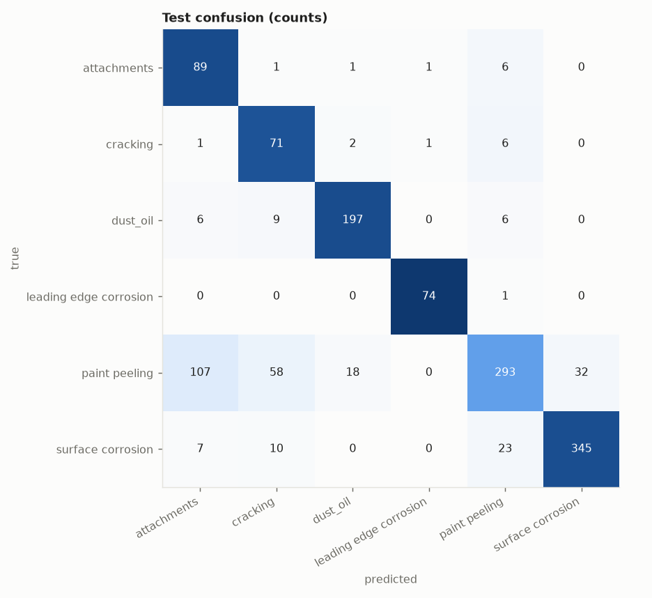
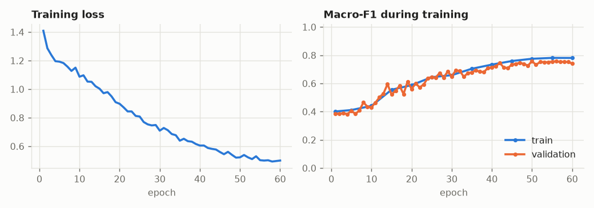
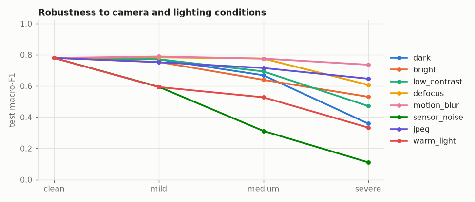
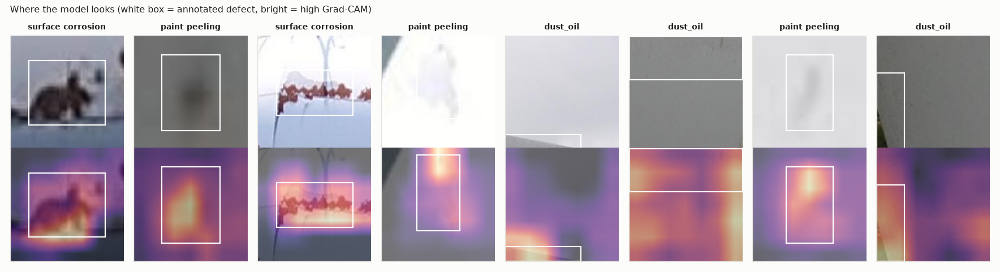
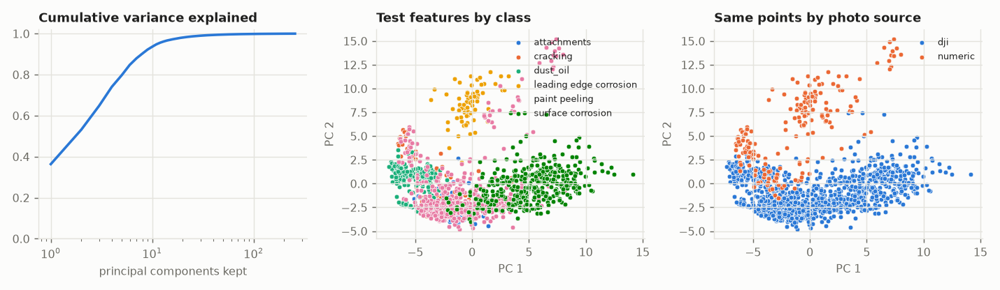

# Evaluation: baseline-simple on turbine

## 1. Test scores (imbalance-aware)

1365 test crops from 382 photos that the model never saw in any form.

| metric | value | 95% interval |
|---|---|---|
| macro-F1 | 0.780 | 0.615 to 0.804 |
| balanced accuracy | 0.858 | 0.823 to 0.878 |
| accuracy | 0.783 | always guessing the largest class scores 0.372 |
| calibration error (ECE) | 0.027 | 0 = the stated confidence is trustworthy |

| class | precision | recall | F1 | test crops |
|---|---|---|---|---|
| attachments | 0.424 | 0.908 | 0.578 | 98 |
| cracking | 0.477 | 0.877 | 0.617 | 81 |
| dust_oil | 0.904 | 0.904 | 0.904 | 218 |
| leading edge corrosion | 0.974 | 0.987 | 0.980 | 75 |
| paint peeling | 0.875 | 0.577 | 0.695 | 508 |
| surface corrosion | 0.915 | 0.896 | 0.906 | 385 |

## 2. Overfitting

| split | macro-F1 | balanced accuracy |
|---|---|---|
| train | 0.775 | 0.861 |
| val | 0.758 | 0.840 |
| test | 0.780 | 0.858 |

Train minus test macro-F1: **-0.005**. A large gap means the model memorised training crops. Val is not a clean number: it chose the checkpoint.

## 3. Distribution shift

Same test crops, degraded the way a helmet camera in a hangar would degrade them. Macro-F1:

| condition | mild | medium | severe |
|---|---|---|---|
| dark | 0.770 | 0.669 | 0.359 |
| bright | 0.754 | 0.639 | 0.531 |
| low_contrast | 0.771 | 0.693 | 0.471 |
| defocus | 0.784 | 0.776 | 0.607 |
| motion_blur | 0.789 | 0.776 | 0.736 |
| sensor_noise | 0.595 | 0.312 | 0.111 |
| jpeg | 0.752 | 0.715 | 0.647 |
| warm_light | 0.593 | 0.527 | 0.333 |

Clean 0.780 -> mean under corruption **0.613** (79% retained). Weakest condition: sensor_noise.

Score by photo source (guessed from filename prefixes). A source that scores far below the rest is a shift the model has not absorbed:

| source | test crops | accuracy | balanced accuracy |
|---|---|---|---|
| dji | 1161 | 0.768 | 0.822 |
| numeric | 204 | 0.868 | 0.759 |

## 4. Shortcut learning

Each test crop comes with the annotator's box around the defect, so we can ask what the model actually used. Balanced accuracy over the defect classes:

| what the model can see | balanced accuracy | what we want |
|---|---|---|
| defect and context both visible | 0.858 | reference |
| defect painted over (context only) | 0.647 | should fall towards chance (0.167) |
| context painted over (defect only) | 0.586 | should stay near the reference (necessary, not sufficient) |

**Context reliance: 70%** of the model's above-chance skill survives with the defect hidden (0% = it needs to see the defect; 100% = it never needed to).

Grad-CAM: 42% of the heat lands inside the defect box, which covers 29% of the crop on average: **1.46x** what uniform attention would give (above 1 = looks at the defect; at or below 1 = looks elsewhere).

Caveats: the defect-hidden row is the decisive one. The context-hidden row cannot rule out a colour shortcut, because the surface colour is still visible inside the box. A painted rectangle also reveals the box's shape (a long thin box hints at a crack), so read these as a comparison between models, not as absolute proof.

## 5. PCA of the learned features

The model's feature vector has 256 dimensions. PCA on the training features: 8 components hold 90% of the variance, 12 hold 95%, 30 hold 99%.

Test macro-F1 of a plain linear classifier on only the first k principal components:

| components kept | 2 | 4 | 8 | 16 | 32 | 64 | 256 |
|---|---|---|---|---|---|---|---|
| macro-F1 | 0.586 | 0.715 | 0.796 | 0.795 | 0.795 | 0.800 | 0.807 |

If the score saturates at a small k, the rest of the feature space is spare capacity that can only memorise.

Source probe: a linear classifier predicts which photo source a test crop came from with balanced accuracy 0.978 (chance 0.500). High means the features carry "which camera/collection" information; combined with a class-source imbalance in `data_audit.py`, that is the shortcut to worry about.

