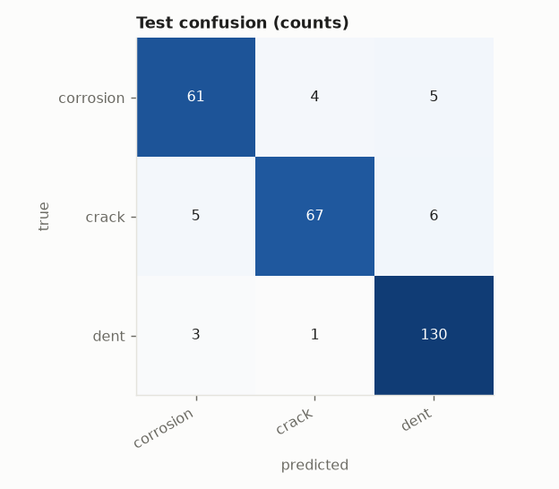
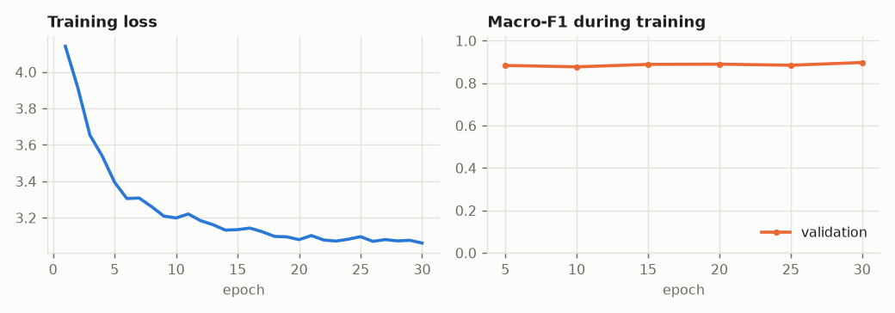
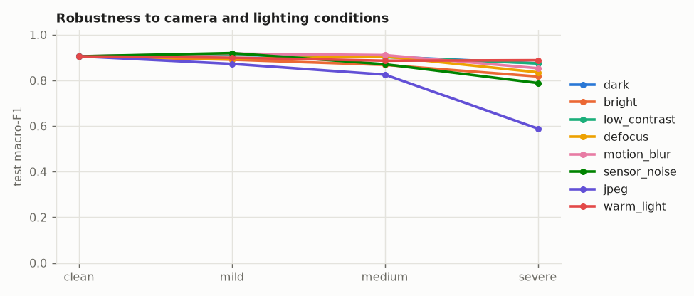
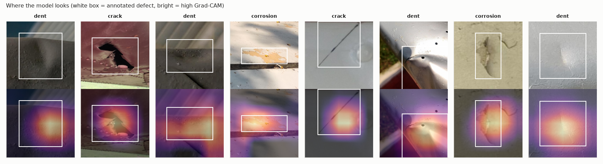
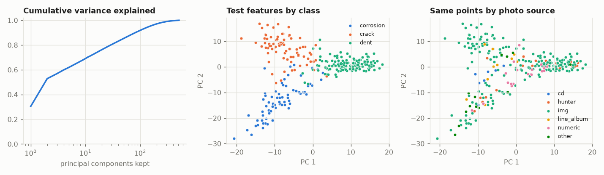

# Evaluation: supcon-resnet18 on aircraft

## 1. Test scores (imbalance-aware)

282 test crops from 177 photos that the model never saw in any form.

| metric | value | 95% interval |
|---|---|---|
| macro-F1 | 0.905 | 0.840 to 0.948 |
| balanced accuracy | 0.900 | 0.840 to 0.946 |
| accuracy | 0.915 | always guessing the largest class scores 0.475 |
| calibration error (ECE) | 0.038 | 0 = the stated confidence is trustworthy |

| class | precision | recall | F1 | test crops |
|---|---|---|---|---|
| corrosion | 0.884 | 0.871 | 0.878 | 70 |
| crack | 0.931 | 0.859 | 0.893 | 78 |
| dent | 0.922 | 0.970 | 0.945 | 134 |

## 2. Overfitting

| split | macro-F1 | balanced accuracy |
|---|---|---|
| train | 1.000 | 1.000 |
| val | 0.902 | 0.902 |
| test | 0.905 | 0.900 |

Train minus test macro-F1: **+0.095**. A large gap means the model memorised training crops. Val is not a clean number: it chose the checkpoint.

## 3. Distribution shift

Same test crops, degraded the way a helmet camera in a hangar would degrade them. Macro-F1:

| condition | mild | medium | severe |
|---|---|---|---|
| dark | 0.911 | 0.904 | 0.875 |
| bright | 0.890 | 0.868 | 0.817 |
| low_contrast | 0.912 | 0.902 | 0.874 |
| defocus | 0.894 | 0.905 | 0.836 |
| motion_blur | 0.917 | 0.911 | 0.853 |
| sensor_noise | 0.920 | 0.871 | 0.788 |
| jpeg | 0.872 | 0.825 | 0.589 |
| warm_light | 0.899 | 0.886 | 0.888 |

Clean 0.905 -> mean under corruption **0.867** (96% retained). Weakest condition: jpeg.

Score by photo source (guessed from filename prefixes). A source that scores far below the rest is a shift the model has not absorbed:

| source | test crops | accuracy | balanced accuracy |
|---|---|---|---|
| cd | 7 | 0.286 | 0.583 |
| hunter | 21 | 1.000 | 1.000 |
| img | 210 | 0.952 | 0.935 |
| line_album | 10 | 0.600 | 0.625 |
| numeric | 21 | 0.762 | 0.701 |
| other | 13 | 1.000 | 1.000 |

## 4. Shortcut learning

Each test crop comes with the annotator's box around the defect, so we can ask what the model actually used. Balanced accuracy over the defect classes:

| what the model can see | balanced accuracy | what we want |
|---|---|---|
| defect and context both visible | 0.900 | reference |
| defect painted over (context only) | 0.620 | should fall towards chance (0.333) |
| context painted over (defect only) | 0.804 | should stay near the reference (necessary, not sufficient) |

**Context reliance: 51%** of the model's above-chance skill survives with the defect hidden (0% = it needs to see the defect; 100% = it never needed to).

Grad-CAM: 57% of the heat lands inside the defect box, which covers 34% of the crop on average: **1.69x** what uniform attention would give (above 1 = looks at the defect; at or below 1 = looks elsewhere).

Caveats: the defect-hidden row is the decisive one. The context-hidden row cannot rule out a colour shortcut, because the surface colour is still visible inside the box. A painted rectangle also reveals the box's shape (a long thin box hints at a crack), so read these as a comparison between models, not as absolute proof.

## 5. PCA of the learned features

The model's feature vector has 512 dimensions. PCA on the training features: 82 components hold 90% of the variance, 146 hold 95%, 304 hold 99%.

Test macro-F1 of a plain linear classifier on only the first k principal components:

| components kept | 2 | 4 | 8 | 16 | 32 | 64 | 512 |
|---|---|---|---|---|---|---|---|
| macro-F1 | 0.894 | 0.905 | 0.906 | 0.911 | 0.907 | 0.899 | 0.904 |

If the score saturates at a small k, the rest of the feature space is spare capacity that can only memorise.

Source probe: a linear classifier predicts which photo source a test crop came from with balanced accuracy 0.652 (chance 0.167). High means the features carry "which camera/collection" information; combined with a class-source imbalance in `data_audit.py`, that is the shortcut to worry about.

