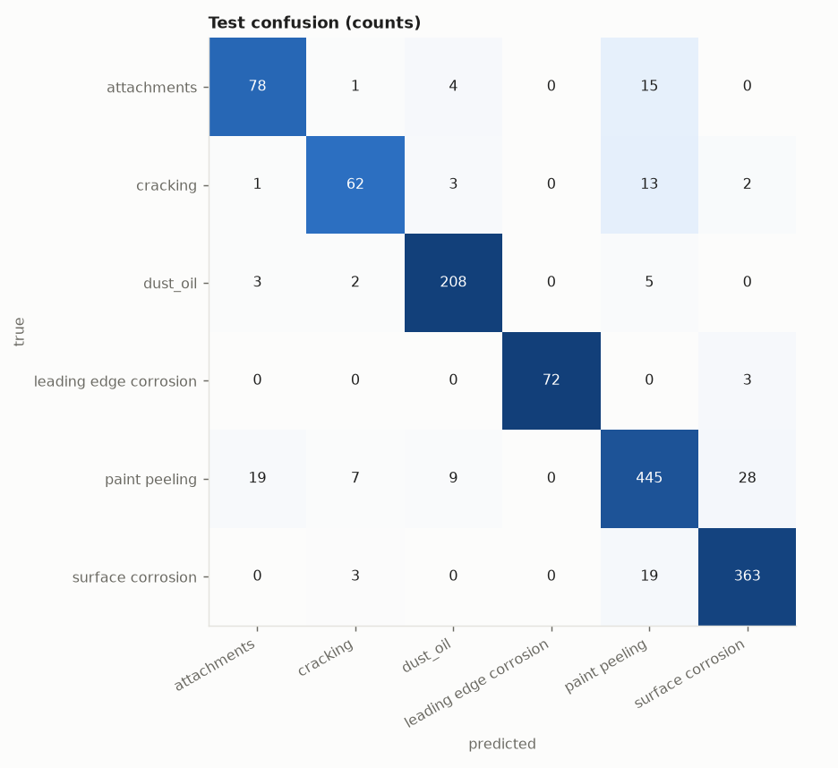
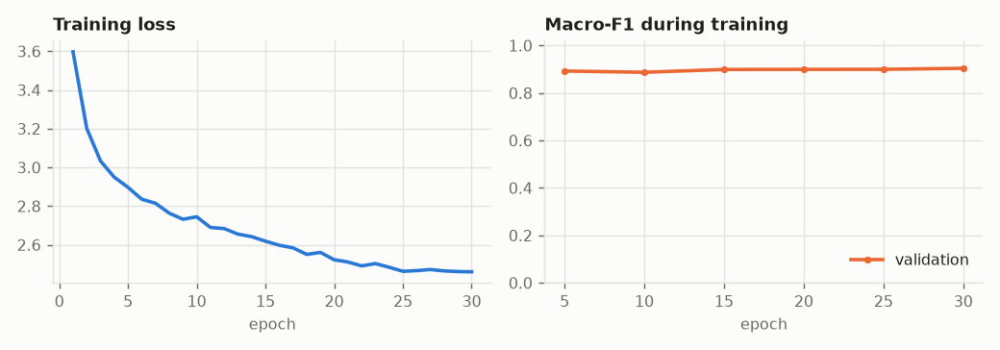
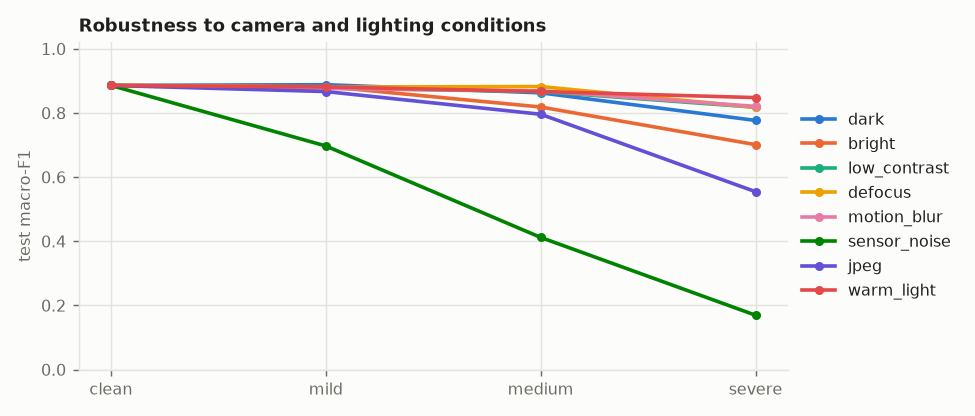
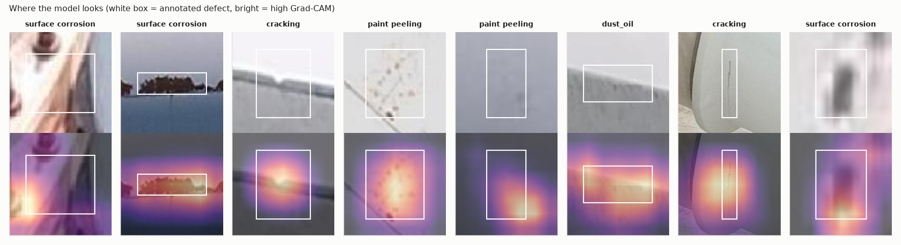
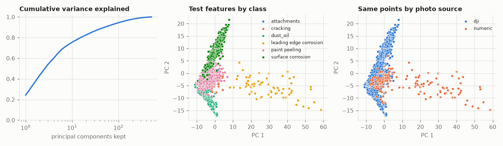

# Evaluation: supcon-resnet18 on turbine

## 1. Test scores (imbalance-aware)

1365 test crops from 382 photos that the model never saw in any form.

| metric | value | 95% interval |
|---|---|---|
| macro-F1 | 0.886 | 0.853 to 0.910 |
| balanced accuracy | 0.882 | 0.852 to 0.913 |
| accuracy | 0.900 | always guessing the largest class scores 0.372 |
| calibration error (ECE) | 0.046 | 0 = the stated confidence is trustworthy |

| class | precision | recall | F1 | test crops |
|---|---|---|---|---|
| attachments | 0.772 | 0.796 | 0.784 | 98 |
| cracking | 0.827 | 0.765 | 0.795 | 81 |
| dust_oil | 0.929 | 0.954 | 0.941 | 218 |
| leading edge corrosion | 1.000 | 0.960 | 0.980 | 75 |
| paint peeling | 0.895 | 0.876 | 0.886 | 508 |
| surface corrosion | 0.917 | 0.943 | 0.930 | 385 |

## 2. Overfitting

| split | macro-F1 | balanced accuracy |
|---|---|---|
| train | 0.987 | 0.991 |
| val | 0.902 | 0.896 |
| test | 0.886 | 0.882 |

Train minus test macro-F1: **+0.101**. A large gap means the model memorised training crops. Val is not a clean number: it chose the checkpoint.

## 3. Distribution shift

Same test crops, degraded the way a helmet camera in a hangar would degrade them. Macro-F1:

| condition | mild | medium | severe |
|---|---|---|---|
| dark | 0.888 | 0.863 | 0.777 |
| bright | 0.882 | 0.819 | 0.701 |
| low_contrast | 0.878 | 0.867 | 0.818 |
| defocus | 0.881 | 0.882 | 0.818 |
| motion_blur | 0.876 | 0.869 | 0.820 |
| sensor_noise | 0.697 | 0.412 | 0.169 |
| jpeg | 0.867 | 0.796 | 0.554 |
| warm_light | 0.881 | 0.867 | 0.848 |

Clean 0.886 -> mean under corruption **0.780** (88% retained). Weakest condition: sensor_noise.

Score by photo source (guessed from filename prefixes). A source that scores far below the rest is a shift the model has not absorbed:

| source | test crops | accuracy | balanced accuracy |
|---|---|---|---|
| dji | 1161 | 0.891 | 0.852 |
| numeric | 204 | 0.951 | 0.921 |

## 4. Shortcut learning

Each test crop comes with the annotator's box around the defect, so we can ask what the model actually used. Balanced accuracy over the defect classes:

| what the model can see | balanced accuracy | what we want |
|---|---|---|
| defect and context both visible | 0.882 | reference |
| defect painted over (context only) | 0.430 | should fall towards chance (0.167) |
| context painted over (defect only) | 0.456 | should stay near the reference (necessary, not sufficient) |

**Context reliance: 37%** of the model's above-chance skill survives with the defect hidden (0% = it needs to see the defect; 100% = it never needed to).

Grad-CAM: 51% of the heat lands inside the defect box, which covers 29% of the crop on average: **1.76x** what uniform attention would give (above 1 = looks at the defect; at or below 1 = looks elsewhere).

Caveats: the defect-hidden row is the decisive one. The context-hidden row cannot rule out a colour shortcut, because the surface colour is still visible inside the box. A painted rectangle also reveals the box's shape (a long thin box hints at a crack), so read these as a comparison between models, not as absolute proof.

## 5. PCA of the learned features

The model's feature vector has 512 dimensions. PCA on the training features: 50 components hold 90% of the variance, 111 hold 95%, 286 hold 99%.

Test macro-F1 of a plain linear classifier on only the first k principal components:

| components kept | 2 | 4 | 8 | 16 | 32 | 64 | 512 |
|---|---|---|---|---|---|---|---|
| macro-F1 | 0.696 | 0.848 | 0.886 | 0.882 | 0.891 | 0.886 | 0.887 |

If the score saturates at a small k, the rest of the feature space is spare capacity that can only memorise.

Source probe: a linear classifier predicts which photo source a test crop came from with balanced accuracy 0.971 (chance 0.500). High means the features carry "which camera/collection" information; combined with a class-source imbalance in `data_audit.py`, that is the shortcut to worry about.

