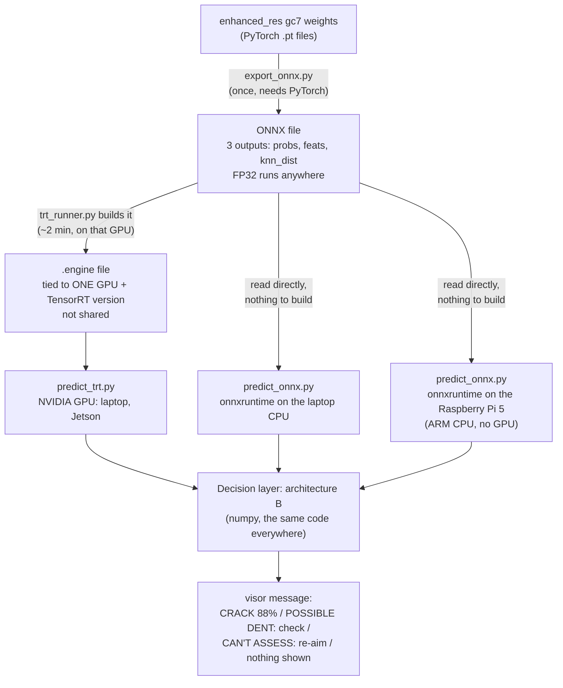

# enhanced_res on TensorRT and onnxruntime: NVIDIA GPU, laptop CPU, Raspberry Pi 5

The main model (**enhanced_res gc7**: ResNet-18 + 8-view TTA + MLP heads + 5-NN, seven classes) with the calibrated
decision layer (**architecture B**, see [`../1_main_model_resnet18/enhanced_res/arch_a/README.md`](../1_main_model_resnet18/enhanced_res/arch_a/README.md)),
exported **as a whole to one ONNX file** and run without PyTorch:

- **TensorRT** on an NVIDIA GPU (your laptop's RTX, later the Jetson Orin NX): the fastest.
- **onnxruntime** on any CPU, **including the Raspberry Pi 5** and your laptop's CPU.

`predict_trt.py` and `predict_onnx.py` are the two runtime versions of `1_main_model_resnet18/predict.py`: same crop, same
model, same answers.



**One ONNX file, three places.** The FP32 ONNX file is the only model file: onnxruntime reads it as it is (laptop CPU,
Raspberry Pi), and TensorRT turns it into an engine. The engine is *not* the model: it is that ONNX file compiled for
one GPU model and one TensorRT version, so every NVIDIA machine builds its own (about 2 minutes) and engines are never
shared. A second ONNX file, with the backbone in FP16, is only there to build the faster FP16 engine (TensorRT 11 takes
the precision from the ONNX file); the Pi and the CPU use the FP32 file.

| file | runs on | made by |
|---|---|---|
| `onnx/enhanced_res_gc7_full_fp32.onnx` (145 MB) | **everything**: onnxruntime on any CPU, TensorRT FP32 | `export_onnx.py` (or download) |
| `onnx/enhanced_res_gc7_full_fp16.onnx` (123 MB) | TensorRT FP16 only (not faster on a CPU) | `export_onnx.py` (or download) |
| `engines/*.engine` | one NVIDIA GPU | `trt_runner.py`, on that GPU |

What the ONNX file takes and gives: input `input` float32 `[N,3,224,224]` (an ImageNet-normalised 224 px crop; the 8
flips/rotations happen inside), outputs `probs` `[N,7]` (corrosion, crack, dent, missing-head, paint-peel-off, scratch,
no-defect), `feats` `[N,768]` (the features architecture B's "aircraft or not" check reads) and `knn_dist` `[N]` (how far
the crop is from its 5 nearest training crops). `predict_*.py` hand these to the decision layer.

## 1. Download (team Google Drive)

The ONNX files are over GitHub's 100 MB limit, so they are **not in git**. From the team's shared Google Drive (next to
`lama_weights.zip`; click **Download anyway** when Drive can't scan a big file):

| file | size | for |
|---|---|---|
| `enhanced_res_gc7_onnx.zip` | 243 MB | the PC: put it in the **repo root** (`defect-inspection-sdp/`) and unzip it there; the files land in `trt_enhanced_res/onnx/` |
| `enhanced_res_pi_bundle.zip` | 132 MB | the Raspberry Pi: copy it over and unzip anywhere (no repo needed); it has its own `README_PI.md` |

SHA-256 (PowerShell: `Get-FileHash <file> -Algorithm SHA256`):

| file | SHA-256 |
|---|---|
| `enhanced_res_gc7_onnx.zip` | `d10276587ea8622659a3751c655a59ef4177a84c0c5238920e62aca399777370` |
| `enhanced_res_pi_bundle.zip` | `78f72744ef837c5887c7986c617bfd219f6419bee96c1faf91d5475ddc3f33b9` |
| `enhanced_res_gc7_full_fp32.onnx` | `063ad7b5e033e03669ec5af7e70740be9b3ea2da8c9e38bf60e27802e757ac2a` |
| `enhanced_res_gc7_full_fp16.onnx` | `a028ede11a3e14288a34fc13a12781b4d605d89b1f779af333a47bc5582d97ea` |

(Windows Explorer shows the zip sizes in MiB: 231 and 126.)

You can also make the ONNX files yourself from the gc7 weights (section 5).

## 2. On an NVIDIA GPU (TensorRT)

Needs an NVIDIA GPU with **driver 580 or newer** (`nvidia-smi` shows `CUDA Version: 13.x`) and Python 3.13. In
PowerShell, from `trt_enhanced_res/`:

```powershell
py -3.13 -m venv .venv
.\.venv\Scripts\Activate.ps1
python -m pip install --upgrade pip
pip install tensorrt-cu13==11.4.0.106 cuda-python==13.4.4 numpy==2.5.3 pillow==12.3.0
python trt_runner.py                  # once: builds engines/enhanced_res_gc7_full_{fp32,fp16}.engine on THIS GPU (~2 min)
python predict_trt.py --selftest      # must end: SELFTEST: 30/30 ... OK
```

If PowerShell says "running scripts is disabled", run `Set-ExecutionPolicy -Scope Process -ExecutionPolicy Bypass` and
activate again. After a driver or TensorRT update, or a new ONNX file: `python trt_runner.py --rebuild`. Building needs
no PyTorch.

## 3. On a CPU (onnxruntime): your laptop, or the Raspberry Pi 5

**Laptop / any PC.** Same folder, any Python 3.11+:

```powershell
pip install onnxruntime==1.31.0 numpy pillow
python predict_onnx.py --selftest     # must end: SELFTEST: 30/30 ... OK
python predict_onnx.py --bench 20     # speed of one crop (8 views) on this CPU
```

**Raspberry Pi 5.** Copy `enhanced_res_pi_bundle.zip` to the Pi and follow the `README_PI.md` inside it. In short (64-bit
Raspberry Pi OS, Python 3.11+):

```bash
unzip enhanced_res_pi_bundle.zip -d enhanced_res_pi && cd enhanced_res_pi
python3 -m venv .venv && source .venv/bin/activate
pip install -r requirements_pi.txt
python predict_onnx.py --selftest     # 30/30 ... OK = the Pi gives the same answers as PyTorch
python predict_onnx.py --bench 20     # how fast it is on the Pi
```

The Pi's 16 GB of RAM makes no difference to the file: the model needs about 1 GB while running. What counts is the ARM
CPU with no GPU, which is why the Pi uses onnxruntime and the FP32 file.

**Speed on the Pi: not measured yet.** This laptop's CPU does one crop (8 views) in about 75-90 ms with 4 threads (it is a
fast x86 CPU); a Pi 5 core is several times slower, so my estimate is roughly 0.3-0.7 s per crop. Measure it with
`python predict_onnx.py --bench 20` and tell the team (the target is under 1 s per accepted frame). If it is too slow,
the options are fewer TTA views (needs re-calibrating) or an INT8 model.

## 4. Use it

Same commands for both scripts (`predict_trt.py` or `predict_onnx.py`), from `trt_enhanced_res/`:

```powershell
python predict_trt.py photo.jpg --box 120 80 260 190      # defect box in pixels of the photo: cut exactly like training
python predict_trt.py photo.jpg                           # no box: the centre square of the photo
python predict_trt.py ..\1_main_model_resnet18\samples\   # a folder; with labels.csv it prints the accuracy at the end
python predict_trt.py photo.jpg --precision fp16          # TensorRT only: the faster FP16 engine
python predict_trt.py photo.jpg --details                 # also the unfamiliar-input p-value and the full ranking
python predict_trt.py photo.jpg --alpha 0.05              # larger answer sets, fewer misses (0.05 / 0.10 / 0.20)
python predict_trt.py photo.jpg --raw --top 3             # the raw ranking, without architecture B
python predict_onnx.py photo.jpg --threads 4              # onnxruntime: how many CPU threads (default all)
```

What the visor shows (architecture B; details in the arch_a README):

| shown | meaning |
|---|---|
| (nothing shown: no damage) | only "no-defect" is likely enough to keep |
| POSSIBLE DENT: check | a defect and "no-defect" are both likely: a person should look |
| CRACK 88.0% | one class is likely enough to keep; the % is calibrated |
| AMBIGUOUS: crack 52% dent 31% | two or more classes kept: a person should look |
| CAN'T ASSESS: re-aim | not aircraft skin, or unlike any training photo: re-aim the camera |
| UNCLEAR: re-inspect | no class is likely enough |

The set holds the true class about 90% of the time on normal crops. `--selftest` compares the 30 sample crops with the
PyTorch model's answers (`samples_reference.json`).

## 5. Results (enhanced_res gc7, 4,868 d1_gc7_fix test crops)

The same trained model on the same crops, whole model + architecture B in every row (`benchmark.py`, full table in
[`results/`](results/results_enhanced_res_gc7_NVIDIA_GeForce_RTX_2050.md)). Laptop: RTX 2050, i7-1260P, on AC power.

| runtime | accuracy / macro-F1 | same class as PyTorch | same visor answer | one crop (8 views), median | crops/s (4 at a time) | all 4,868 crops |
|---|---|---|---|---|---|---|
| PyTorch FP32 (GPU) | 0.8036 / 0.7514 | (reference) | (reference) | 20.4 ms | 74 | 77 s |
| **onnxruntime FP32 (laptop CPU)** | 0.8038 / 0.7517 | 99.98% | 99.92% | 73 ms | 13 | 447 s |
| **TensorRT FP32 (RTX 2050)** | 0.8040 / 0.7522 | 99.96% | 99.86% | 10.3 ms | 113 | 45 s |
| **TensorRT FP16 (RTX 2050)** | 0.8032 / 0.7513 | 99.92% | 99.69% | 5.9 ms | 300 | 18 s |

- **Same answers as PyTorch.** Across all 4,868 crops the runtimes differ from PyTorch on at most 15 crops (0.31%);
  those sit right on a threshold, where different kernels round differently. McNemar finds no significant difference.
  `--selftest` gives 30/30 on all of them, and on the Pi bundle in a fresh Python 3.11 environment.
- **Architecture B's own numbers hold on every runtime** (its test half, 2,752 crops; expected from `calibration_gc7.json`):
  the set holds the true class 90.3-90.4% (expected 90.4%), mean set size 1.48, a defect is shown as nothing 0.3-0.4%
  (0.3%), the visor speaks on 26.9-27.2% of clean crops (26.9%). Four of five runtimes pass all seven of `evaluate.py`'s
  tolerance checks; TensorRT FP32 is 0.0057 off (tolerance 0.005) on the share of photo families stopped by the
  "re-aim" gate, because one borderline crop in a 2-crop family has a p-value of 0.078 in PyTorch and 0.082 in TensorRT
  against the 0.08 cut.
- **Speed.** TensorRT is the fastest in every run: about 2x PyTorch for one crop in FP32 and 3.5-4.3x in FP16. Timings
  on this laptop vary from run to run (TensorRT FP16, one crop: 4.6 ms in one full run, 5.9 ms in the other, end-to-end
  6-12 ms), so read them as rough. PyTorch FP16 is in the full table but not quoted: its one-crop time swung between
  13 and 51 ms across runs (it is bound by Python overhead at batch 1), and it is not a deployed path. The Pi will be
  slower than this laptop's CPU: see section 3.
- The model's own accuracy is unchanged by the export: 0.8036 / 0.7514 in PyTorch, as on the dashboard's Model page.

## 6. Re-making the files (only if the model or the calibration changes)

Needs PyTorch with CUDA and the extra packages at the bottom of `requirements.txt`, the gc7 weights
(`enhanced_res_gc7_model.zip`, Release `v3.0-gc7`), `main_model_data_work.zip` and `d1_gc7_no_defect_crops.zip`. From
`trt_enhanced_res/`:

```powershell
python export_onnx.py                 # whole model -> onnx/enhanced_res_gc7_full_{fp32,fp16}.onnx, each checked against PyTorch
python trt_runner.py --rebuild        # TensorRT engines from them
..\.venv\Scripts\python.exe make_reference.py   # the PyTorch answers on the 30 samples (samples_reference.json, in git)
python make_zips.py                   # the two zips for the Drive (+ their checksums for this README)
python benchmark.py                   # PyTorch vs onnxruntime vs TensorRT on the test crops (~25 min)
```

Only a change to the **model** (new weights, model code, preprocessing) or to the **kNN bank / head** needs a new ONNX
file. A new calibration (`arch_a/calibration_gc7.json`) needs no export: the decision layer reads it at run time.
Changes to how results are printed only need the same change in `infer_common.py`.

## Files

| file | what |
|---|---|
| `predict_trt.py` | classify images with the TensorRT engine (no PyTorch) |
| `predict_onnx.py` | the same with onnxruntime on any CPU (no PyTorch, no GPU); `--bench` times it |
| `infer_common.py` | what both share: cropping, the decision layer, printing, `--selftest` (numpy + Pillow only) |
| `trt_runner.py` | build the engines from the ONNX files; the runner `benchmark.py` uses |
| `export_onnx.py` | export the whole model to ONNX and check it against PyTorch |
| `erc.py`, `trt_paths.py` | the exportable model (`FullModel`), file locations |
| `benchmark.py` | accuracy, answers and speed of every runtime on the test crops |
| `make_reference.py`, `samples_reference.json` | the PyTorch answers on the 30 samples, for `--selftest` |
| `make_zips.py` | makes `enhanced_res_gc7_onnx.zip` and `enhanced_res_pi_bundle.zip` |
| `engines/*.txt` | the GPU and TensorRT version each local engine was built for |
| `results/` | the benchmark of the current files |

## On the Jetson Orin NX

Copy this folder and the two ONNX files, then run `python3 trt_runner.py` there to build Jetson engines (TensorRT
comes with JetPack: TensorRT 10 on JetPack 6; `trt_runner.py` handles both 10 and 11; `cuda-python` should match the
JetPack CUDA version). Then `predict_trt.py` works unchanged; without a working TensorRT, `predict_onnx.py` runs on its
CPU.
